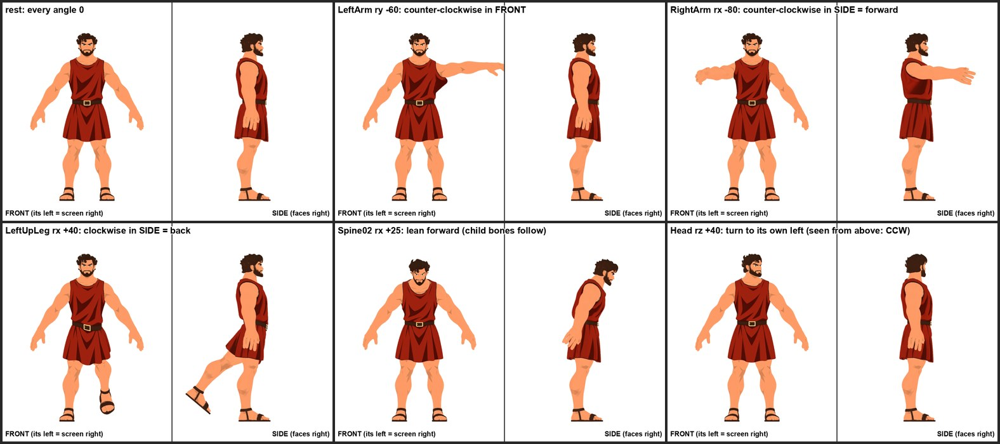

# Animation pipeline: matching a rig to a front + side reference video

## The method (for viewers)
Every animation in this game is keyframed by hand, but every hand pose is checked against a video:
1. **Sheet.** The rigged character is rendered in Blender from the FRONT and from the SIDE, at the same scale, side by side
   on one image (`tools/blender/render_split_sheet.py`, which also writes `cam.json` with the exact framing).
2. **Reference video.** That sheet is the first frame for Seedance 2.5 (480p, 10 s), prompted with the motion. The result is
   a split-screen video: left half the front view, right half the side view of the same move.
3. **Matching.** An agent poses the real rig until its own front and side renders sit on top of the video frames, a few key
   poses per clip, and checks itself with an overlap score (silhouette IoU, 1.0 = perfect) and a red/blue difference picture.
   Two views pin a 3D pose: the front view shows sideways angles, the side view shows forward/back angles.

The tools for step 3 are `tools/ak` (animkit). Each call takes 1-3 s (Blender runs headless).

## Rules for animation agents
- Work in `work/anim/<char>_<clip>/`. Use the character blend IN PLACE and read-only: `art_src/chars/<id>/<id>.blend`.
  **Never copy it** (its textures are `//relative`; a copy renders magenta and exports without textures: `ak` warns and
  `ak export` refuses). Bake with `--out-action` (JSON). The lead merges all JSON files with `ak merge` and exports once.
- Every command prints one last line `###AK### {json}`; `"ok": false` comes with an `"error"`, and `"warnings"` lists
  problems that did not stop the command. Exit code is non-zero on failure.
- Images from `ak` have a long side <= 1024 px (read them directly) except `--render-out` and the full frames in `frames/`.
- `ak` limits itself to 6 Blender processes machine-wide (`AK_SLOTS`) and passes each launch through the optional memory gate (`AK_MEMGATE_SCRIPT`, not included):
  do NOT wrap `ak` calls in a memory gate yourself.
- Bone names come from `ak info`. Never guess them; the tools never assume names.
- Bones listed under `driven` in `ak info` (e.g. Hercules' skirt) are set by code from the other bones on every pose and
  frame. Never pose them (it is an error); they follow the thighs automatically in renders, bakes and the GLB.

## Commands
```
A=tools/ak  CH=art_src/chars/hercules/hercules.blend  CAM=<cam.json of the sheet>  SHEET=<the sheet png>
$A info  $CH --cam $CAM [--out bones.jpg] [--json-out info.json]
      # bones (+ side l/r, rest panel angles), pivot, chains + what bend_up/bend_side do, driven bones + bones picture
$A frames ref.mp4 --cam $CAM --sheet $SHEET --every 0.125 [--t0 1 --t1 2] --out fr [--mask] [--cols 3]
      # frames aligned to the sheet framing (fr/f###_tSS.SSS.png, exact video-frame times) + fr/contact.jpg
      # (more pages: contact_p2.jpg ...); full list in fr/frames.json; first run writes fr/calib.json (reuse: --calib)
$A cycle ref.mp4 --cam $CAM --calib fr/calib.json --t0 1.0 [--t1 3]  # loop length of a cyclic move (run, idle, fly)
$A pose  $CH --cam $CAM --pose k0.json --target fr/f003_t01.375.png [--pose k1.json --target ...] --out cmp.jpg
      # 1 pose: 2x2 TARGET | OURS / 50% OVERLAY | DIFF; several: one row TARGET | OURS | DIFF per pose, ONE image.
      # JSON: iou, iou_limbs (outside the trunk), iou_rest (the rest pose scored against the same frame), ground
$A pose  $CH --cam $CAM --from-action action_run.json --t 0.25 --save-pose k_mid.json --out mid.jpg  # read back a pose
$A solve $CH --pose k0.json                      # numbers only: every bone head/tip in metres, lowest vertex per foot
$A fit   $CH --cam $CAM --pose p.json --target fr/f003.png --bones A,B,C[,view_offset] [--axes rx,ry] [--limit 45]
      --out-pose p_fit.json --out fit_cmp.jpg   # nudges the listed angles to raise IoU (20-30 s for 10 bones)
$A mirror p.json --blend $CH --out p_m.json      # left/right mirror (rig.json pairs, then l/r name tokens)
$A mirror --keys keys.json --blend $CH --out keys_m.json   # mirror a whole clip (strafe_r = mirror of strafe_l)
$A retime keys.json --scale 1.2 --out keys_slow.json        # all key times, length and events x 1.2
$A bake  $CH --clip run --keys keys.json [--loop] [--fps 30] --out-action run.json  # JSON route (parallel safe)
$A strip $CH --cam $CAM --action-json run.json --video ref.mp4 --calib fr/calib.json --t0 1.0 --n 8 \
      --out strip.jpg [--mp4 strip.mp4]          # reference row above our row; reference time = t0 + clip time
$A merge $CH work/anim/*/action_*.json            # lead: re-bake every clip on the CURRENT rig, one save
$A export $CH --out game/assets/characters/hercules/hercules.glb --clips-json game/assets/characters/hercules/hercules_clips.json
$A selftest $CH                                   # pose-math check on any rig
```

## The pose format


Angles are degrees in the **view axes**, not bone axes (the character faces -Y, Z is up):

| key | turns the bone in | positive means |
|---|---|---|
| `ry` | the FRONT panel | clockwise as you look at the front panel |
| `rx` | the SIDE panel | clockwise as you look at the side panel (character faces screen right) |
| `rz` | the floor plane (twist/yaw) | turning toward the character's own left, counter-clockwise seen from above |

Handy consequences: a hanging limb with `rx` < 0 swings FORWARD, `rx` > 0 swings BACK. A bone pointing up (spine) with
`rx` > 0 leans FORWARD. For the character's LEFT arm (screen right in the front panel) `ry` < 0 lifts it out sideways,
for the RIGHT arm `ry` > 0 does. The combined rotation is `Rz * Ry * Rx` (rx first) applied to the rest orientation.

**Aim form (easiest for limbs).** Rest poses are Meshy A-poses (arms hang ~30 deg out), so `rx`/`ry` are deltas from a
splayed arm. Instead give the bone's direction AS DRAWN in each panel:
`{"bones": {"forearm_r": {"front": 60, "side": -100, "twist": 0}}}`. `front`/`side` = the angle of the bone (joint to
next joint) in that panel: 0 = straight down, clockwise positive, so 90 = pointing screen-left, -90 = screen-right,
180 = straight up. Measure them on the frame. One of the two may be left out (the depth is then kept from rest).
`twist` turns the bone about itself. Aim entries are always absolute. `ak info` prints every bone's rest angles
(`rest_angles` = [front, side]; null = the bone points into that panel). For a hanging bone `ry` 30 and `front` 30 agree.

`"space": "absolute"` (default): a listed bone's angles are its total turn away from its REST orientation, whatever its parent
does. A bone you do not list keeps its rest angle RELATIVE TO ITS PARENT (it rides along). So list the bones you see.
```json
{"space": "absolute", "root": {"loc": [0, 0, 0], "ground": "lowest"}, "view_offset": [0.03, -0.05, 0],
 "bones": {"spine_01": {"rx": 12}, "thigh_l": {"rx": 30}, "shin_l": {"rx": 100},
           "thigh_r": {"rx": -25}, "upper_arm_l": {"front": -20, "side": 15}, "forearm_l": {"rx": -85, "rz": -35}}}
```
Here the left thigh points 30 deg back and the left shin 100 deg back (knee bent 70 deg) no matter how the hips turn.

`"space": "local_delta"` (per pose, or per bone as `"space"` inside the bone entry): the angles are added ON TOP of the
parent-following pose. `{"space": "local_delta", "bones": {"neck": {"rx": 10}, "head": {"rx": 10}}}` nods 20 deg in total.

**Chains** (necks, tails, snakes, wings): `ak info` lists `chains` (runs of single-child bones + rig.json "chains") and
`chain_axes`: each chain's class from its rest direction and what its bend keys do.
`"chain": {"name": "tail", "bend_up": [0, -5, -10], "bend_side": [5, 10, 15]}` bends each link (local_delta):

| chain class (rest direction) | `bend_up` + moves the tip | `bend_side` + moves the tip |
|---|---|---|
| vertical (spine, legs, hanging hair) | FORWARD (-Y), side panel | to the character's LEFT (+X), front panel |
| fore-aft (horse neck, tail, Hydra necks) | UP (+Z), side panel | to the character's LEFT (+X), seen from above/front |
| lateral (wings, T-pose arms) | UP (+Z), front panel | sweep FORWARD (-Y), side panel |

`rx`/`ry`/`rz` lists are also accepted (fixed view axes). Several chains: a list.

**Root.** `root.loc` (metres) and `root.rot` (degrees, view axes) move and turn the WHOLE body: real body motion only
(rolls, jumps, crouches, sway). They turn about the **pivot** that `ak info` prints: rig.json `pivot`, else the
root-most deforming bone (the hips, not the non-deforming `root` bone at the feet). Bone angles are measured before
`root.rot`, so a rolling body keeps its limb angles. `"ground": "lowest" | "left" | "right"` (inside `root`) sets
`root.loc` z so that the lowest vertex of the whole body / the left foot side / the right foot side touches the floor.
Every pose JSON line reports `ground` (`lowest_z`, `left_z`, `right_z`; left = +X side): a planted foot should read ~0.

**Framing.** `view_offset` [x, y, z] metres and `view_scale` (1.0) correct the video's framing (Seedance shifts and zooms
a little). They move/scale the RENDER only: `pose`, `fit` and `strip` use them, `bake` never puts them in the action and
`mirror` keeps them. Put framing in `view_offset`, never in `root.loc` (bake removes root drift; mirror negates loc x).

## keys.json (one clip)
```json
{"fps": 30, "loop": true, "length": 0.708, "events": {"impact": 0.42},
 "keys": [{"t": 0.0, "pose_file": "k0.json"}, {"t": 0.177, "pose_file": "k1.json", "interp": "hold"},
          {"t": 0.354, "pose": {"bones": {"...": {}}}}, {"t": 0.531, "pose_file": "k3.json"}]}
```
`t` is clip time in seconds from 0. If the first key is not at 0 (keys written in video time), keys AND events are shifted
by the same amount and the JSON says `shifted_by`; an event outside 0..length is an error. Key times and `length` snap to
whole frames of `fps`. Use the video's fps (24) for loops measured on the video. Clips of one character may use different fps:
`export` writes the GLB at the highest fps and, if a clip's length is not a whole frame there, retimes that clip by
< 1 frame (`retimed` in the JSON; the manifest gets the GLB length). With `loop` the first pose is copied to `length` (exact seam,
cyclic curves). Without `loop` the clip ends at the last key (or holds it to `length`). Per key `"interp"`: `bezier`
(default, eases), `linear`, `hold` (snap to the next key: impacts, attacks). The horizontal drift of `root.loc` between
the first and last key is removed (clips play in place) unless you pass `--keep-root-motion`. `events` go into the clips
manifest (SPEC section 8 names: `active_start`, `active_end`, `impact`, `fire_start`, `fire_end`). The action JSON keeps
the poses: `ak merge` re-bakes them on the rig of the day (a renamed bone fails loudly instead of going stale).

## Recipe: match one clip in about 20 calls and <= 15 image reads
1. `ak info $CH --cam $CAM --out bones.jpg --json-out info.json`; read bones.jpg once (blue = LEFT bones, orange = RIGHT,
   green line = floor). Note `pivot`, `driven`, `chain_axes`, and `rest_angles` of the limbs you will aim. [1 image]
2. `ak frames ref.mp4 --cam $CAM --sheet $SHEET --every 0.25 --out fr0 --cols 3`; read `fr0/contact.jpg`. Check
   `calib_iou` (>= 0.85 good; < 0.75 = wrong sheet or moving camera: report it). [1 image]
3. Pick the clip window `t0..t1` (the move itself, not the settling first second). For loops run `ak cycle` from `t0`
   and use the period (if the best candidate is about 2x a shorter one, the shorter one may be a half-step: check the views).
4. Choose 3-6 key times: extremes (highest, lowest, contact, full reach), not even spacing. `ak frames ... --times a,b,c
   --calib fr0/calib.json --out keyf --cols 3`; read `keyf/contact.jpg`. [1 image]
5. Write `k0.json`... from what you see: trunk first (hips/spine `rx` lean), then thighs and shins, then arms (aim form:
   read the limb angles off the frame), head. Planted foot: `"root": {"ground": "left"}` (or right/lowest).
6. `ak pose $CH --cam $CAM --pose k0.json --target keyf/f000_*.png --pose k1.json --target keyf/f001_*.png --out r1.jpg`
   (2-3 keys per image); read it. Red = the video has body there and we do not; blue = we have body there and the video
   does not. Check left/right on the skeleton colours. Fix the biggest red/blue blob first. [1 image per 2-3 keys]
7. Repeat step 6 once or twice, changing 2-4 bones per key by 10-30 deg. Watch `iou_limbs` (limbs only) and
   `gain_over_rest`: a good key gains clearly over the rest pose (the trunk alone already scores ~0.6).
8. `ak fit ... --bones <the bones you posed>,view_offset --out-pose k0_fit.json` (add `--out` only if you want to look).
   Fit puts framing corrections in `view_offset`. Keep the fit only if it still LOOKS right in your next step-6 image
   (fit cannot see limbs hidden behind the body and cannot tell left from right).
9. For the next keys start from the closest finished key (copy it), or from `ak mirror` of a key half a cycle away
   (a run's second step is the mirror of its first).
10. Write `keys.json` with clip times (`t = video_t - t0`), `loop`, `length`, `events`.
11. `ak bake $CH --clip <name> --keys keys.json --out-action action_<name>.json`; read `notes` (floating feet, shifts).
12. `ak strip $CH --cam $CAM --action-json action_<name>.json --video ref.mp4 --calib fr0/calib.json --t0 .. --n 8
    --out strip.jpg`; read it: in-betweens must look right too (no limb through the body, no pops). [1 image]
13. Fix a bad in-between: `ak pose --from-action action_<name>.json --t <s> --save-pose k_mid.json ...`, correct it,
    add it as a key, re-bake, re-strip. Add `--mp4 strip.mp4` for the final check (do not read the mp4).
14. Hand over `action_<name>.json`, `keys.json`, the pose files, `strip.jpg` and the IoU numbers.
Budget for 5 keys: 3 (steps 1-4) + 3 rounds x 2 images + 2 strips = 11 reads; keep the rest for surprises.

## Common mistakes
- Using the raw video frame as `--target`: always use `ak frames` output (aligned to the sheet). Seedance re-frames the
  video (the character is ~20% larger and the divider moves), so raw frames never overlap.
- Mixing up left and right: the FRONT panel is a mirror (the character's left is screen right); the SIDE panel shows the
  character's RIGHT side, its left limbs are behind the body. IoU cannot see a swap (a mirrored run scores the same):
  check the skeleton colours (blue = LEFT) against the leg that is forward in the video.
- Expecting `rx` to bend a limb sideways: `rx` works in the side panel, `ry` in the front panel.
- Leaving a forearm out of the pose after turning the upper arm: it rides along at its rest bend. List both.
- Putting the framing offset in `root.loc`: it is real motion (baked, mirrored). Use `view_offset`.
- Floating characters: bent knees with the root fixed lift the feet. Use `root.ground`, read `ground` in the JSON.
- Building a chain pose in absolute space: every link must then be given; use local_delta or `chain` instead.
- Loops whose `length` is the last key time (the seam then repeats a pose).
- Copying the character blend, or two agents baking into the same blend: use it in place with `--out-action`.
- Chasing IoU 1.0: hands, hair and cloth differ in the video. Stop at ~0.8 when the limbs line up.

## Known limits
- Seedance may slowly zoom or pan during a clip (measured: the head grows ~10% between t=0 and t=2-9 s). Calibration
  uses frame 0 only; fit `view_offset,view_scale` per key to absorb it. Prompt for "static locked-off camera" (lead note).
- `fit` only climbs to the nearest IoU peak: in the synthetic test it recovered the visible arm and leg within 1 deg, but
  not an arm hidden behind the body. Pose such limbs by eye first.
- White or grey characters on a white sheet cannot be separated from the background: render their sheet with `--bg`.
  Grey floor shadows below the floor line are ignored; shadows beside the feet still count.
- Imported (Meshy) bones have meaningless lengths; the bones picture draws joints and parent links instead.
- glTF has no loop flag: Godot imports every clip with loop off; the game must take `loop` from `<id>_clips.json`.
- No two-character renders yet (riding Pegasus): pose each character separately.
- Tests: `tools/animkit/tests/run_tests.sh` (pose math + aim, calibration + masks, render time, bake/strip/export, loop seam,
  fit, mixed fps, view offsets, driven bones, ground, mirror on every rig.json, chain axes, pivot, missing textures,
  merge re-bake, exact frame sampling, events, read-back + hold, multi-pose image + image caps, floor shadows).
