# Hercules · Devlog

> The story of the build, chapter by chapter. Prompts are quoted word for word (see [PROMPTS.md](PROMPTS.md)); decisions are in
> [DECISIONS.md](DECISIONS.md); the timeline is in [TIMELINE.md](TIMELINE.md); screenshots are in [MEDIA_INDEX.md](MEDIA_INDEX.md).
> Chapters 1-8 were written while the build was still running (8:40 PM); Chapter 9 and the totals below were written in the
> final pass (12:55 AM), when the game was finished and waiting for JC to test it. The lead added Chapter 10 at the
> hand-over (1:40 AM). Chapters 11 and 12 cover Monday morning, when JC came back (written at about 11:30 AM, before the
> app was rebuilt). Chapter 13 covers Monday afternoon: JC's own 18-minute play-test and his feedback, written at about
> 2:35 PM, before the app was rebuilt with it; the totals below were refreshed then. Chapter 14 covers Monday evening (an
> explainer video, the push and the public release), written by the lead at about 8:45 PM; its numbers and the
> whole-project count at 8:37 PM are in the chapter. Every chapter keeps the numbers of
> the moment it was written.

## Project at a glance

| | |
|---|---|
| Started | Sun Nov 22 2026, 4:31 PM EST (trailer prompt); game request 5:32 PM |
| First hand-over | Mon Nov 23 2026, 1:45 AM EST: the lead's last fix (Chapter 10) passed every bot, the Mac app was rebuilt, and the hand-over message asked JC Q02 |
| Second day | Mon Nov 23, 8:40 AM: JC answers "Polish them now" (P05), then at 8:46 AM asks for natural animations (P06). Chapters 11-12. At 11:26 AM the last fixes were running; the app rebuild and the lead's last look come after this devlog pass |
| JC plays it | Mon Nov 23, 12:51 PM: "Go ahead and launch the game for me to play test" (P07); he plays the rebuilt app for 18 minutes, recording his screen and voice, and at 1:12 PM writes "Everything looks good" with six small points (P08). Chapter 13. At 2:23 PM the fixes had passed the final check; the app rebuild comes after this devlog pass |
| Approved and public | Mon Nov 23, 7:20 PM: JC plays the build rebuilt at 2:50 PM and writes "Game looks good. Go ahead, come in and push." (P12). 7:21 PM: pushed to a private repo. 8:32 PM: the public repo <https://github.com/jc-able/hercules-game> (MIT for the code, CC BY 4.0 for the art) with release v0.1.0, the Mac app as a 132 MB download. Chapter 14 |
| Last updated | Mon Nov 23 2026, about 8:45 PM EST (Chapter 14). The time, agent and token rows below stop at 2:38 PM; Chapter 14 has the evening and the whole-project count at 8:37 PM |
| Engine / tools | Godot 4.7.2 (GDScript), Blender 5.2.2 headless, Higgsfield (Meshy 7, Hunyuan3D v3, Seedance 2.5, Nano Banana Pro, Mirelo, ElevenLabs Music), Python |
| What was made | 5 characters generated and rigged (Hercules, Four-Armed Cyclops, Medusa, nine-headed Hydra, Pegasus), 42 Seedance reference videos (33 on Nov 22, 9 from natural stances on Nov 23), 53 clips in the game files, 18 props, 72 sound generations (62 sounds in the game), 3 boss fights, a world with flight on Pegasus, a macOS app (232 MB, rebuilt 11:42 AM Nov 23 with the morning's work, the build JC played; rebuilt again at 2:50 PM with the Chapter 13 fixes: the build he approved at 7:20 PM and the one in the public release) |
| Time, Nov 22 (first night) | wall clock 9.16 h (4:31 PM -> 1:40 AM), active 8.89 h (trailer included); the game alone 8.14 h |
| Time, Nov 23 (up to 2:38 PM) | 5.98 h wall (8:40 AM -> 2:38 PM), 4.67 h active: the session was idle 0.97 h after the 11:52 AM report and 0.33 h while JC played (12:52-1:12 PM) |
| Time, whole project (up to 2:38 PM) | 22.12 h wall clock including a 6.9 h quiet night (1:45 -> 8:40 AM); 13.64 h active |
| Agents | Nov 22: 136 agents in 16 workflows, 40.84 agent-hours. Nov 23 (to 2:38 PM): 75 agents in 11 workflows, 15.97 agent-hours (the Chapter 13 devlog agent still writing). Whole project: 211 agents, 56.81 agent-hours (all Opus 5.5) |
| Tokens, Nov 22 | 1,762.63 M in total, 9.13 M output. Lead (Fable 5.2): 174.41 M (522.3 k output); agents 1,588.22 M (8.61 M output) |
| Tokens, Nov 23 (to 2:38 PM) | 975.61 M in total, 4.71 M output. Lead 112.92 M (267.3 k output); agents 862.68 M (4.44 M output) |
| Tokens, whole project (to 2:38 PM) | 2,742.66 M in total, 13.85 M output (the rest is cached context re-read). Lead 291.76 M (810.7 k output); agents 2,450.90 M (13.04 M output) |
| Higgsfield credits | game: 2,018.29 (ledger 1,928.29 quoted over 163 jobs + 90 for three Meshy multi-image jobs the ledger did not price, at the catalogue price of 30 each). Of that, Nov 22: 1,748.29; Nov 23: 270 (nine Seedance videos, no retakes). Trailer before the game: 835 (Claude's reports). Total about 2,853 |
| Workflows | Nov 22: 16 (props, foundation, rigs, modules, ride sheet, 3 animation waves, ride clip, integration 1, finalize, devlog 1, integration 2, QA, polish 1, devlog 2). Nov 23: polish 2, natural stance, natural re-base, natural animate (2 runs), natural integrate (2 runs, the second with final check 2), natural clip fix, last fixes, devlog 3; afternoon: feedback 2 (intake, 4 fixers, 4 reviewers, 4 re-fixers, final check 3, devlog 13) |
| Weekly usage | all models 25 % before the build -> 35 % at 7:01 PM -> 40 % at 7:36 PM -> 45 % at 8:09 PM -> 58 % at 11:01 PM (before the play-test) -> 63 % at 1:33 AM (after the last fix); no reading recorded on Nov 23 |
| JC's messages | 8 (P01-P08): 4 on Nov 22 (the last at 5:33 PM), 4 on Nov 23 (a reply button at 8:40 AM, a message typed while Claude worked at 8:46 AM, "launch the game" at 12:51 PM, his play-test feedback at 1:12 PM), plus 28 lines he spoke in his play-test recording (S01-S28). Claude asked 3 questions or offers (Q01 unanswered, Q02 answered by P05, Q03 never answered). Monday evening added five messages (P09-P13), one question (Q04, answered by P13) and the first multiple-choice card (AQ1) |

Time and tokens: `session_stats.py` over the session transcript. "Nov 22" runs up to 1:40 AM (the hand-over; final count).
"Nov 23" runs from 8:40 AM (P05) to 2:38 PM, while the Chapter 13 devlog agent was still writing (it is counted only up to
that moment; the lead's rebuild and report come later). "Whole project" is one run from 4:31 PM Nov 22 to the same 2:38 PM
cut-off; it also holds the rest of the 1:40-1:45 AM hand-over message (4.42 M tokens after the Nov 22 cut-off), which
neither day row includes: 1,762.63 + 4.42 + 975.61 = 2,742.66 M. "Total" counts every cached re-read of the context, so it
is far larger than what the models wrote; "output" is what they wrote. The token figures in the workflows' own completion
notices (for example 0.97 M for the stance workflow) count differently and are not used here. The Nov 23 rows taken at
11:26 AM (Chapters 11-12) are in TIMELINE.md.

## Higgsfield credits (from the job ledger `docs/higgsfield/jobs.jsonl`, 163 jobs: 154 on Nov 22, 9 on Nov 23)

By model:

| Model | Jobs | Credits | Used for |
|---|---|---|---|
| Seedance 2.5 (480p, 10 s) | 45 | 1,350.00 | 33 reference videos + 1 refused by the filter + 2 method tests (Nov 22); 9 natural-stance reference videos (Nov 23) |
| Hunyuan3D v3 image-to-3D | 23 | 365.00 | 5 character candidates (19 each), 18 props (15 each) |
| Meshy 7 image-to-3D | 2 | 82.00 | Hercules (44, with auto-rig), Cyclops (38) |
| Meshy multi-image to 3D | 3 | 90.00 * | Medusa, Hydra, Pegasus candidates (not used in the game) |
| ElevenLabs Music v2.5 | 5 | 61.04 | title, flight and three boss tracks |
| Nano Banana Pro (image) | 18 | 36.00 | prop concept images (3 weapons, 14 props, olive tree v2) |
| Mirelo text-to-audio | 67 | 34.25 | 57 sound effects (122 s of audio, 30.50) + 10 regenerated at 8:41 PM (15 s, 3.75); 0.25 credits per second |
| **Total** | **163** | **2,018.29** | |

By purpose:

| Purpose | Jobs | Credits |
|---|---|---|
| Animation reference videos (33 + the filtered Cyclops death) | 34 | 1,020.00 |
| Character 3D candidates (2 per character) | 10 | 267.00 * |
| Prop 3D models (weapons, 14 props, olive tree v2) | 18 | 270.00 |
| Music | 5 | 61.04 |
| Method test videos | 2 | 60.00 |
| Prop concept images | 18 | 36.00 |
| Sound effects | 57 | 30.50 |
| Sound effects regenerated (Chapter 9) | 10 | 3.75 |
| Natural-stance reference videos (Chapter 12, Nov 23) | 9 | 270.00 |
| **Total** | **163** | **2,018.29** |

\* The ledger has no price for the three Meshy multi-image jobs. They are counted at the catalogue price, 30 each (90).
The balance readings fit that but do not prove it: 4,289.96 at 5:20 PM and 7,022.96 at 5:50 PM, after the batch and a
top-up. The 4,022.96 used below is worked out on the assumption that the top-up was exactly 3,000. It is not a reading.
With that assumption the batch cost 267, which is 177 for the seven priced jobs plus 90. Every later reading matches the
ledger to the cent (6,583.92 at 6:14 PM, 6,385.42 at 7:06 PM). The last reading, 5,333.67 at 12:53 AM, does not: it is
208 credits lower than the ledger predicts (6,385.42 minus 843.75 of jobs logged after the 7:06 PM reading), and the ledger
does not say why. The filtered Cyclops "death" video (status `nsfw`) is counted at its quoted 30; the ledger
does not say whether it was charged. The method test "run" video shows status `submitted` in the ledger (its result was
used, see Chapter 5). During the build credits were added to the account (most likely 3,000: 4,289.96 -> 7,022.96 across the 267-credit batch).
The credits chart in `media/02_plan/02_higgsfield_credits.jpg` was drawn by the media agent from the same ledger and shows
1,714.5 (exactly 1,744.54 minus 30), because it leaves out the 30 credits for the filtered Cyclops video. It prices the
Meshy multi-image jobs the same way (267 for the ten candidates). It was drawn at 8:45 PM, before the ten regenerated sounds
(3.75); the Nov 22 subtotal of 1,748.29 includes both.
On Nov 23 the ledger adds nine jobs (`ref_<character>_<clip>_n`, Seedance 2.5, 30 each, all completed, 9:12-9:28 AM): 270
credits, which brings the game to 2,018.29. No balance was read on Nov 23.

Not in this ledger (made before the repo existed): the trailer, 555 credits for round 1 (three 480p drafts at 45, one 4K
final at 420) and 280 for round 2 (six 480p drafts at 45, five opening frames at 2), as Claude reported them at the time.

## Chapters
- [Chapter 1 · The trailer that set the look](#chapter-1) — a 15 s concept trailer, rejected for its look, re-made with the camera behind Hercules and giant bosses
- [Chapter 2 · The pitch for the game and the plan](#chapter-2) — JC's one long request, the contract and the workflow plan
- [Chapter 3 · Characters and props from sheets](#chapter-3) — two Higgsfield 3D candidates per character, 18 props, one broken tree
- [Chapter 4 · Rigging](#chapter-4) — Meshy's auto-rig for Hercules, four hand-built rigs, two failed reviews and their fixes
- [Chapter 5 · JC's animation method](#chapter-5) — FRONT | SIDE sheet -> Seedance 2.5 at 480p -> keyframes, and the toolkit that measures the match
- [Chapter 6 · Thirty-three reference videos and forty-one clips](#chapter-6) — every clip, its score, and what Seedance got wrong
- [Chapter 7 · The game code](#chapter-7) — core, three bosses, the world and Pegasus flight, and the test bots
- [Chapter 8 · Sound](#chapter-8) — 57 effects and 5 music tracks generated, repaired and wired in
- [Chapter 9 · Integration, play-testing and hand-over](#chapter-9) — real models in every scene, six AI play-testers and 54 findings, the Mac app, what JC tests himself
- [Chapter 10 · The lead's last look: Hercules ran side-on](#chapter-10) — one "minor" open item against JC's main request, fixed in code before the hand-over
- [Chapter 11 · "Polish them now"](#chapter-11) — Monday morning: the nine open items fixed, reviewed and re-fixed, the first-use freeze and its real cause, and working beside the owner without taking his keyboard
- [Chapter 12 · "They seem a little stiff"](#chapter-12) — frozen limbs measured, the cause found in the method's first frame, natural stances, nine new videos, 50 clips re-keyed or re-based
- [Chapter 13 · "Everything looks good": JC plays it himself](#chapter-13) — his 18-minute recorded play-test, six small points (the backwards sword hand, the mount, flight, creatures on the islands, hit effects, clipping), 25 review findings, final check 3
- [Chapter 14 · "Game looks good": an explainer video, a push and a public repo](#chapter-14) — JC approves the build; Claude narrates a 3-minute explainer; the push to a private repo; his two choices (licence, a clean repo); a scrubbed copy audited by a second agent; a byte-for-byte check and the switch to public with a downloadable Mac app

---

## Chapter 1 · The trailer that set the look

### In one minute
Before any game existed, JC pasted a detailed prompt for a 15-second Seedance 2.5 trailer: three boss fights and a title.
Claude made it in 4K. JC liked the art but not the look: it played like a side-on fight with bosses about Hercules's size.
He wanted giant creatures, circling and dodging, and a camera right behind the hero. Words alone did not get Seedance there;
an opening picture for each fight did. That 47-second review cut became the gameplay reference for the whole game.

### What JC asked
> "Use Higgsfield Seedance 2.5 to generate a 15-second, 16:9 gameplay-style concept trailer for HERCULES, an original cel-shaded third-person action game. Show exactly three boss fights and a final title screen." — P01, 4:31 PM (full prompt in PROMPTS.md)

> "The art style looks good, but I don't like, but it's not what I'm intending the game to look like. I want the game to look like Elden Ring, where you have a boss fight. The creatures should be a lot bigger, and you should circle around them, dodging the attacks from the creatures. The camera should stay right behind the character being controlled, which is Hercules in this case." — P02, 5:06 PM

He also asked to keep the game's name out of the prompt: "Go ahead and fix the prompt with this intended result without
mentioning the actual game Elden Ring." (The game is named only in his own words above; no prompt, file or code names it.)

### What Claude asked back
- Q01 (5:21 PM, an offer): 4K finals for 1,260 credits or 1080p for 720 → **no answer**; JC moved on to the game (P03).

### Decisions
- D01 · Use the sheets from Downloads (nothing was attached); leave Pegasus out.
- D02, D03 · Three 480p drafts first, then 4K of draft 1 (draft 2 cut mid-fight; draft 3 had a real roll but a distant side-on camera).
- D04 · JC: giant bosses, circle and dodge, camera behind Hercules, one 15 s clip per fight.
- D05 · One prompt per fight with CAMERA / SCALE / MOVEMENT blocks; scale stated as multiples of his height.
- D06 · An opening frame per fight (Nano Banana Pro) as Seedance's first frame.
- D07 · Review at 480p before any 4K; finals offered, never ordered.

### What was built
- **Round 1 (4:31-4:50 PM):** three 480p drafts and one 4K final, 15.0 s, 3840x2160, 24 fps, with music, club thud, shield
  hit, fire sweep and a title hit. Hard cuts at 4.2 s, 8.6 s and 13.0 s. Misses Claude listed itself: a sidestep instead of a
  roll, the forearm strike hidden behind the arm, a stone maul instead of a wooden club, title letters slamming in, audio
  raw at -21.2 LUFS. The 4K file was 30.7 MiB, just over the 30 MiB limit for phone delivery.
- **Round 2 (5:06-5:21 PM):** the new prompts (in the trailer folder's `v2/PROMPTS.md`): a shared block (CAMERA "close
  behind Hercules's back at his head height ... never rises above him, never pulls far away"; SCALE "a towering giant for
  the entire clip"; MOVEMENT "locked on ... strafes sideways in a circle") plus timed beats per boss. First three drafts:
  camera too far. Then three opening frames (Hercules from behind in the lower centre, the boss towering), one redone because
  his sword came out bronze. Three new drafts from those frames, stitched with the round-1 title into a 47 s cut.
- What Claude saw in the drafts: the Cyclops sweep rolled under, the slam rolled away from, the club stuck, the forearm hit;
  Medusa's first gaze dodged, the second reflected off the shield, her neck cut; the Hydra's fire sprinted around, the jaw
  slashed, the stomp rolled away from. Camera slips: about a second side-on during the Medusa neck cut and the Hydra stomp.

### Before → after
<!-- MEDIA:01_trailer -->
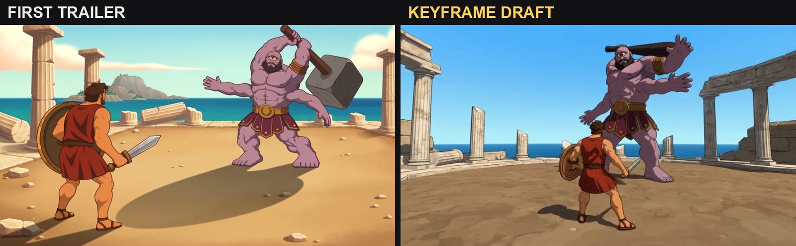
*The LOOK change the owner asked for (P02): first trailer = side-on fight, Cyclops about Hercules's size; keyframe-based draft = chase camera behind Hercules, Cyclops towering over him (the prompt asked for five times his height; on screen it is closer to two and a half). Same boss, both at 1.0 s.*

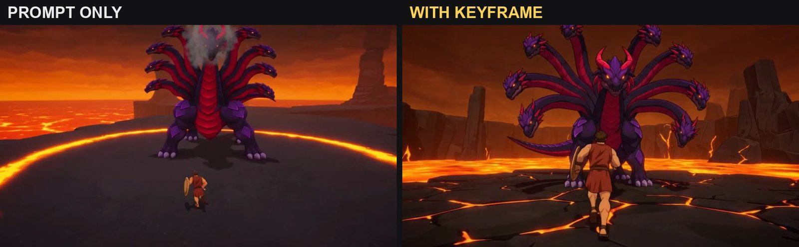
*Hydra fight, prompt-only draft vs keyframe-based draft (both at 6.0 s): with only CAMERA/SCALE text the camera drifted high and far and Hercules is a speck; starting from the keyframe image keeps the camera close behind him.*

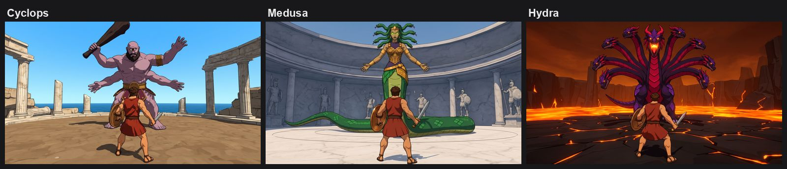
*The fix for the look: one opening keyframe per fight made with Nano Banana Pro from the two character sheets (2 credits each per the lead log): camera close behind Hercules, boss towering over him. Each was passed to Seedance as the start image.*

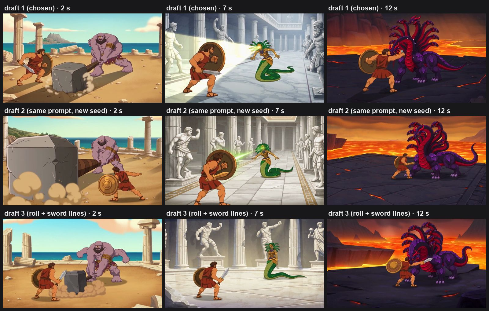
*The three 480p drafts of the first trailer (frames at 2 / 7 / 12 s). Draft 1 was chosen and finalized in 4K. All three share the side-on, 2D-fighting-game framing the owner later rejected.*

**Clip:** [01_trailer_v1.mp4](media/01_trailer/01_trailer_v1.mp4) — The first HERCULES concept trailer (15 s, Seedance 2.5): draft 1 of 3 at 480p, then finalized in 4K (shown here at 1080p). Side-on fights with bosses about Hercules's size, then the title. Credits per the lead log: three 480p drafts at 45 each + the 4K final at 420 = 555.

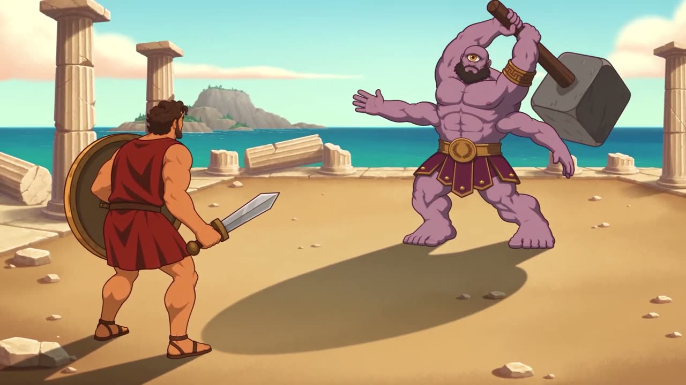

**Clip:** [06_boss_fights_review.mp4](media/01_trailer/06_boss_fights_review.mp4) — The 47 s review cut of the three keyframe-based fight drafts (Cyclops, Medusa, Hydra, then the title), 480p with Seedance sound. This cut became the gameplay reference for the game (art_src/reference_video/gameplay_reference_480p.mp4). Round cost 280 credits per the lead log; the 4K finals were offered and not ordered.

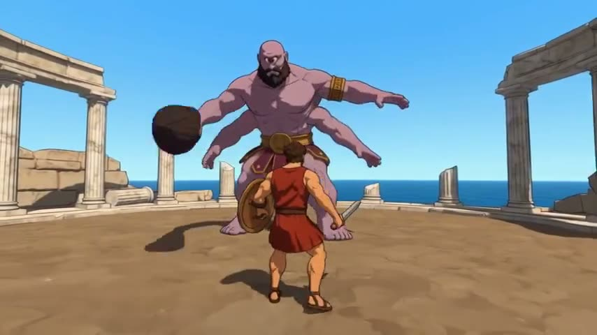

All 15 files for this chapter, with captions and same-view pairs marked: [MEDIA_INDEX.md](MEDIA_INDEX.md#01_trailer-the-trailer-the-game-was-built-from).
<!-- /MEDIA:01_trailer -->

### The numbers
| | Round 1 | Round 2 |
|---|---|---|
| Generations | 3 drafts (480p, 15 s) + 1 final (4K) | 6 drafts (480p, 15 s) + 5 opening frames (2K) |
| Credits | 555 (3 x 45 + 420) | 280 (6 x 45 + 5 x 2) |
| Output | 15.0 s trailer, 4K | 47 s review cut (3 x 15 s + 2 s title), 480p |
| Time / tokens (Claude's report) | 19 min, 7.85 M (40.9 k output) | 14 min, 8.40 M (39.7 k output) |

### Time and tokens
4:31-5:22 PM (session_stats): 0.57 h active (0.84 h wall, including 16 minutes while JC watched the trailer),
18.07 M tokens, 87.0 k output, lead only (no agents).

### Problems hit and how they were solved
- No images attached → used the four sheets in Downloads (D01).
- Wrong look (side-on, boss-sized bosses) → JC's feedback P02 → per-fight prompts.
- Camera drifted high and far with words alone (Hercules tiny in the Hydra fight) → an opening keyframe per fight (D06).
- Paid 420 for a 4K of a look that was thrown away → lesson: draft first, 4K only after approval (D07). It is in the lead's
  notes for the rest of the build.

### Talking points for the video
- "I pasted one long prompt and got a 4K trailer in 19 minutes. It looked great. It was also the wrong game."
- "The fix wasn't more words. Seedance only kept the camera behind Hercules once it was given a first frame."
- "That 47-second review cut is the target the AI built the whole game against."
- Honest moment: Claude spent 420 credits on a 4K before I had seen the look, and wrote down the lesson itself.

### Show
The 4K trailer (round 1), the three round-1 drafts, the three keyframes, a "camera too far" draft vs a keyframe draft, and
the 47 s review cut. The originals are in the trailer folder on JC's Desktop (`HERCULES trailer - 4K.mp4`, `drafts/`, `v2/`); devlog copies
are under "Before → after" above.

---

## Chapter 2 · The pitch for the game and the plan

### In one minute
Eleven minutes after the review cut, JC asked for the whole game in one message: build it in Godot, make every 3D asset with
Higgsfield in the sheet style, auto-rig and hand-rig, animate everything with his own video-matching method, add flying on
Pegasus between islands, double-check everything, don't stop, and document it all for his audience. He re-sent it with
Ultracode on, which turned the job into teams of AI agents. Claude asked nothing back: it scouted the machine, wrote a
contract for the agents, and started generating.

### What JC asked
> "I want you to build this game inside of the Godot game engine using Higgsfield, MCP, CLI, or plugin through Blender to create all of the 3D assets in the same art style you have all the tools you need available to you." — P03, 5:32 PM

> "When you build the different animations for the characters, I want you to use Cdance 2.5 on the lowest resolution level to generate a front view and a side view of the animation that you want to make." — P03

> "Double check everything to make sure that everything is built properly. And don't stop until the game is completely built." — P03

> "Also make sure to document the entire process so that I can review your devlog in terms of how you used the 3D assets, how you generated them, and how you created the video files as explained here for the animations and everything, so that I can share that with my audience after the game is complete." — P03

He interrupted 12 seconds later (X01) and re-sent the same text with Ultracode on (P04, 5:33 PM).

### What Claude asked back
Nothing. Every open point became a written decision (D08-D15).

### Decisions
- D08 · Ultracode workflows: lead on Fable 5.2, agents on Opus 5.5 at effort high (JC's standing rule).
- D09 · All Blender work headless; JC's open Blender held another project and was never touched.
- D10 · The Higgsfield CLI through a job tool that logs every generation with model, purpose and credits.
- D11 · Meshy 7, Hunyuan3D v3 and Meshy multi-image; Tripo H3.1 not tried in this build.
- D12 · No preset animations (678 were available): every clip by JC's method.
- D13 · Repo `~/HerculesGame`, outside iCloud.
- D14 · A contract (`docs/SPEC.md`), agent rules and one brief per role; build -> independent review -> fix.
- D15 · The "Dragon" in his requirements document is the nine-headed Hydra from his trailer prompt.

### What was built (the plan)
The design came from three sources: JC's requirements document (from his Downloads), the 47 s review cut, and his words.
`docs/SPEC.md` turned that into numbers every agent builds against:
- **Hercules** 1.9 m, 100 health, run 6.0 m/s, locked-on 4.6 m/s, roll 0.70 s over 4.8 m with 0.08-0.45 s of invulnerability,
  two-hit sword combo that only hurts an exposed weak point (anything else "glances": spark and clang), shield blocks a
  120 degree front arc.
- **Cyclops** 8 m, 8 hit points: sweep (blockable), slam (breaks guard, roll), club stuck 3 s with the forearm open.
- **Medusa** 6.5 m upright, 6 hit points: gaze (a fan of light; dodge past it or reflect it with the shield), stun, tail swipe.
- **Hydra** 6.5 m shoulder, 8 hit points: fire sweep (circle to the shoulder), head down (strike under the jaw), stomp, bite.
- **World:** title -> home island -> mount Pegasus -> fly over the sea -> land on an island -> boss -> back on Pegasus.
  Islands unlock in order behind a storm wall; after the Hydra an ending card, then free flight.
- **Definition of done:** play from the title screen to the ending with keyboard/mouse and an Xbox controller; bots win and
  lose every fight with no script errors; real rigged, animated characters in every scene; a macOS app; a complete devlog.

Then the work was cut into workflows (see TIMELINE.md for times): props; foundation (animation toolkit + Godot core);
rigs (five characters); modules (three bosses + world); ride sheet; three animation waves; ride clip; integration 1
(core follow-up + audio); finalize (merge, export, review per character); devlog. Each has builders, an independent
reviewer and a fixer, except where D41 cut the per-video reviews to save usage.

### Before → after
<!-- MEDIA:02_plan -->
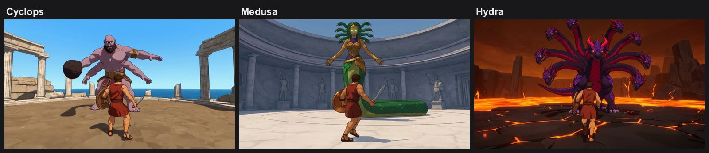
*The target for the game: one frame per boss from the 47 s keyframe-based review cut (4 / 20 / 36 s). The game copies this camera (behind the hero) and boss scale.*

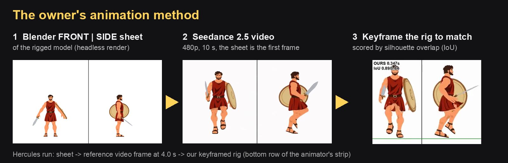
*The owner's method in one card, with real Hercules run files: FRONT/SIDE sheet -> Seedance 480p reference video -> rig keyframed to match (run loop strip IoU 0.857).*

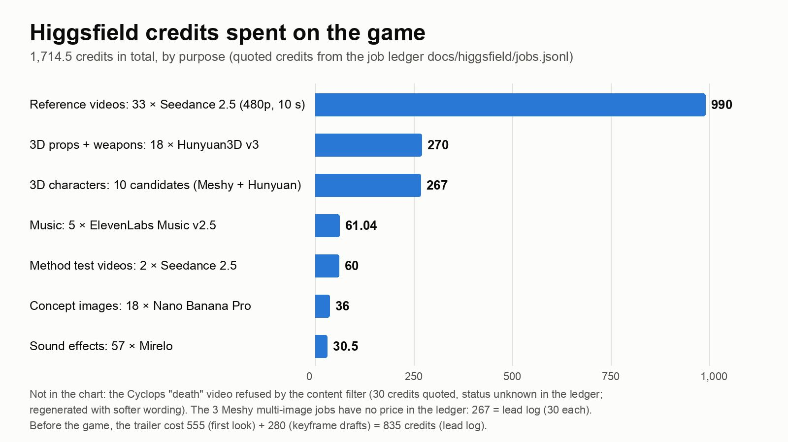
*Higgsfield credits for the game by purpose, from the job ledger (144 rows): 1,714.5 credits, 58 % of it on the 33 reference videos. Trailer credits (835) listed separately from the lead log. The chart leaves out the filtered Cyclops video (30); with it the total is 1,744.54.*

All 3 files for this chapter, with captions and same-view pairs marked: [MEDIA_INDEX.md](MEDIA_INDEX.md#02_plan-what-was-planned-and-what-it-cost).
<!-- /MEDIA:02_plan -->

### The numbers
- Scouting found Godot 4.7.2 with export templates, Blender 5.2.2 LTS, and the Higgsfield 3D catalogue: Meshy 7 (38 credits,
  44 with auto-rig), Meshy multi-image (30), Hunyuan3D v3 (19 at 50-70 k faces, 15 at 40 k), Meshy rigging, 678 preset clips.
- Briefs written: animkit, core, rig, props, boss_module, world, audio, anim_clip (8).
- First commit 5:59 PM: spec, agent rules, briefs, the job ledger, the sheets and the first meshes (70 files).

### Time and tokens
5:32-5:58 PM (setup, generation and planning, lead only): 0.42 h, 18.16 M tokens (117.1 k output).

### Problems hit and how they were solved
- A shell quirk (zsh does not split `$J args`) made nine of the first ten 3D submissions silently do nothing → resubmitted
  through shell functions; the trap is written into the lead's state file for later sessions.
- The Meshy jobs also needed `--enable_rigging false --enable_animation false` spelled out, because the CLI could not check
  the model's rules without them → resubmitted with the flags.

### Talking points for the video
- "One message. Godot, Higgsfield, auto-rigging, my animation method, flying on Pegasus, and 'don't stop until the game is completely built'."
- "It didn't ask me a single question. It wrote a contract for its own agents instead."
- "My Blender was open on another project, so every agent ran Blender invisibly in the background."

### Show
The spec page (pillars and boss tables), the workflow list, the method card (sheet -> video -> keyframes).

---

## Chapter 3 · Characters and props from sheets (Higgsfield 3D)

### In one minute
JC's character sheets were cut into single views and fed to Higgsfield's image-to-3D models, two different generators per
character. Claude rendered each result from four sides and picked the better one: Meshy 7 for Hercules (it came already
rigged) and the Cyclops, Hunyuan3D for Medusa, the Hydra and Pegasus. Weapons and 14 scenery props were drawn first as
concept images in the same style, then turned into 3D. One tree came out bare and was regenerated.

### What JC asked
> "create all of the 3D assets in the same art style" — P03

### Decisions
- D16 · Crop the sheets into one figure per image (image-to-3D fuses everything in a frame).
- D17 · Two candidates per character (10 jobs, 267 credits).
- D18-D22 · The picks and why (below).
- D23 · Props as concept image -> 3D; D24 · cut the brazier's baked flame; D25 · regenerate the olive tree.

### What was built
| Character | Candidates | Pick | Why | Raw triangles |
|---|---|---|---|---|
| Hercules | Meshy 7 (front view, auto-rig on) vs Hunyuan (4 views) | Meshy 7 | came auto-rigged (24 bones), 2048 px texture; Hunyuan was also good | 31,025 (rig agent's count; the lead's first note said 31,105) |
| Cyclops | Meshy 7 (front only) vs Hunyuan | Meshy 7 | crisper ink lines; the invented back was fine | 41,209 |
| Medusa | Hunyuan vs Meshy multi-image | Hunyuan | the only one that kept the straight rear tail; Meshy made a hanging J tail | 70,000 |
| Hydra | Hunyuan vs Meshy multi-image | Hunyuan | nine clear heads in a fan; Meshy stacked the necks | 69,992 |
| Pegasus | Hunyuan vs Meshy multi-image | Hunyuan | real wings; Meshy made paper-thin vertical wings | 69,986 |

Each job took about 3-5 minutes; the ten were submitted at 5:44-5:46 PM and all done by 5:49 PM.

**Props:** three weapon concepts (sword, lion shield, club) and 14 scenery concepts (column, broken column, two petrified
statues, basalt spire, boulder, temple, olive tree, brazier, amphora, pedestal, gate, cypress, cliff rock), each a Nano Banana
Pro image (2 credits) with the Hercules sheet as style reference, then Hunyuan3D (15). The props agent cleaned them in
headless Blender: upright, grounded, centred, real size, one material, triangles cut from about 40,000 to 3,000 (6,000 for
statues, trees and the gate; 12,000 for the temple), textures 4096 -> 1024 px (temple 2048), collision shapes in
`props.json`. An independent verifier re-imported every file and agreed: 13 of 14 good.

### Before → after
<!-- MEDIA:03_characters_props -->
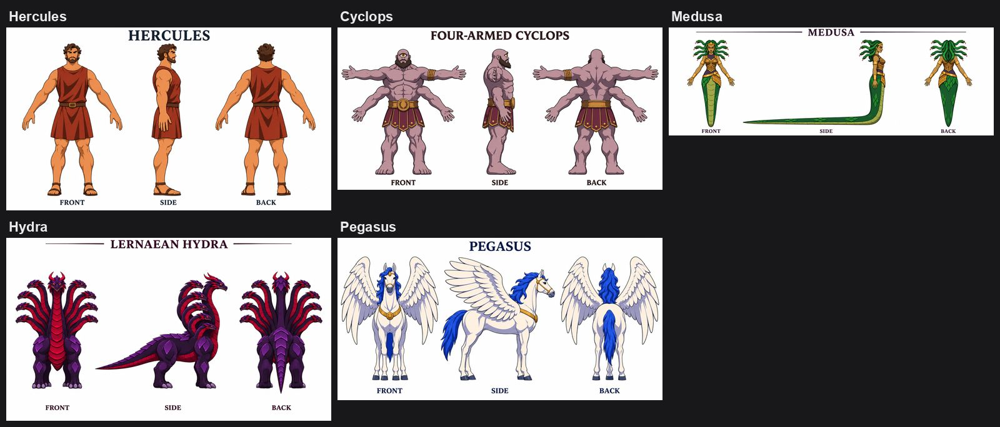
*The five character sheets the build started from (Hercules, Cyclops, Medusa, Hydra, Pegasus): the art style every 3D asset was generated in.*

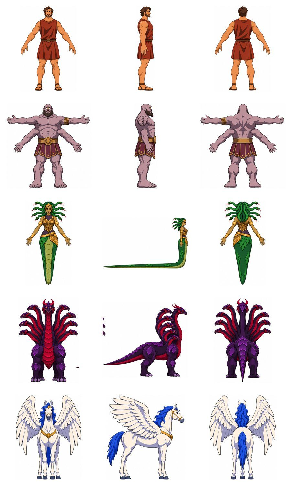
*One figure per image: front / side / back cut out of each sheet (image-to-3D fuses everything in a frame into one object). First cropper bug: Hydra's tail tip landed in the front crop; fixed by blanking pixels of other blobs.*

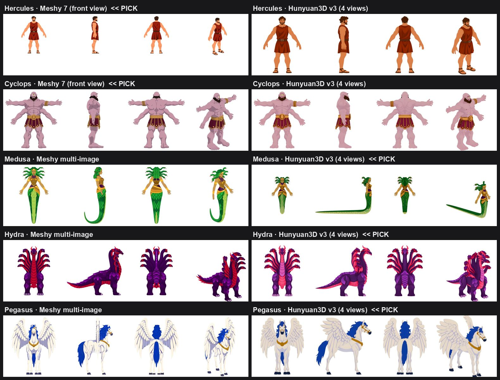
*Two 3D candidates per character (10 Higgsfield jobs, 267 credits, 3-5 min each), front / side / back / 3-4 renders. Picks: Meshy 7 for Hercules (comes auto-rigged, 24 bones) and Cyclops (crisper ink lines); Hunyuan3D v3 for Medusa (kept the straight rear tail; Meshy made a hanging J tail), Hydra (nine clear heads; Meshy stacked the necks) and Pegasus (real wings; Meshy made paper-thin vertical wings).*

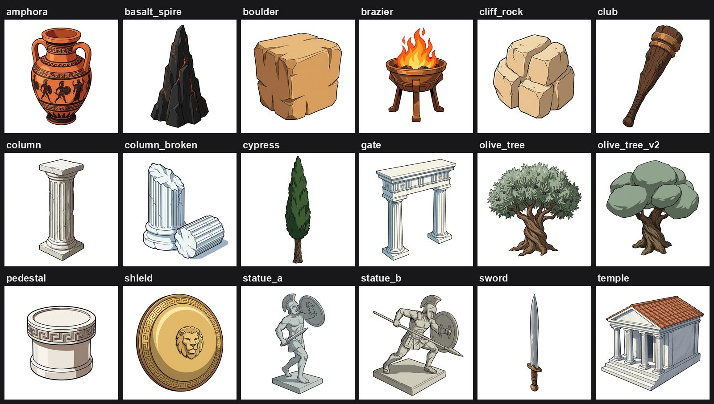
*All 18 prop concept images (Nano Banana Pro, 2 credits each, Hercules sheet as style reference): 14 environment props, 3 weapons (sword, shield, club) and olive_tree_v2, the regenerated olive tree.*

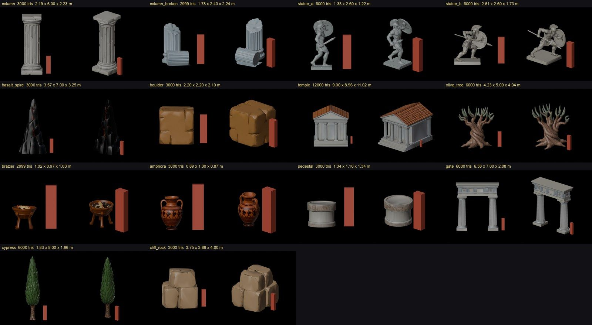
*all 14 cleaned environment props, front + three-quarter, red bar = 1.8 m person (13 props at 2999-3000 / 6000 / 12000 tris (from ~40,000 each), textures 4096 -> 1024 px (temple 2048); olive tree came out with no canopy (generation fault))*

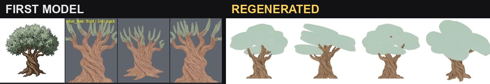
*Olive tree: the first 3D generation (concept left, model views right) came out as a bare trunk with a few leaf tufts; a new concept asking for "ONE big solid rounded canopy" gave a tree with a canopy (17 more credits).*

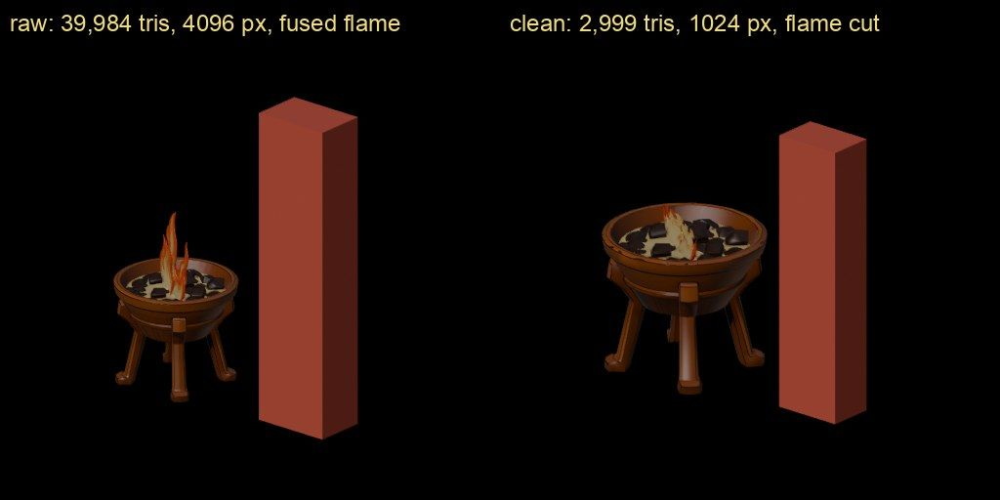
*brazier before/after: the flame was fused to the bowl, so it was cut by texture colour + an above-rim cut (the game adds real fire) (39,984 -> 2,999 tris, 8,560 raw faces removed; body 0.97 m so body + fire = 1.5 m)*

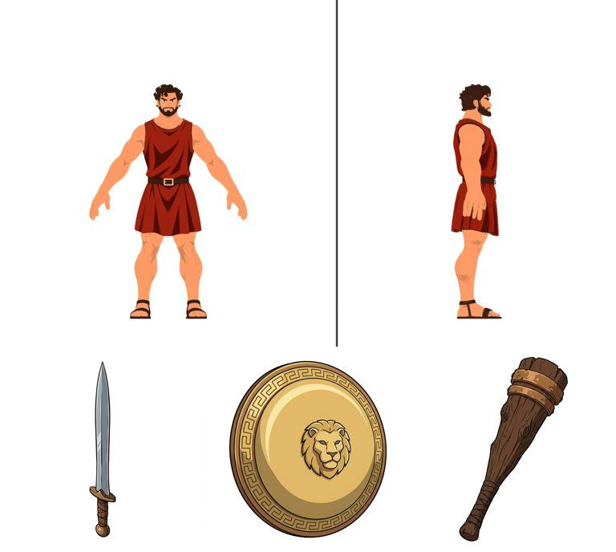
*Hercules front/side views next to the three weapon concepts (sword, lion shield, club) generated from his sheet; each then became a Hunyuan3D model (15 credits each).*

All 19 files for this chapter, with captions and same-view pairs marked: [MEDIA_INDEX.md](MEDIA_INDEX.md#03_characters_props-character-sheets-3d-candidates-props).
<!-- /MEDIA:03_characters_props -->

### The numbers
- Character 3D: 10 jobs, 267 credits. Props: 18 concept images (36 credits) + 18 3D models (270 credits).
- Weapons as rigged props: sword 0.85 m and shield 0.90 m (3,880 triangles each), club 5.5 m.
- Brazier: 39,984 -> 2,999 triangles, 8,560 flame faces removed, body 0.97 m so body + game fire = 1.5 m.
- Olive tree v1: 6,000 triangles, 4 loose parts (3 floating leaf tufts at about 3.4 m); v2 has a canopy (2 + 15 credits).

### Time and tokens
Generation and picking were done by the lead inside the 5:32-5:58 PM window (Chapter 2). Props workflow
(`hercules-props`, 6:09-6:20 PM): 2 agents, 0.19 h, 6.26 M tokens (58.9 k output).

### Problems hit and how they were solved
- First cropper: bounding boxes of neighbouring figures overlapped (the Hydra's tail tip inside the front crop) → blank the
  pixels that belong to another connected blob.
- Nine of ten submissions lost to the zsh word-split trap (Chapter 2) → resubmitted.
- Sword upload hiccup and one brazier upload failure → a retry was added to the upload script.
- Olive tree: Hunyuan made a bare trunk → new concept with "ONE big solid rounded canopy built from a few large chunky leaf
  clumps (solid closed shapes, no individual leaves)" → canopy on the second try.
- `column_broken`: the generator baked the concept's drop shadow into the mesh as a flat ground card → removed.

### Talking points for the video
- "Every character got two AI-generated 3D models from two different generators, and the AI picked a winner from four angles."
- "Medusa's tail is the tell: one generator kept it straight like on my sheet, the other bent it into a J."
- "The olive tree came out bald. The fix was to ask for big solid leaf clumps, not leaves."

### Show
The five sheets, the cropped views, the candidate comparison per character, the prop contact sheet with a 1.8 m person bar,
the olive tree before/after, the brazier before/after.

---

## Chapter 4 · Rigging (Higgsfield auto-rig + own rigs)

### In one minute
Hercules kept the skeleton Higgsfield's Meshy auto-rig gave him. The four creatures got skeletons built by AI agents from
measurements of the mesh itself: a four-armed giant, a woman with a 14-segment snake tail, a beast with nine necks and a
winged horse. Every rig was then attacked by a second agent that bent each part to breaking point. Two rigs failed review
(the Cyclops's knees were really its ankles; the Hydra had a hidden headless neck that flew out like a ghost head); all five
were fixed and re-checked.

### What JC asked
> "Through Higgsfield to do auto rigging and to do your own rigging." — P03

### Decisions
- D26 · Meshy auto-rig kept for Hercules; own rigs for Cyclops, Medusa, Hydra, Pegasus.
- D27 · Own distance-based weights and joints measured from mesh slices (Blender's bone-heat weights fail on generated meshes).
- D28 · Hydra sized by its 6.5 m shoulder (14.4 m tall, 16.0 m long).
- D29 · Hercules gets four skirt bones driven from the thighs; 496 glue faces deleted.
- D30 · The Hydra's headless 10th tube deleted. D31 · Cyclops knees and ankles moved up.

### What was built
| Character | Rig | Bones (final) | Size | Review verdict before fixes |
|---|---|---|---|---|
| Hercules | Meshy auto-rig (24 bones) cleaned: 0.01 armature scale applied, helper mesh "Icosphere" deleted, bones renamed, `headfront` (3,826 weighted vertices) merged into head, root added, then 4 driven skirt bones | 29 | 1.90 m | pass with fixes (2 major, 8 minor) |
| Cyclops | own: humanoid + a second, lower arm pair; club 5.5 m in the upper right hand | 29 | 8.0 m (scaled x4.22) | **fail** (1 blocker, 2 major, 4 minor) |
| Medusa | own: spine, arms, 14-segment tail (0.84 m each) along the measured centre line, 6 snake bones | 35 | 6.5 m upright (x9.58) | pass with fixes (4 major, 3 minor) |
| Hydra | own: body, 4 legs, 8-bone tail, centre neck (5 bones + head + jaw) and 8 side necks (4 bones + head each) | 76 | 14.4 m tall, 16.0 m long (x16.25) | **fail** (2 blockers, 2 major, 5 minor) |
| Pegasus | own: spine, neck, head, 4 legs, tail, 2 wings with feather-fan bones, a saddle bone for the rider | 41 -> 43 (tail 3 -> 5) | withers 1.90 m, 2.99 m with wings up (x3.2255) | pass with fixes (4 major, 4 minor) |

Each rig shipped `<id>.blend`, `rig.json` (bones, chains, sockets, pairs, limits), a FRONT | SIDE split sheet with its
camera file, deform test sheets and a test GLB that re-imports with one skin.

### Before → after
<!-- MEDIA:04_rigging -->
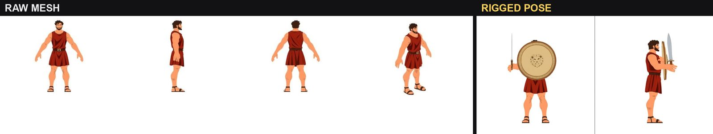
*Hercules: raw Meshy 7 mesh vs rigged block pose with sword and shield sockets*

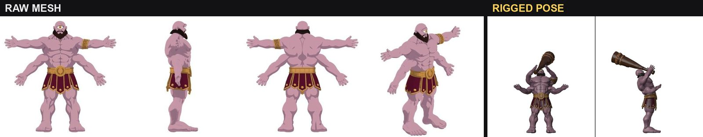
*Cyclops: raw mesh vs the rigged two-handed slam wind-up*

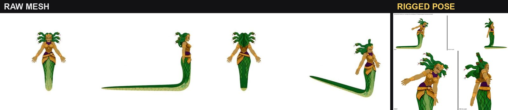
*Medusa: raw mesh vs rigged tail-swipe curl*

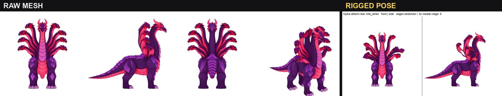
*Hydra: raw mesh vs rigged bite test (side heads strike, draw back, twist)*

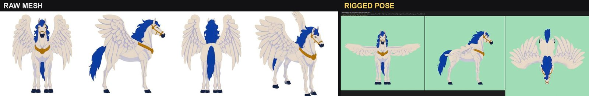
*Pegasus: raw mesh vs rigged glide pose (wings spread)*

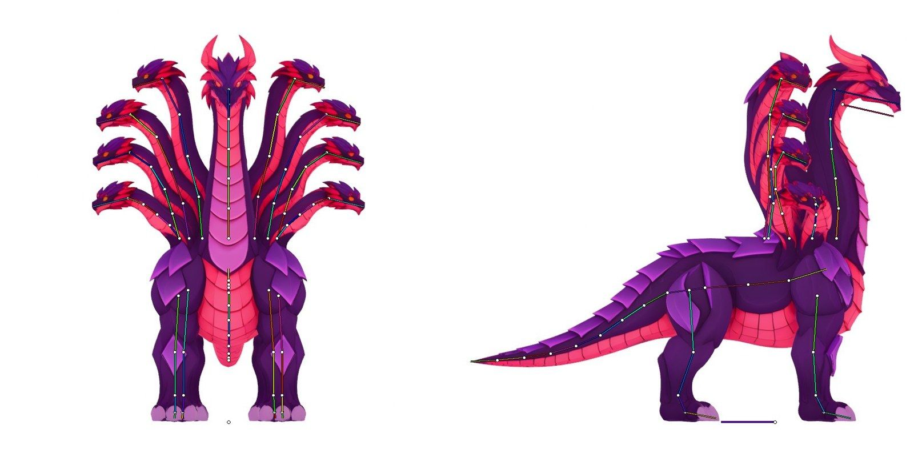
*the hand-built skeleton over the cleaned mesh: spine, tail, 4 legs, 9 necks found by slicing the mesh (76 bones (75 deform), 14.4 m tall, 16.0 m long, 10.1 m wide)*

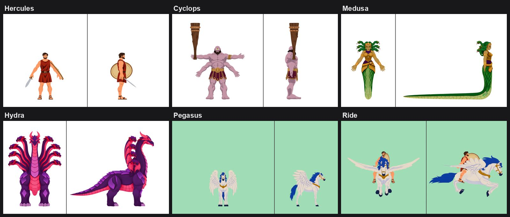
*Final FRONT / SIDE split sheets ("std" framing) of all five rigs and the ride pair: the first frame of every Seedance reference video. Pegasus and the ride pair are rendered on a soft green background.*

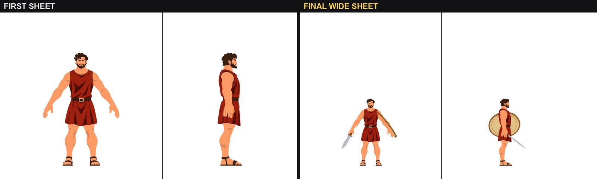
*Split-sheet framing: the early Hercules sheet (17:54, the one the two method tests started from: no weapons, narrow side panel, no room to fall or roll) vs the final "wide" sheet rendered with a motion envelope (sword + shield, room for death falls and forward rolls).*

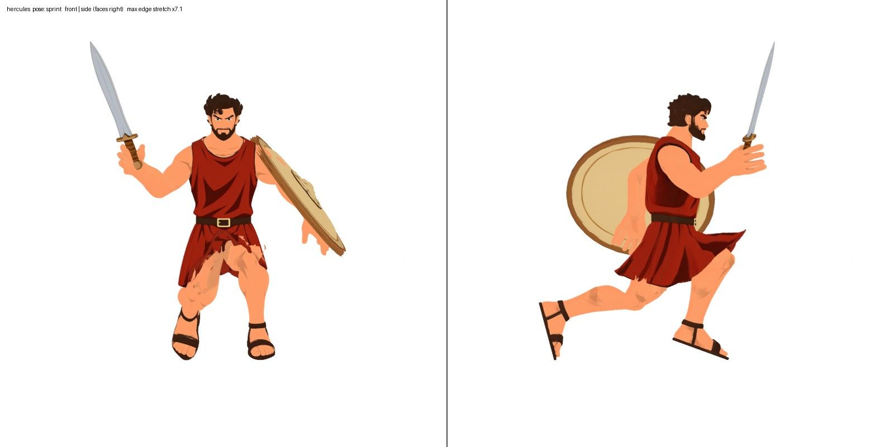
*review fix: sprint (thigh 70 fwd, shin 90) with the new driven skirt bones; skirt lies over the lifted thigh instead of tearing (run test: 63 stretched edges max x5.2 (was 86, max x11); 496 skirt-to-thigh glue faces removed)*

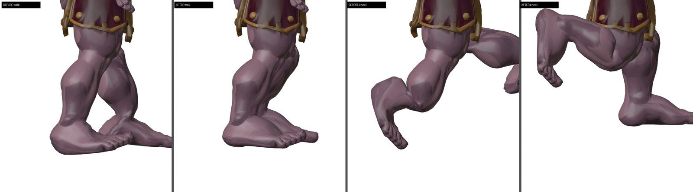
*cyclops leg rig fix, side close-ups of the same walk and kneel poses: before, the rig's 'knee' was really the ankle (z 1.12) so the leg bent just above the foot; after re-placing joints from mesh slices it bends at the real knee (knee z 1.12 -> 2.22, ankle z 0.55 -> 0.95; heel verts with thigh weight 126/164 -> 0; heel foot weight mean 0.37 -> 1.0; slam-impact pose edges stretched > 0.1 m: 496 -> 155)*

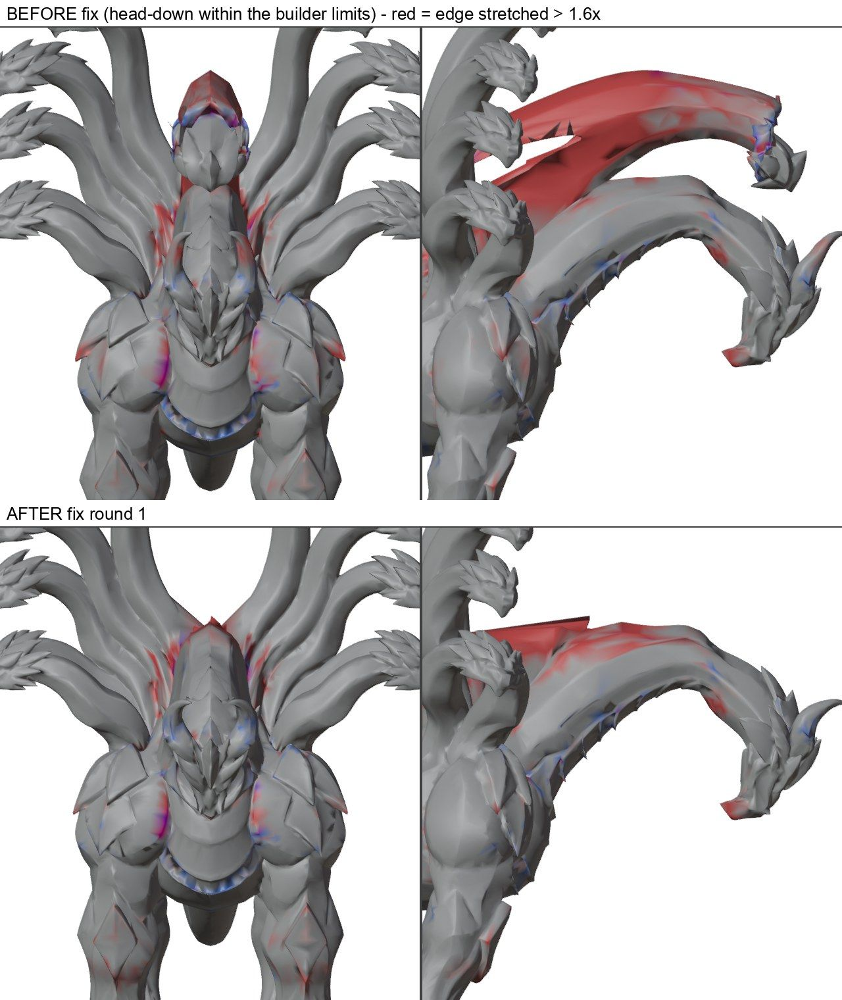
*Rig fix round 1: reviewer's head-down pose before/after. The headless 10th tube behind the centre neck (weighted to neck_c by height) swung out as a fake second head; deleted (1,775 verts) and capped (new edges > 3x median edge in that pose 483 -> 94; edges > 2x 632 -> 145)*

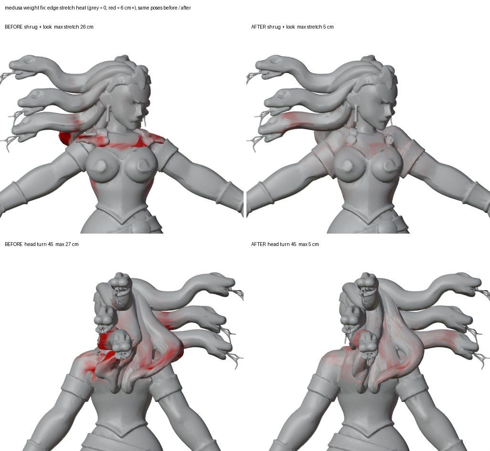
*medusa weight repair after review: stretch heat before/after on a shrug+look and a 45 deg head turn (max edge stretch 26.4 -> 5.1 cm (shrug+look), 26.6 -> 5.3 cm (head turn 45); 14,340 of 34,976 vertices re-weighted by harmonic (Laplace) blending)*

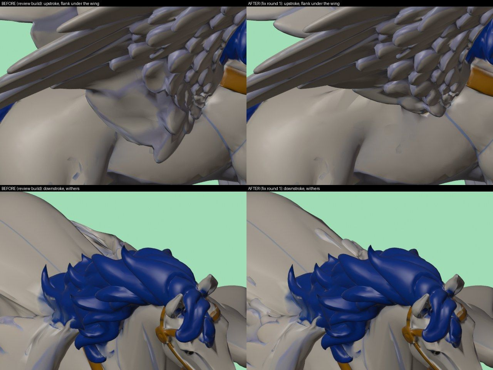
*Pegasus skin fix round 1, before/after (back faces culled like Godot): the feather lobe no longer smears down the flank in an upstroke; no holes at the mane/wing root (upstroke flank edges >2x 325 -> 77; a rip test opened 0.28 m holes, so contacts are blended instead)*

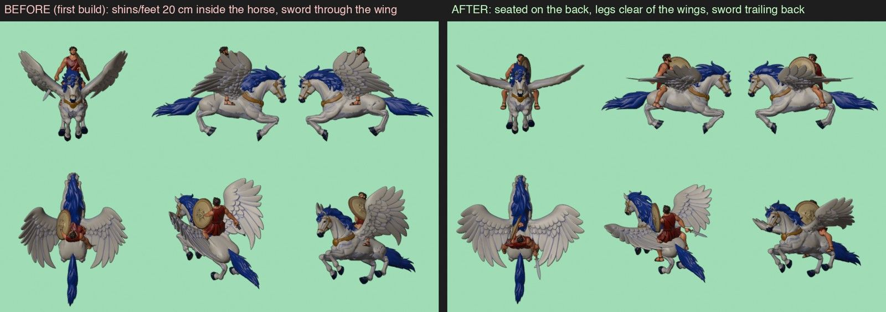
*first combined build vs final: shins/feet inside the horse and the sword through the right wing, fixed by straddling wider (thighs 58 deg out), moving him 0.20 m back, pitching the wing trailing edge up 18 deg and trailing the sword back over the croup (before: shin_l/shin_r 155/144 and feet 118/66 triangle hits with the body, sword 133 hits with the right wing; after: 0 leg-wing, 0 sword, 0 shield-skin/wing hits; shins <= 0.1 cm into the flank, inner thighs <= 9 cm (gripping contact))*

All 53 files for this chapter, with captions and same-view pairs marked: [MEDIA_INDEX.md](MEDIA_INDEX.md#04_rigging-rigging-raw-mesh-to-rigged-pose).
<!-- /MEDIA:04_rigging -->

### The numbers (review findings and what the fixes measured)
- **Hercules:** the review found the skirt tied to both thighs: run 86 edges stretched over 2.5x (max 11x), riding pose 113
  (max 11.9x), lunge 221 stretched / 155 collapsed (max 14.3x). After the fix: run 63 (max 5.2x), ride 91 (max 6.1x).
  Earlier the builder fixed the tunic tearing into "wings" with arms overhead (max stretch 6.0x, 3,538 vertices re-weighted).
- **Cyclops:** knee moved 1.12 m -> 2.22 m, ankle 0.55 m -> 0.95 m; heel vertices carrying thigh weight 126/164 -> 0;
  elbow-90 test: mid-forearm error 0.21 m median -> 0 m.
- **Medusa:** a hard neck/shoulder weight seam (665 edges jumping by more than 0.5) → harmonic re-weighting of 14,340 of
  34,976 vertices; max edge stretch 26.4 -> 5.1 cm (shrug + look) and 26.6 -> 5.3 cm (head turn 45). Earlier bug: arms raised
  left a skin sheet hanging (NaN weights from stray labels; 472 vertices fixed).
- **Hydra:** fused necks in the generated mesh pulled pink membranes when spread → 547 seam edges ripped (stretched edges in
  the test pose 543 -> 16). The 10th headless tube: 1,775 vertices deleted (edges over 3x the median in the head-down pose
  483 -> 94). New head-down "bow": jaw from 11.8 m at rest to 1.17 m.
- **Pegasus:** neck weight bled onto the back under the saddle: the rider would float 0.19 m when the neck moved → 0.000 m
  after the fix; withers edges over 2x in a neck-forward pose 183 -> 48.

### Time and tokens
`hercules-rigs` (5:59-6:57 PM): 15 agents (5 builders, 5 reviewers, 5 fixers), 0.97 h wall, 4.20 agent-hours, 205.14 M
tokens (1.33 M output) — the most token-hungry workflow after animation wave 2.

### Problems hit and how they were solved
- Meshy's rig ships a helper mesh "Icosphere" that inflated the bounding box; the first split sheet showed Hercules tiny and
  floating → deleted.
- Blender's automatic weights fail on generated meshes → own numpy weights with smoothing (D27).
- Generated meshes come split along texture seams (Medusa fell into 719 pieces) → vertices welded (44,589 -> 34,976).
- The skirt driver needed code in the toolkit (Chapter 5): the rig agent could not edit that file, so it wrote the request
  into its notes and the toolkit fixer added "driven bones" (thigh 45 deg forward moves the skirt tip 6.6 cm).
- One minor stays open on Hercules: an armpit smoothing pass made no measurable difference.

### Talking points for the video
- "Hercules came with a skeleton from Higgsfield. The monsters didn't: no auto-rig has a button for nine necks."
- "A second AI agent's only job was to break the first one's work. It failed two of five rigs."
- "The Cyclops's knees were actually its ankles. The reviewer found it by slicing the mesh like a CT scan."
- "The Hydra had a tenth neck with no head hidden behind the others. Bend forward and it flew out like a ghost."

### Show
Raw mesh vs rigged pose per character, bones over mesh, deform sheets, the Cyclops knee before/after, the Hydra ghost-neck
before/after, the Hercules skirt fix, the Pegasus saddle fix.

---

## Chapter 5 · JC's animation method: sheet -> Seedance 2.5 at 480p -> keyframes

### In one minute
JC's idea: render the rigged character from the front and the side as one split image, give that image to Seedance 2.5 as
the first frame of a 10-second 480p video with the motion described, then pose the real rig in Blender until it matches the
video frame by frame. Claude tested it with two videos before spending more: it worked. Agents then built a toolkit that
scores how well each pose matches the video, and found that Seedance quietly zooms and re-frames the picture, which the
toolkit now corrects.

### What JC asked
> "To generate the videos, you want to take a screenshot of the actual 3D asset from the front view and the side view, and then use that split screen, create a split screen sheet, so one image, and then use that as a reference image to generate the actual animation video inside of Cdance 2.5." — P03

> "And then you match the keyframes inside of Blender to the actual video that we generated for the reference animation. Do that for Hercules, Pegasus, and all animations for the creatures." — P03

### Decisions
- D32 · Test the method with two videos first (60 credits).
- D33 · Build `animkit`, a toolkit that measures the match (silhouette overlap, "IoU", 0 = nothing overlaps, 1 = identical).
- D34 · Calibrate every video against the sheet (Seedance re-frames it).
- D35 · Keep camera framing separate from real body motion.
- D36 · Three sheet framings per character (std, wide, swipe); D37 · green background for the white horse.

### What was built
1. **The split sheet** (`tools/blender/render_split_sheet.py`, headless): flat-textured Workbench render, two orthographic
   cameras (FRONT | SIDE) at the same pixels per metre, a thin divider, 1280x720 (Medusa later 1920x1080). Two framing bugs on
   the first Hercules sheet: the Icosphere helper made him tiny and floating, and the side panel was too narrow for a run.
   The final sheets add a motion envelope: `std` (closer), `wide` (room for falls, slams, sweeps), `swipe` (Medusa's tail).
2. **The method test (5:55 PM):** two Seedance 2.5 videos, 480p, 10 s, 30 credits each, the sheet as first frame: Hercules
   running in place and a dodge roll. Result: the split layout held, both panels stayed in sync, the character stayed on
   model, the cameras stayed still. The method works.
3. **The prompt template** (`docs/anim_clips.json`): every video prompt = a base block + one motion line. The base block:
   "Animation reference video for a 3D game {noun}, shown as a split screen. LEFT panel: FRONT view. RIGHT panel: SIDE view
   of the same {noun}, facing right. Both panels show the SAME motion at the SAME time, perfectly in sync. Fixed, locked-off
   orthographic cameras: no camera movement, no zoom, no reframing, no cuts. Plain {bg} background ... stays in place in each
   panel (any travel happens on the spot, like on a treadmill)." Motion lines are timed (e.g. the roll: "0-2 s he drops into
   a low combat stance. 2-4 s he does one fast forward combat dodge roll ...").
4. **animkit (`tools/ak`)**, built, reviewed and fixed in the foundation workflow: `info` (bones picture), `frames`, `pose`
   (render one pose next to the video frame: target / ours / 50 % overlay / red-blue difference, with IoU per panel, 0.9 s per
   call), `fit` (nudges bone angles to raise IoU), `cycle` (finds a loop's period in the video), `mirror`, `bake` (poses ->
   Blender action, loops seamless, root drift removed), `strip` (reference row above our row), `merge`, `export` (GLB with
   all clips + a clips manifest for Godot), `selftest`. Angles are written as seen in the views: `ry` turns a bone in the
   front panel, `rx` in the side panel, `rz` is twist.
5. **The recipe** (`docs/ANIM_PIPELINE.md`): read the video, find the window and the loop, pose keys by eye, `fit`, check
   the strip, bake, write notes.

### What Seedance does to the framing (the surprise)
- In the first test video the character is drawn about 21 % larger than on the sheet and the divider moves from 700 px to
  the middle. Raw frames never line up with the renders → `animkit` aligns video frame 0 to the sheet and reuses that for
  every frame (alignment 0.90 front / 0.94 side on the real video).
- Later videos showed more of it: Pegasus "fly" zoomed about 1.9x and switched the panel split from 790/490 to 50/50; Pegasus
  "glide" did not start from the sheet pose at all (calibration 0.46, re-done against a render); Medusa "slither" zoomed about
  1.2x so the last 2-3 m of tail left the frame; Hercules "idle" redrew the side view (side calibration 0.70).
- The "treadmill" wording keeps the character in frame, but it also means runs and backpedals do not cover ground (Chapter 6).

### Before → after
<!-- MEDIA:05_animation_method -->
**Clip:** [01_test_run.mp4](media/05_animation_method/01_test_run.mp4) — Method test 1 (17:55): Seedance 2.5 run in place from the Hercules FRONT / SIDE sheet as first frame, 480p, 10 s, 30 credits. Both panels stay in sync, cameras static, character on-model.

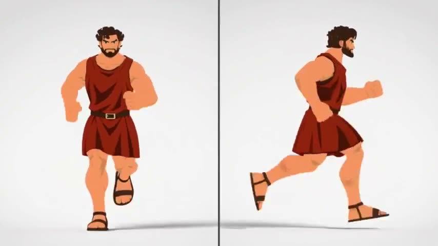

**Clip:** [02_test_roll.mp4](media/05_animation_method/02_test_roll.mp4) — Method test 2: Seedance 2.5 dodge roll from the same sheet (480p, 10 s, 30 credits). The split layout held through a full roll.

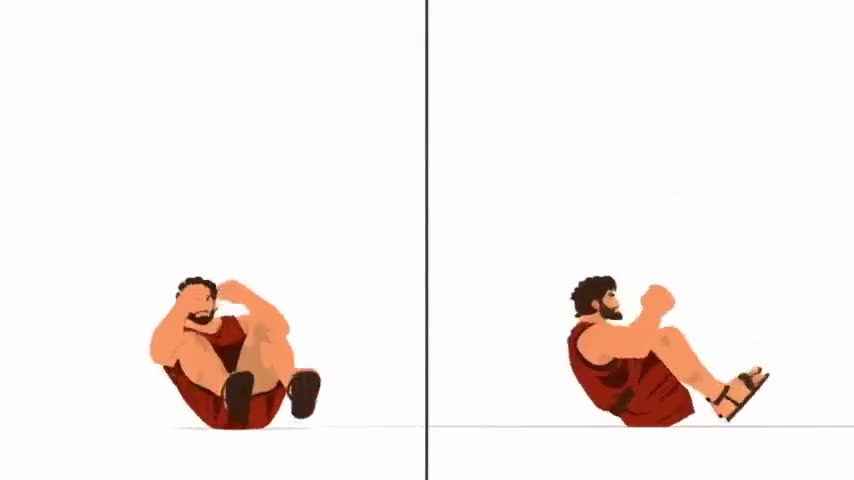

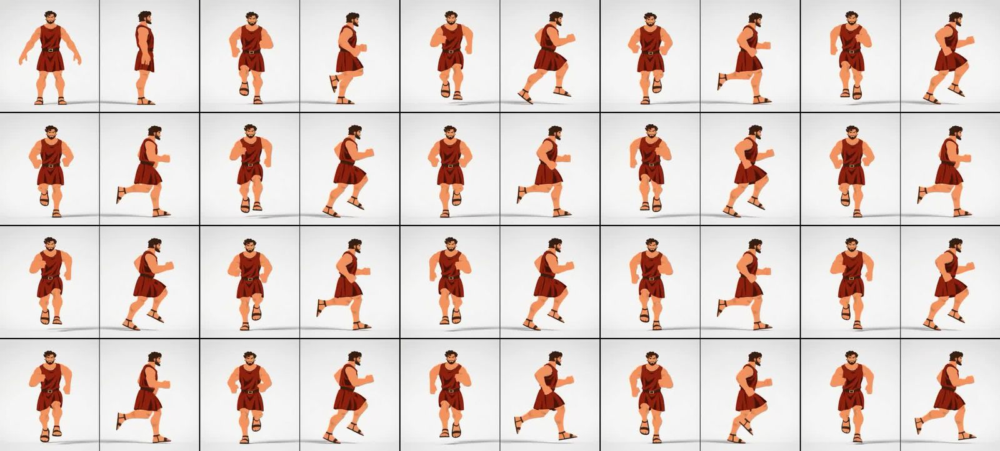
*Frames of method test 1 (run in place) in a grid: front and side panels move together frame by frame.*

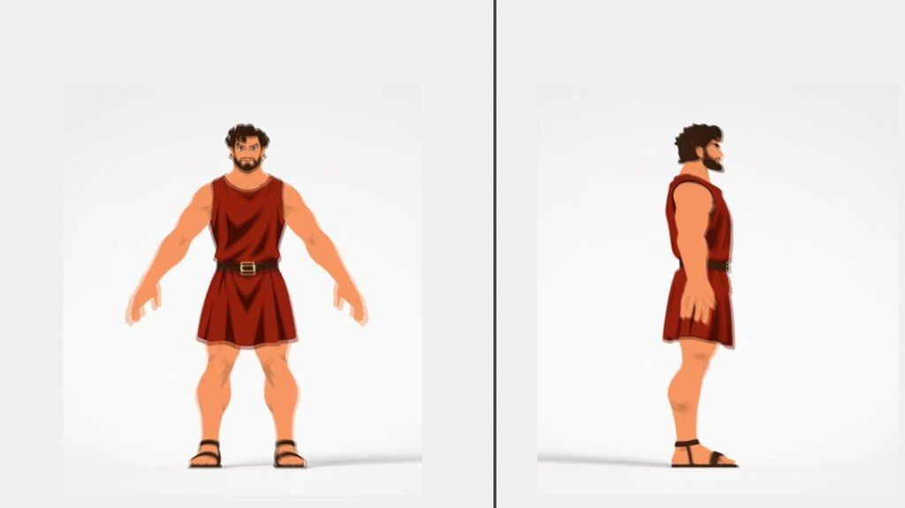
*Seedance re-frames the split sheet (character ~20% larger, divider moved from 700 px to the middle); auto-calibration lays video frame 0 back onto the sheet (calibration IoU 0.90 front / 0.94 side)*

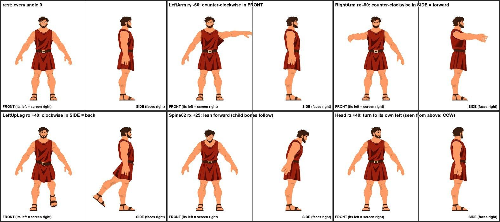
*the pose format: angles in the view axes (ry = front panel, rx = side panel, rz = twist), signs shown on the real rig (pose-math test: 349 bone directions within 0.5 deg)*

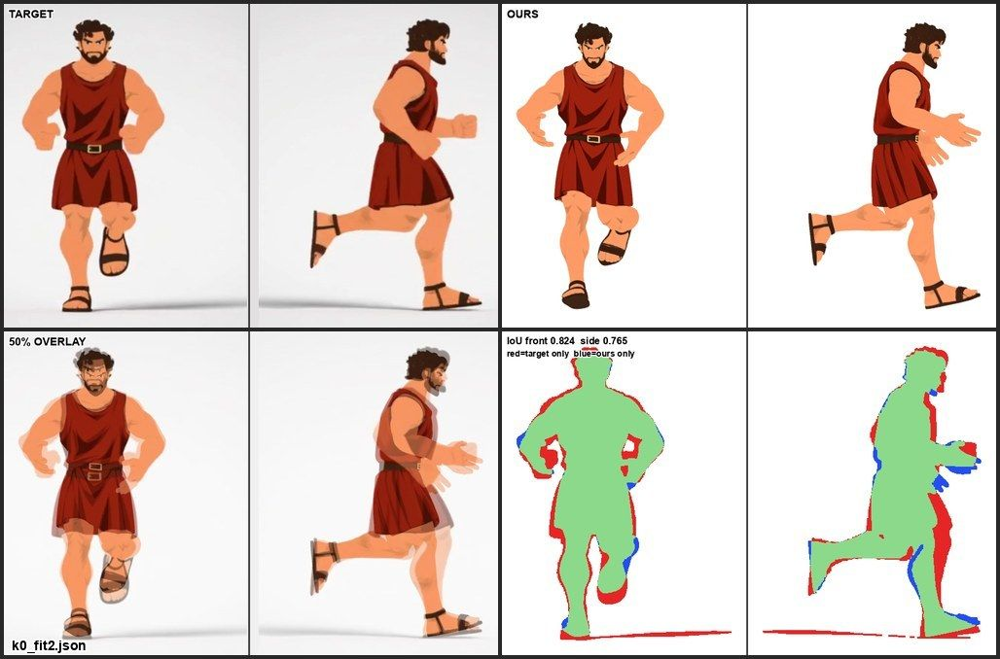
*one key of the run: target frame vs our render, 50% overlay and red/blue silhouette difference (IoU 0.82 front / 0.77 side after ak fit (0.64/0.48 by eye first))*

**Clip:** [10_proof_match.mp4](media/05_animation_method/10_proof_match.mp4) — First proof match of the toolkit, looped x4: Seedance run (top) vs our keyframed rig (bottom); 0.708 s loop, 5 keys, mean strip IoU 0.72.

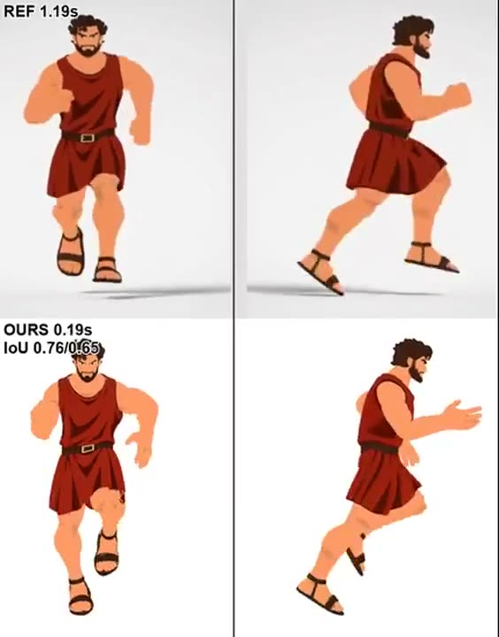

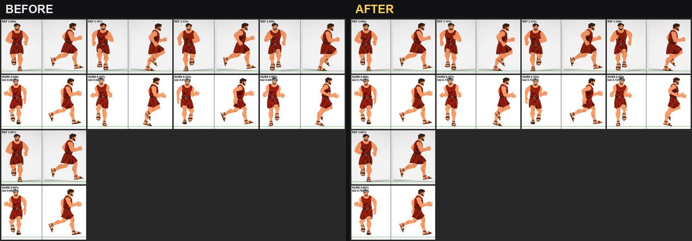
*Toolkit fix: framing offset moved out of the root motion and the strip sampled at the exact video frame; same 4 run keys score 0.600 -> 0.753*

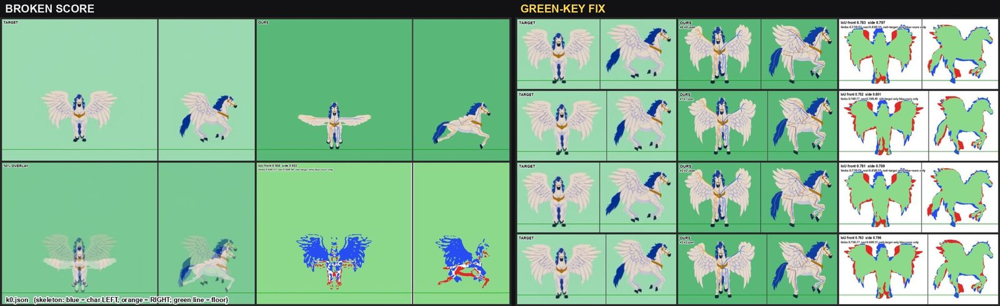
*Pegasus: the green sheet background was counted as horse, so every pose scored ~0.94 and IoU meant nothing; with green-key masks the glide keys score 0.75-0.80 for real*

All 22 files for this chapter, with captions and same-view pairs marked: [MEDIA_INDEX.md](MEDIA_INDEX.md#05_animation_method-proving-the-owners-method).
<!-- /MEDIA:05_animation_method -->

### The numbers
- Test videos: 2 x 30 credits. Toolkit tests: 10 at first, 24 after the review fixes, all passing; pose math checked on 349
  bone directions within 0.5 deg; `fit` recovers deliberately wrong limbs to within 1 deg (IoU 0.73 -> 0.96).
- Proof match by the builder: `cycle` found the run's period, 0.708 s; 5 keys (2 by eye then `fit`, 3 from `mirror` then
  `fit`), mean IoU 0.72; Godot imported the clip at 0.70833 s.
- The independent reviewer made its own clip using only the manual: 4 keys, 17 tool calls, about 70 s of tool time; strip
  IoU 0.60 in place, 0.73 with the framing kept → that gap became finding D35.
- Review: 14 major and 7 minor findings (mixed frame rates made loops play 25 % too fast; framing vs body motion; driven
  skirt bones ignored; feet floating 8-10 cm with nothing to warn; mirror names; chain bends on vertical chains ...). The
  fixer reports all majors fixed and every minor but two (the fixer counted 13 majors); after the framing fix the review's
  run strip went from IoU 0.600 to 0.753.

### Time and tokens
`hercules-foundation` (5:58-6:56 PM, animkit + Godot core together): 6 agents, 0.97 h wall, 1.83 agent-hours, 67.72 M
tokens (600.1 k output). The animkit share (3 agents): 0.97 agent-hours, 31.49 M tokens (318.7 k output).

### Problems hit and how they were solved
- Seedance re-frames the sheet → calibration against frame 0 (D34).
- The in-place bake deleted the framing fit, so agents chased a problem that did not exist → `view_offset` (D35).
- Clips baked at 24 and 30 fps exported at the wrong length → one project fps, length checked against the manifest.
- Feet floating with nothing to warn → floor line in every panel, lowest-vertex report, `root.ground`.
- Pegasus on green: the stock silhouette counted the background as horse, so every pose scored about 0.95 → green-key mask
  (Chapter 6, D44).
- First sheets had no room for a falling body or a raised club → framings with motion envelopes (D36).

### Talking points for the video
- "Here's my method in one picture: front and side of the real model, side by side. That's the first frame of the video."
- "480p, 10 seconds, 30 credits. Two test videos told us the idea works before spending a thousand credits."
- "Seedance cheats a little: it zooms in about 20 % and moves the divider. The toolkit catches it and lines it back up."
- "Every pose gets a score: how much of our character's silhouette overlaps the video's. That number is what the agents chase."

### Show
The split sheet, the two test videos, the calibration overlay, the pose-axes card, one target/ours/overlay/difference
comparison, the proof-match strip, the before/after strip from the toolkit fix.

---

## Chapter 6 · Thirty-three reference videos and forty-one clips

### In one minute
Claude wrote one motion prompt per video: 32 for the five characters plus one of Hercules riding Pegasus. Each video is
cut into one or more game clips, 41 in total. One AI agent per video watched it frame by frame and keyframed the real rig to
match, scoring every pose. Seedance did not always do what the prompt asked: a run that never moves forward, a bite by the
wrong head, a side panel that never moves, a one-frame jump cut in Medusa's death. The agents traced what was usable and
authored the rest, and wrote down which was which.

### What JC asked
> "We want to generate a video animation of Hercules also flying on Pegasus so that we can ensure to then properly display that inside of the game as well." — P03

### Decisions
- D38 · Batches of 6 (the account's limit; 26 of the first 32 submissions were refused, no credits lost).
- D39 · Wave 1 on the six Hercules videos already in, with a reviewer and a fixer per video.
- D40 · Reworded the Cyclops death after the content filter refused it.
- D41 · Waves 2 and 3 animators only; one reviewer per character after the merge.
- D42 · Author a real stride on top of "treadmill" videos; D43 · Cyclops walk traced from the side panel only.
- D44 · Green-key masks for Pegasus; D45-D47 · the rider's seat, a wider ride frame, a forward wing sweep.

### What was built
**33 videos** (480p, 10 s, 30 credits each, generated 7:00-7:42 PM): Hercules 9, Cyclops 6, Medusa 7, Hydra 7, Pegasus 3,
ride 1. **41 keyed clips**: Hercules 11, Cyclops 8, Medusa 9, Hydra 9, Pegasus 3, ride 1. `strafe_r` is a mirror of
`strafe_l` and comes on top, so the files hold 42 actions.

The ride: an agent seated the real rigged Hercules on the real Pegasus saddle bone and rendered a FRONT | SIDE sheet on
green; a checker widened the frame because a fully spread wing (1.81 m from its root) had only 3.4 cm of room. The
Seedance ride video shows the pair from front and side with full wing beats. A third agent keyed Hercules's `ride` loop.

Final scores per clip (mean silhouette IoU against the video; after fixes where a fix ran):

| Character | Clip (keys, length) and IoU | Range |
|---|---|---|
| Hercules | idle (4 keys, 3.5 s) 0.788 · run (10, 0.833 s) 0.725 · strafe_l (10, 0.833 s) 0.78 · strafe_r (mirror) 0.76 · walk_back (12, 0.5 s) 0.776 · roll (17, 0.708 s) 0.57 · attack_1 (9, 1.25 s) 0.687 · attack_2 (12, 1.5 s) 0.662 · block_start (3, 0.417 s) 0.75 · block_idle (2, 2.5 s) 0.74 · hit (9, 2.167 s) 0.852 · death (15, 3.75 s) 0.55 · ride (loop 1.5 s) rider 0.78 front / 0.84 side | 0.55-0.852 |
| Cyclops | idle (4, 3.333 s) 0.902 · walk (14, 3.917 s) 0.84 · sweep (17, 2.5 s) 0.75 · slam (9, 1.75 s) 0.727 · stuck (2, 1.5 s) 0.724 · pull_free (9, 1.75 s) 0.703 · hurt (7, 2.25 s) 0.796 · death (21, 4.5 s) 0.60 | 0.60-0.902 |
| Medusa | idle (6, 3 s) 0.778 · slither (8, 2 s) 0.842 · gaze (9, 4.25 s) 0.816 · stun_start (5, 1.625 s) 0.63 · stunned (2, 3 s) 0.61 · rise (6, 2.5 s) 0.57 · tail_swipe (11, 2.75 s) 0.58 · hurt (8, 3.25 s) 0.72 · death (8, 3.5 s) 0.62 | 0.57-0.842 |
| Hydra | idle (6, 3 s) 0.922 · walk (27, 2.167 s) 0.877 · fire_sweep (8, 5 s) 0.687 · head_down (4, 1.5 s) 0.624 · head_up (6, 1.5 s) 0.759 · stomp (10, 3 s) 0.794 · bite (7, 3.5 s) 0.84 · hurt (8, 1.633 s) 0.79 · death (21, 5.5 s) 0.744 | 0.624-0.922 |
| Pegasus | idle (21, 7 s) 0.904 · fly (7, 1.042 s) 0.71 · glide (4, 3 s) 0.78 | 0.71-0.904 |

Read the scores with care: a high score on a still idle is easy (the rest pose already overlaps); deliberate departures
from the video (a real stride, a weapon kept in hand) lower the score on purpose; a one-frame smear or a redrawn tail caps
it. Typical first guesses by eye scored 0.3-0.7 and `fit` lifted them by 0.1-0.4.

### What Seedance got wrong, and what the agents did
| Video | Problem | Handling |
|---|---|---|
| Hercules run, walk_back, strafe | "On the spot, like on a treadmill" = no travel; walk_back marched in place, strafe shuffled left-right | stride authored on top (run toe travel 0.13 -> 0.61 m, 3.7 m/s; walk_back 1.2 m/s; strafe 0.27 -> 0.6 m per cycle); IoU drops accepted |
| Hercules attack | first strike a backhand (prompt asked right-to-left); body steps 0.6 m forward | matched the video; step absorbed in `view_offset` |
| Hercules hit, block, death | the first second stays in the sheet's A-pose; props dropped in death | traced from the motion; props kept in hand |
| Cyclops walk | panels out of sync (side steps every 1.96 s, front lifts one leg every 2.93 s) | traced the side panel, mirrored one step (D43) |
| Cyclops death | first prompt refused by the content filter (status `nsfw`) | reworded, passed (D40) |
| Cyclops slam | the smash takes 3 motion-blurred frames | keys there score low; impact event at 1.5 s |
| Medusa tail_swipe | not the prompt's low 360 degree sweep | traced what the video shows; IoU 0.58 |
| Medusa death | a one-frame jump cut from tipping to lying flat at 3.0 s | fall authored over the cut |
| Medusa idle, hurt, stunned | tail drawn past the panel edge or curled from frame 0 | upper-body scoring; ceiling noted |
| Hydra fire_sweep | centre neck drawn about 1.5x longer (top 17.4 m vs 14.4 m) | traced the bend, not the length |
| Hydra bite | the centre head bites, not an outer one | matched the video; per-side bites suggested |
| Hydra stomp | side panel static through both stomps in the video | front traced, side lift authored |
| Pegasus fly / glide | zoom 1.9x, split moved to 50/50; glide's first frame not the sheet | calibrated against a render; green-key masks |
| Pegasus idle | spread wings drawn bigger than the mesh can reach | fitted as far as the rig allows (front 0.45 -> 0.73) |
| Ride | beats every 1.48 s, not "about once per second"; the rider never moves relative to the horse | loop 1.5 s, small rider motion; wings swept 10 deg forward (D47) |

### Before → after
<!-- MEDIA:06_reference_videos_clips -->
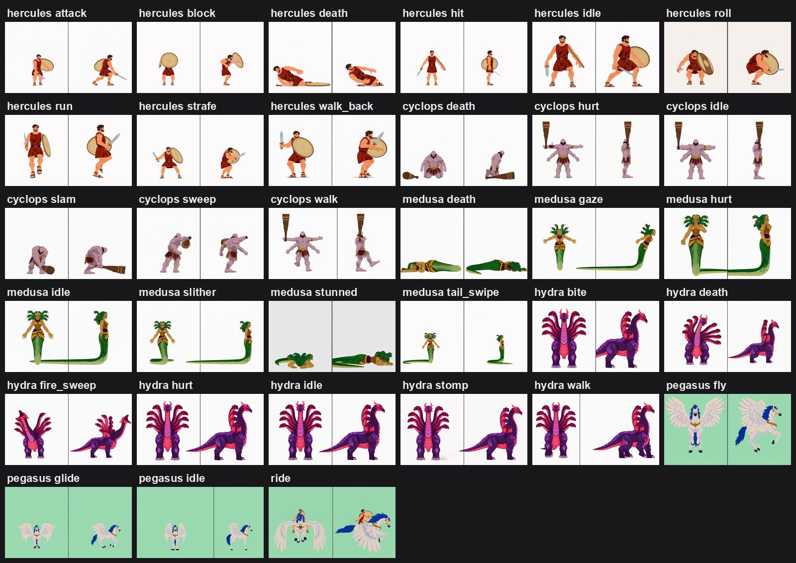
*All 33 Seedance 2.5 reference videos (480p, 10 s, 30 credits each), frame at 4.0 s: 9 Hercules, 6 Cyclops, 7 Medusa, 7 Hydra, 3 Pegasus, 1 ride. Each starts from the character's FRONT / SIDE sheet.*

**Clip:** [02_hercules_run_ref.mp4](media/06_reference_videos_clips/02_hercules_run_ref.mp4) — Hercules run reference video (Seedance 2.5 from the std sheet): running in place, front + side.

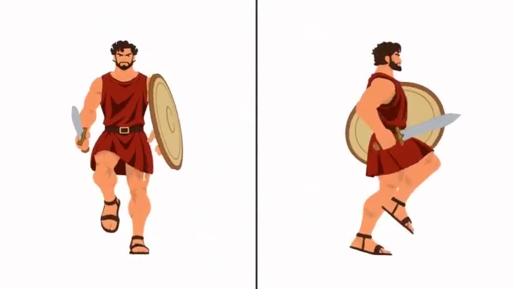

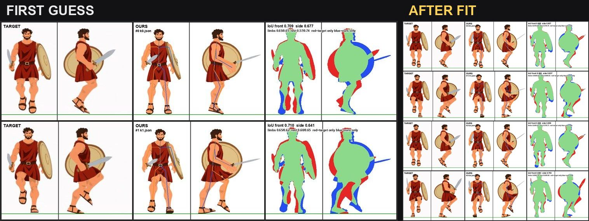
*Hercules run keys: first hand-posed guess vs after ak fit*

**Clip:** [05_hercules_run_match.mp4](media/06_reference_videos_clips/05_hercules_run_match.mp4) — Hercules run loop after the stride fix, looped: reference row above our rig (0.833 s loop at 24 fps).

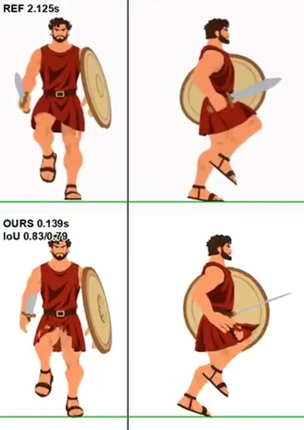

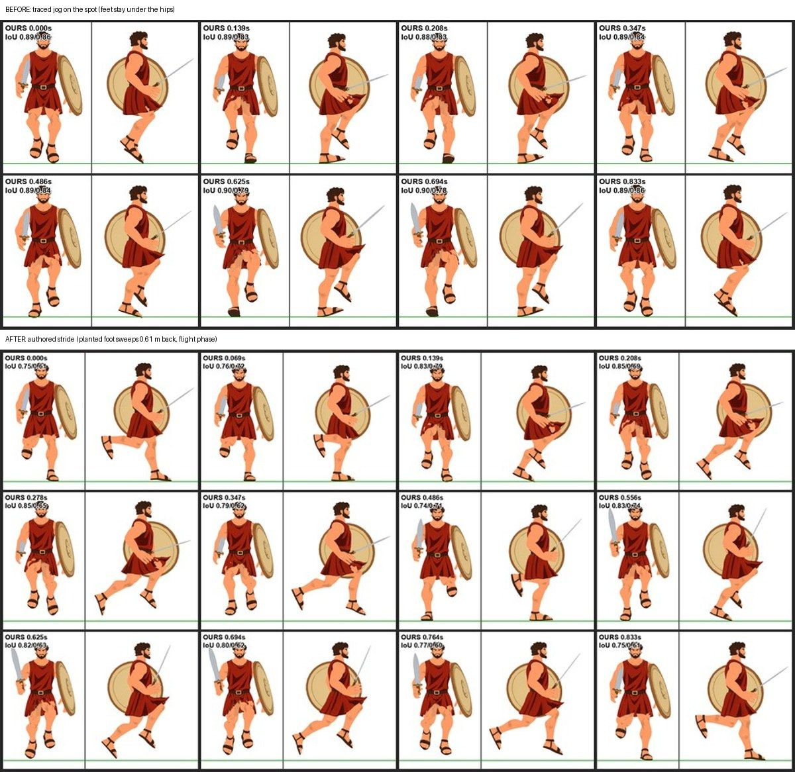
*Hercules run before/after the stride fix: traced jog-on-the-spot vs authored running stride with flight phase (planted toe travel 0.13 m/0.30 s -> 0.61 m/0.17 s (3.7 m/s); thigh range -66..+3 -> -66..+24 deg; hip bob 1.023-1.070 m both steps (limp 2.5 cm -> 0); strip IoU 0.857 -> 0.725 (deliberate departure from the reference))*

**Clip:** [13_cyclops_slam_ref.mp4](media/06_reference_videos_clips/13_cyclops_slam_ref.mp4) — Cyclops slam reference video: lift, overhead wind-up, smash, club stuck.

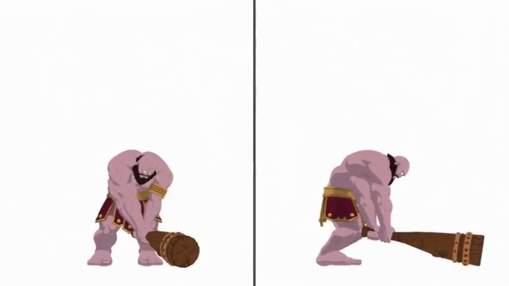

**Clip:** [19_cyclops_death_match.mp4](media/06_reference_videos_clips/19_cyclops_death_match.mp4) — Cyclops death: reference above, our rig below (11 traced keys + 10 grounded in-betweens, 4.5 s).

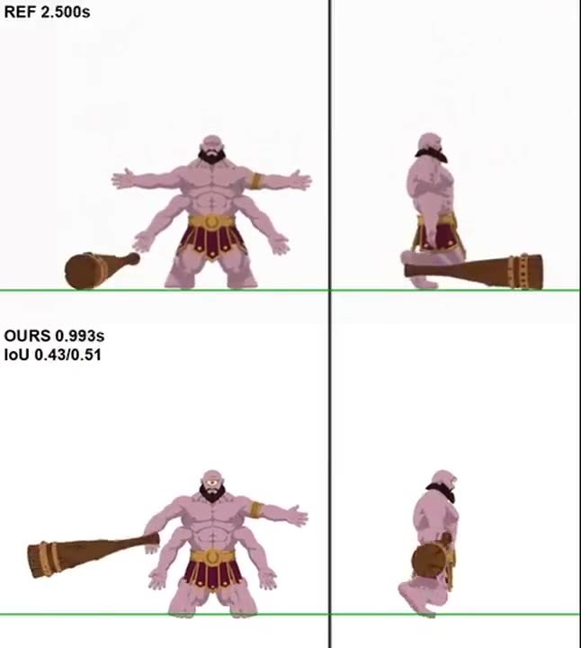

**Clip:** [22_medusa_gaze_match.mp4](media/06_reference_videos_clips/22_medusa_gaze_match.mp4) — Medusa gaze: reference above, our rig below (9 keys, 4.25 s, strip IoU 0.80).

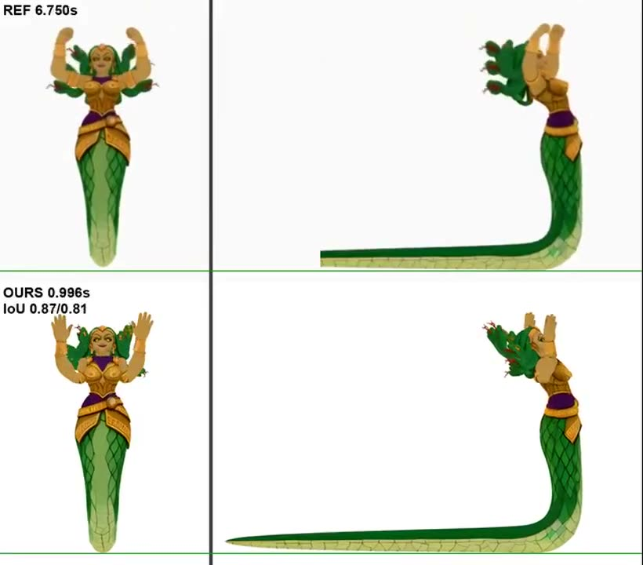

**Clip:** [29_hydra_fire_sweep_match.mp4](media/06_reference_videos_clips/29_hydra_fire_sweep_match.mp4) — Hydra fire sweep: reference above, our rig below (5.0 s, 8 keys).

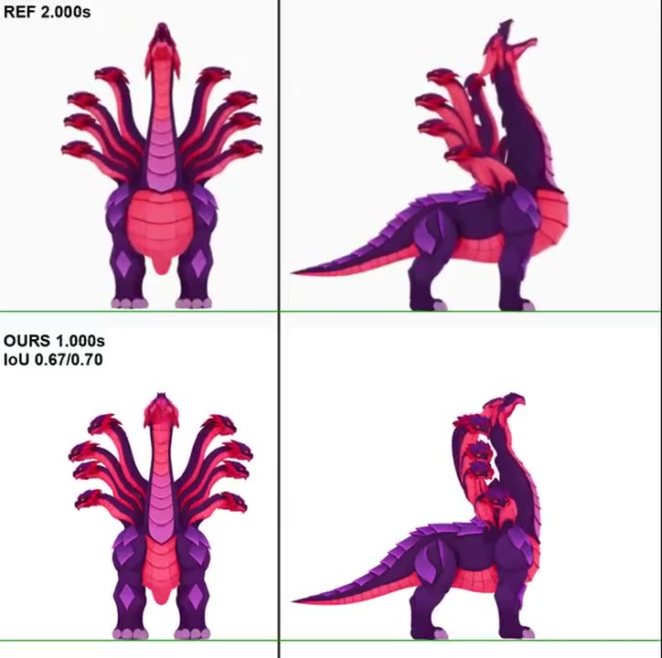

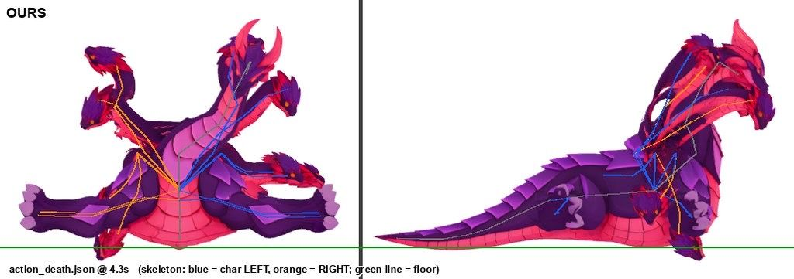
*mistake caught by a per-frame floor scan: between two keys a right-side head swung 0.48 m under the floor at 4.30 s (fine on every strip frame); fixed with one extra key holding the outer necks in a raised arch (lowest vertex -0.48 m -> 0.00 m from 4.0 to 4.5 s)*

**Clip:** [38_ride_ref.mp4](media/06_reference_videos_clips/38_ride_ref.mp4) — The ride reference video: real rigged Hercules seated on the real Pegasus (front + side), full wing beats. The animator matched Hercules's ride loop to it.

*Hercules ride loop vs the Seedance ride video, rider close-ups (top = video, bottom = our Blender render, FRONT (SIDE) at 4 phases of one wing beat / beat 1.48 s; rider IoU front 0.78 / side 0.84 mean; 0 wing hits with the rider after a 10 deg forward wing sweep (was up to 944 tri pairs at the downstroke))*

All 65 files for this chapter, with captions and same-view pairs marked: [MEDIA_INDEX.md](MEDIA_INDEX.md#06_reference_videos_clips-33-reference-videos-41-clips).
<!-- /MEDIA:06_reference_videos_clips -->

### The numbers
- Videos: 33 x 30 = 990 credits, plus 30 for the filtered Cyclops death = 1,020 (ledger).
- First submission attempt: 6 of 32 accepted (account limit 6 concurrent jobs), 26 refused with no charge.
- Wave 1 (Hercules x6, with review + fix): 6 reviews, 1 pass and 5 pass-with-fixes (16 major, 25 minor findings in total).
- Ride check: loop seam exact (rotation difference 0.0), 0 wing/sword/shield hits, left hand 4.2-4.8 cm from the mane; the
  pair bobs 8.3 cm together in the video.
- Mistakes caught by the agents themselves (from their captions): Hercules death's first fall hovered 0.6 m up (IoU
  0.05-0.35 -> 0.50-0.54); the Hydra death swung a head 0.48 m under the floor between two keys (caught by a per-frame floor
  scan); the Hydra walk pushed a toe 0.18 m through the floor with keys every 4 frames (fixed with keys every 2); a block
  pose held the shield flat like a tray (IoU 0.66/0.44 -> 0.87/0.62).

### Time and tokens
| Workflow | Agents | Wall | Agent-hours | Tokens (output) |
|---|---|---|---|---|
| Wave 1 (7:07-8:09 PM) | 18 | 1.03 h | 3.71 | 121.09 M (790.0 k) |
| Wave 2 (7:37-8:32 PM), 22 videos | 22 | 0.93 h | 10.78 | 216.45 M (1.20 M) |
| Wave 3 (7:47-8:33 PM), 4 videos | 4 | 0.76 h | 2.26 | 47.30 M (255.9 k) |
| Ride sheet (7:01-7:36 PM) | 2 | 0.58 h | 0.58 | 31.88 M (173.8 k) |
| Ride clip (7:47-8:11 PM) | 2 | 0.40 h | 0.40 | 13.65 M (98.3 k) |

Wave 2 is the biggest single workflow of the build: 22 agents working at once.

### Problems hit and how they were solved
- 26 of 32 submissions refused by the 6-job limit → batches of 6 (D38).
- Content filter on the Cyclops death → softer wording (D40).
- Usage climbing about 5 % per 35 min → animators only in waves 2-3 (D41).
- The game modules asked for exact poses the videos did not give (the Cyclops forearm down at 1-2.5 m when stuck, the Hydra
  jaw at about 1.2 m in head_down, Medusa's head about 4.6 m forward when stunned) → passed to the finalize reviewers.
  The integration check later found the real Hydra's head_down still leaves the jaw 9.1-10.2 m up (Chapter 9).

### Talking points for the video
- "Thirty-three videos, thirty credits each, all generated in about forty minutes, six at a time."
- "Twenty-two AI animators worked at the same time, each watching one video and posing the real rig to match."
- "Seedance is a great reference, not a ground truth: the Hydra's neck grew 50 %, the wrong head bit, and one side panel froze."
- "The ride video is the coolest frame of the build: Hercules on Pegasus, front and side, posed from the real rigs."

### Show
A contact sheet of all 33 videos, 2-3 reference/match strips per character, first guess vs fitted key pairs, the ride
video and the ride proof strip.

---

## Chapter 7 · The game code (core, three bosses, world, bots)

### In one minute
The Godot game was written from scratch by agents: first the core (Hercules, the camera behind him, lock-on, roll, shield,
a boss framework, a test arena and a test bot that can win or lose), then the three boss fights and the world with flying
on Pegasus, each built, reviewed and fixed. A bot plays every fight headless and must win; another must lose. Until the
animated models land, the fights run on grey stand-ins sized to the real rigs.

### What JC asked
> "Use your best judgment for the game and let me know when it's complete for me to test." — P03

### Decisions
- D48 · Core gap-fills (shield walk 2.2 m/s, invulnerable while petrified, roll cancels an attack after its hit window).
- D49 · The bot asks the world for advice when no boss fights (review blocker).
- D50 · Medusa gazes only within 10 m. D51 · Only the target ring lands you by itself.
- D52 · Hydra fire as damage over time without knockback. D53 · The camera arm grows to frame a 14.4 m Hydra.

### What was built
- **Core** (`build:core`, then a review with 1 blocker, 9 major and 10 minor findings, then a fixer that reports 22 items
  handled): player, chase camera behind the hero with lock-on, roll, shield, two-hit sword, glances, boss base class, HUD,
  title screen drawn in code (painted sea, Greek-key bands, pad menu), pause, save, keyboard/mouse and controller with
  prompts that follow the device, a test arena with a 6 m dummy boss, and the test harness (`--bot=win|lose`, `--pad`,
  `--keys`, `--shots`, `--probe`).
- **Cyclops** (quarry): sweep (0.6 s windup, 150 deg, 10 m), slam (1.4 s, r 3.4 m), club stuck 3 s with 2 forearm hits.
- **Medusa** (sanctuary): gaze fan, shield reflect, stun, tail swipe; two ways to win (reflect, or flank and cut the neck).
- **Hydra** (volcano): fire sweep with 360 + 160 + 220 particles, head down with the jaw weak point, stomp ring, bites.
- **World:** home plateau (47 m across, 14 m above the sea, sign, Pegasus waiting, trophy pedestals), flight over the sea
  at 28 m/s, locked islands inside an 88 m storm wall, landing rings, the ending card, free flight.
- **Integration 1** (`core:followup`): applied every request the modules wrote for the core (tuning keys, camera framing
  for the real 14.4 m Hydra, fire damage over time, a toon-shader fix for omni lights, HUD changes).

GDScript at 8:39 PM: 38 files, 11,125 lines (`game/scripts/`); animkit: 3,389 lines of Python (both still changing).

### Before → after
<!-- MEDIA:07_game -->

*first playable core loop: hero (grey-box stand-in) vs the 6 m dummy boss in the test arena; blocked sweep, telegraphed slam dodged by a roll, weak point struck, LABOR COMPLETE (--bot=win wins in 15.6 s game time, 4/4 weak-point hits, 0 damage taken; whole core written from scratch, first harness run passed)*

*title screen drawn entirely in code (no images or fonts): painted sea backdrop, Greek-key bands, pad-navigable menu (bug fixed: full-screen Controls had size 0 (set_anchors_preset keeps the old offsets) -> set_anchors_and_offsets_preset)*

*Sweep warning from the chase camera: red 150 degree cone on the packed earth, colonnades and sea behind the 8 m giant (cone 10 m reach, 0.6 s windup (0.48 s enraged))*

*Medusa v1 (stand-in body): gaze windup fan, shield reflect, stunned neck weak point, tail-swipe ring (win bot 6/6 hits in 22.5-23.4 s on 3 seeds; flank route 42.3 s; lose bot dies to 4 gazes (30 dmg each))*

*Same moment with the real rigged Hydra mesh (art_src export, no clips yet) loaded through the harness-only --hydra-glb probe: fire comes from a head at the top, but at this distance the tops of the necks are cut off by the frame (the lock-on framing fix is in 18_pair_hydra_lock_framing); Hercules is still a stand-in (66,440 tris, 76 bones, multiply tint 0.62/0.52/0.70 to pull the magenta albedo back to violet under orange light)*

*Hydra fire: pale yellow smoke puffs vs orange-red flames after one flag per particle material (vertex_color_is_srgb)*

*Lock-on camera on the real 14.4 m Hydra: horns cut off vs whole Hydra framed*

*World: storm wall drawn wrong (far side over near side, sea painted over it) vs fixed (back faces culled, drawn after the sea)*

*home plateau as spawned: sign with next goal + controls, Pegasus waiting, medusa pillar + hydra storm on the horizon (plateau 47 m across, 14 m above the sea)*

*flying at the open Volcano Isle: lava rivers, smoke plume, pillar of light, landing ring (cone 88 m tall, ring r 28 m at 42 m)*

*ending card after the Hydra (shown once, then free flight) (6 lines, 11 s hold)*

**Clip:** [29_cyclops_fight.mp4](media/07_game/29_cyclops_fight.mp4) — A 22 s Godot Movie Maker capture of the Cyclops fight with the game's sound (made by the audio agent to check the mix): title card "The Quarry Isle", club slam, crack, stuck club, sweep. Grey-box stand-ins for Hercules and the Cyclops (real rigged models were not wired in yet). -14.8 LUFS integrated, peak -0.5 dBFS.

All 36 files for this chapter, with captions and same-view pairs marked: [MEDIA_INDEX.md](MEDIA_INDEX.md#07_game-the-godot-game).
<!-- /MEDIA:07_game -->

### The numbers (bot runs, headless, all from the agents' logs)
| Run | Result |
|---|---|
| Core test fight, first build | victory in 15.6 s game time, 4/4 weak-point hits, 0 damage |
| Cyclops (stand-in) | victory in 34-37 s on 9 seeds, 0 damage; lose bot dies at 21.8 s and the fight restarts |
| Medusa (stand-in) | victory 6/6 neck hits in 22.5-23.4 s; flank route 42.3 s; tail-swipe stress 41.0 s |
| Hydra (stand-in) | victory 8/8 jaw hits in about 80.8 s, then about 84 s after fixes; lose bot 86.7 s -> 37.8 s after the fire fix |
| World | home -> mounted at 1.0 s -> landed in the Cyclops ring at 16.6 s; whole chain Cyclops -> Medusa -> Hydra -> ending |
| Integration 1 regression (speed 3, seeds 11 and 4242) | test 16.9 s, Cyclops 39.4 / 35.1 s, Medusa 24.1 / 23.3 s, Hydra 86.5 / 86.6 s, 0 hits taken |
| Integration 1 verifier | pass, 4 minor findings |

Review findings in the modules workflow: Cyclops 2 major / 7 minor, Medusa 2 / 6, Hydra 7 / 6, World 1 / 5; all majors fixed.

### Time and tokens
| Workflow | Agents | Wall | Agent-hours | Tokens (output) |
|---|---|---|---|---|
| Core share of `hercules-foundation` (5:58-6:56 PM) | 3 | 0.86 h | 0.86 | 36.23 M (281.4 k) |
| `hercules-modules` (6:59-8:09 PM) | 12 | 1.18 h | 3.77 | 126.23 M (816.3 k) |
| `hercules-integration-1` (8:10-8:40 PM, core follow-up + audio + verifier) | 3 | 0.50 h | 0.79 | 54.73 M (231.8 k) |

### Problems hit and how they were solved
- The bot did nothing outside a boss fight, so "fly from home to the first island" could not be tested → advisor fallback (D49).
- A replayed clip resumed from the middle instead of restarting (Godot `AnimationPlayer.play`) → restart on re-play.
- Pause leaked a roll on resume → the menu closes on button release, inputs released on resume.
- Cyclops kept fighting after killing the player (stuck pose and a lit weak point under DEFEATED, 3 of 3 slam deaths) → guard
  after each impact.
- Hydra bite block test always passed (the hit circle was centred on the hero) → test against the biting head's position.
- Hydra fire looked like pale yellow smoke → particle colours were treated as linear; one `vertex_color_is_srgb` flag fixed it.
- World: home plateau top missing (face wound backwards), storm wall drawn wrong over the sea, flight camera hid the target
  island behind Pegasus, rings landed you by themselves → all fixed by the world fixer.
- Medusa's lit omni lights drew pale rectangles (the toon light lit whole cluster tiles) → lights removed, then a shader fix
  in integration 1.

### Talking points for the video
- "Before any animation existed, a bot was already beating every boss on grey boxes. That's how you know the fights work."
- "The reviewer found the Hydra's bite could be blocked facing the wrong way. The shield check was looking at Hercules's own feet."
- "The fire looked like smoke until one checkbox: the colours were in the wrong colour space."

### Show
Core v1 test fight, the title screen, each boss on stand-ins (warnings, weak points), the real Hydra in the arena, the fire
before/after, the storm wall before/after, the home island, flight to the islands, the ending card, the Hydra framing
before/after.

---

## Chapter 8 · Sound

### In one minute
Every sound in the game was generated through Higgsfield in about 12 minutes: 57 effects with Mirelo and 5 music tracks
with ElevenLabs Music. An audio agent then measured each file, repaired the bad ones (a silent gap, a hum where a lyre should
be, a rumble instead of a footstep), levelled everything and wired it into the game, with warning sounds starting on the
same frame as the warning on the ground.

### What JC asked
Nothing specific about sound; it falls under "Use your best judgment for the game" (P03) and "using Higgsfield".

### Decisions
- D54 · Generate everything (Mirelo effects at 0.25 credits per second, ElevenLabs Music v2.5).
- D55 · Repair now, regenerate 10 later. D56 · The harness waits 0.15 s before quitting.

### What was built
- `docs/audio_list.json`: 57 effects (sword, shield, roll, steps, every boss attack and its warning, hurt and death, wings,
  sea, lava, fire, wind, beacon, thunder, UI, victory, defeat, title, trophy, neigh) and 5 tracks (title, flight, Cyclops,
  Medusa, Hydra).
- Processing (`work/audio/process.py`): effects start within 0-5 ms and peak at -3 dBFS; sub-bass removed where it
  dominated; loops seamless; music at -16 LUFS (flight -17.1), intros play once, music 5 dB under the effects.
- `sfx.gd` rewritten: one-shots, positional sounds (pool of 32), loops that follow objects, music crossfades, buses (Master
  with a limiter, Music, SFX, UI), a `--sfx-log` for tests.
- Wiring: sea everywhere near water, braziers crackle, beacons hum on open islands, Pegasus wind follows speed, footsteps
  per surface (stone at the sanctuary), boss music starts after the title card, a trophy chime at home.

### Before → after
<!-- MEDIA:08_sound -->

*8 sounds before/after processing (same 2 s scale): hydra inhale gap spliced out, giant step shaped into a thud, sword hit cut to its loud slash, sub-bass removed from the glance, hum replaced by a lyre chord (57 sfx + 5 music processed, warn sounds start <= 5 ms, peaks -3 dBFS, music -16 LUFS)*

*audio track of a 22 s Movie Maker capture of the Cyclops fight with every logged sound start marked (warns in red) (-14.8 LUFS integrated, peak -0.5 dBFS, 0 clipped samples)*

All 2 files for this chapter, with captions and same-view pairs marked: [MEDIA_INDEX.md](MEDIA_INDEX.md#08_sound-sound).
<!-- /MEDIA:08_sound -->

### The numbers
- Generation: 57 effects (122 s of audio, 30.50 credits) + 5 tracks (61.04 credits) = 91.54 credits. Four submissions
  failed on the first pass and went through on the second.
- A 22 s capture of the Cyclops fight: -14.8 LUFS integrated, peak -0.5 dBFS, 0 clipped samples.
- Repairs: `hydra_fire_sweep_warn` had 0.65 s of silence in the middle (cut); `ui_accept` was a steady 294 Hz hum (a
  synthesized lyre chord ships for now); `cyclops_step` was 1 s of even rumble (shaped into a thud); `sword_hit` uses only its
  loud slash from 0.54 s; `thunder` and `hydra_stomp_warn` lost quiet lead-ins.
- 10 sounds listed for regeneration with new prompts (glance, ui_accept, hurt, trophy, cyclops_step, sword_hit, fire_loop and
  others in `docs/notes/audio.md`); regenerated at 8:41 PM for 3.75 credits (Chapter 9).

### Time and tokens
Generation by the lead in the background (6:11-6:14 PM). Audio agent in `hercules-integration-1`: 1 agent, 0.39 h, 23.92 M
tokens (118.1 k output).

### Problems hit and how they were solved
- Core's sound names did not match the sound list, so most core sounds would have been silent (core review) → renamed, plus
  an alias table.
- Every test run ended with leak errors because audio was still playing at quit → the harness stops audio and waits 0.15 s.
- A plain `--quit-after 2` (engine flag, not the harness) still prints leak lines; no script error, nothing a player sees.

### Talking points for the video
- "Sixty-two sounds for about ninety credits. Some were great, some were a 294-hertz hum labelled 'lyre'."
- "The agent didn't just drop files in: it measured every one, cut the dead air, and made each warning sound land on the same frame as the red circle on the ground."

### Show
The raw-vs-game waveforms card, the Cyclops fight audio track with every sound start marked, a short clip of the fight
with sound (to record).

---

## Chapter 9 · Integration, play-testing and hand-over

### In one minute
At 8:40 PM every clip existed but nothing in the game used them: the fights still ran on grey stand-ins. In the next four
hours the agents merged the clips into one game file per character (and found a bug in their own merge tool), put the
real animated models into every scene, moved the camera in close behind Hercules, and then handed the whole game to six
independent AI play-testers. They filed 54 findings: no blockers, 19 majors. The biggest: you never saw Hercules die,
the Cyclops's club swung through the camera, the Hydra turned pink, Medusa did not tower, and one wrong button press on
the title screen wiped your save. Fixers cleared them, a last pass tidied the leftovers, and a bot beat the whole game
from the title screen to the ending with no errors. The game ships as a 231 MB Mac app. No person has played it yet:
what no bot can judge (a real Xbox controller in JC's hands, the feel, the difficulty, the look) is left for JC to test,
and 11 minor or cosmetic issues from the final check are still open.

### What JC asked
No new message. JC sent nothing after P04 (5:33 PM); the build ran to the end on his first request. This chapter answers
the last lines of it:
> "Double check everything to make sure that everything is built properly. And don't stop until the game is completely built." — P03

> "Use your best judgment for the game and let me know when it's complete for me to test." — P03

### What Claude asked back
Nothing. With the owner away, every open point became a written decision (D59-D82), most of them taken by the agent
that met the problem and recorded in its notes file. The one open question from the start of the session is still open:
the 4K finals of the boss-fight trailer (Q01).

### Decisions
- D59 · Finalize per character: one writer per Blender file, then one reviewer over all its clips, then a fixer.
- D60 · The merge-tool bug: fixed in the tool and every character re-merged, instead of working around it.
- D61 · Pegasus flies with a 25 degree forward wing sweep so the wings never cut the rider (10, 15 and 20 still hit).
- D62 · The Hydra gets 8 extra clips (mirrored and returning fire sweeps, side bites, a hurt and a death that start from the head-down pose).
- D63 · Regenerate the ten weakest sounds (3.75 credits). D64 · Per sound, keep the better take or layer the two.
- D65 · Camera from 6.5 m to 3.7 m behind the hero, 1.3 m high. D66 · Locked-on movement speeds and a forgiving sword hit volume.
- D67 · Per-boss camera rules: the camera follows the boss's live pose; the Hydra may pull back 3.0 m.
- D68 · Medusa stalks closer (6-9 m, gazes from 8 m).
- D69 · **The lead:** scale Medusa x1.5, because she still did not tower.
- D70 · Six independent testers, then one fixer per module, then a final verifier; the lead's own findings go in with theirs.
- D71 · A reflect needs a timed shield raise; a shield held up the whole time only blocks.
- D72 · Hero framing to match the reference: a 2.9 m camera arm for the Cyclops and Medusa.
- D73 · Ship the app by the "pck route" first, switch to the one-step export once the project allows it. D74 · Turn on ETC2/ASTC texture import and give the game its own save folder.
- D75 · The app icon drawn in code (no credits). D76 · Hydra colours fixed per pixel; at the Hydra's death the hero is pushed back 14.5 m.
- D77 · "New game" asks before wiping progress; losing window focus pauses the game.
- D78 · Medusa's tail rule: "roll out of the ring before it fills". D79 · The final checker applies Medusa's camera hook outside its own files.
- D80 · Shield turned +40 degrees on the arm, not the -50 to -70 asked for.
- D81 · **The lead's two tweaks:** Medusa's tail warning 1.5 -> 1.8 s, Hydra jaw radius 1.1 -> 1.3 m.
- D82 · **The lead:** hand over after this devlog pass; JC tests the controller, feel, difficulty and look himself.

### What was built

#### 1. Finalize: one game file per character (8:33-9:23 PM, `hercules-anim-finalize`)
Five assemblers merged each character's keyed clips into its rig, exported the game GLB with a clip manifest (lengths,
loops, events, sockets, size) and loaded it in Godot through a probe. Then one reviewer per character watched every clip
in the game's own terms (does the clip start where the previous one ends? does the club land where the game needs it?),
and a fixer handled the findings.

| Character | Review verdict | Findings (blocker / major / minor) | The worst one | Clips in the game file |
|---|---|---|---|---|
| Hercules | pass with fixes | 0 / 8 / 5 | attack and hit started on the rig's rest A-pose, so he popped upright (hips +0.25 m) on every swing | 14 (added `block_end`) |
| Cyclops | **fail** | 1 / 4 / 4 | `hurt` only plays while his club is stuck, but it started upright: a 5.0 m joint jump on every forearm hit | 8 |
| Medusa | pass with fixes | 0 / 6 / 6 | the body sank 0.354 m through the floor between `stun_start` and `stunned` (the merge bug) | 9 |
| Hydra | **fail** | 1 / 5 / 5 | `hurt` started from the standing pose, so each jaw hit snapped the head 11.7 m from the floor into the air | 17 (8 added) |
| Pegasus | pass with fixes | 1 / 1 / 4 | the `fly` loop popped 22 cm at the seam: horse and rider dropped on every wing beat (the merge bug) | 3 |

All 51 findings went to the fixers; every fixer reports its character done. What they did, in short:
- **Hercules:** attacks and the hit start and end on the idle guard; the swing now lasts 5 frames (92 ms, was 37 ms); a
  new `block_end` lowers the shield; a 0.458 s flinch replaces the long hit. GLB 7.37 MB, 29 joints.
- **Cyclops:** a new 0.667 s `hurt` flinch that starts and ends on the stuck pose (club head moves at most 0.03 m), a
  deeper crouch with the club on his centre line, `walk` retimed x0.365 (3.917 -> 1.417 s) so his feet move at 2.6 m/s.
  The bot now lands 2 forearm hits in every stuck window: 30 s to win instead of 62 s.
- **Medusa:** the stun chain (`stun_start`, `stunned`, `rise`) regenerated from the rig's lean recipe; bot win 23.03 s.
- **Hydra:** `hurt` and `death` rebuilt to start from head-down (gap 0.000 m), the old ones kept as `hurt_standing` and
  `death_standing`; `fire_sweep` retimed so the game plays it at speed 1.0; new `fire_sweep_l`, `fire_sweep_return(_l)`,
  `stomp_r`, `bite_r`, `bite_l`. GLB 10.39 MB, 17 clips; bot win 8/8 jaw hits, 80 s.
- **Pegasus:** the seam pop gone (0.0 m); the legs move through graded in-betweens (biggest step 41 -> 12 degrees per
  frame); the rider-safe `fly` keeps its 25 degree sweep. The price is a looser match to the fly video: strip IoU 0.708 for
  the matched clip -> 0.645 for the rider-safe one, and after the fix (hand-keyed bob, no body pitch) 0.635 for the
  clip and 0.60 for the rider-safe version the game plays.

**The bug in the agents' own tool.** The Cyclops assembler noticed that one `ak merge` call with all 8 clips left a
wrong root height on frame 0 of every clip after the first: 0.16-0.31 m jumps at the loop seams and a giant floating at
the start of `stuck`. Cause: the merge baked each clip before clearing the previous clip's action. The assembler worked
around it (one clip per call); the Medusa fixer fixed the tool itself (two lines in `tools/animkit/ak_blender.py`, about
8:49 PM; the animkit suite still passes 24/24) and every character was re-merged. In integration 2 an asset checker
measured every loop seam on all five shipped files: 0.0000 m everywhere, and every manifest matches its GLB. Its scanner
still finds the bug in the pre-fix backups (Hydra walk 0.0515 m, old Pegasus fly 0.22 m), which shows the check works.

#### 2. Integration 1 wraps up, and ten sounds are made again (8:10-8:41 PM)
Integration 1 had two agents side by side. The core follow-up applied every request the boss and world modules had
written for the core: a lock-on camera that grows its arm (up to 10 m) to frame a 14.4 m Hydra while keeping the hero's
feet above the boss bar, the Hydra's fire as damage over time with no knockback, a toon-shader fix for the pale squares
omni lights drew, and HUD hooks. The audio agent processed all 62 sounds (effects start within 5 ms, peaks at -3 dBFS,
music at -16 LUFS), rewrote the sound manager and wired every sound in (Chapters 7 and 8). The verifier passed it with 4
minor findings, among them two that only showed with the real models: the Cyclops's raised club made the camera frame
11.4 m instead of 8 m, and the real Hydra's head-down left its jaw 9.1-10.2 m up (both fixed above and below).

The audio agent had also listed ten raw sounds that processing could only patch, so the lead regenerated all ten with new
prompts at 8:41 PM, 3.75 credits in total:

| Sound | Why it was regenerated | What happened to the new take |
|---|---|---|
| glance | 56 % of its energy was sub-bass | new knock + the old take's 3.4 kHz ring, layered |
| ui_accept | a steady 294 Hz hum | only a 60 ms ping: the synthesized lyre chord stays, ping on top |
| hurt | -44 LUFS, no clear grunt | used: a clean grunt, -16 LUFS raw |
| trophy | -47 LUFS, chime only 0.4 s | used (still thin and very high) |
| cyclops_step | 1 s of even rumble | used: one boom at 0.04 s |
| sword_hit | the slash only started at 0.54 s | **rejected**: the new take was worse; the old one stays |
| fire_loop | sparse crackles at -36.6 LUFS | new roar + old crackle, layered into a 2.3 s loop |
| hydra_fire_sweep_warn | 0.65 s of silence in the middle | used: no gap, no splice |
| step_stone | -44 LUFS and 56 % sub-bass | used (the heel click of its second step) |
| hydra_bite | only a click | used: starts on the jaw snap, 4.8 dB louder in play |

#### 3. Integration 2: the real models in every scene (9:24-10:59 PM, `hercules-integration-2`)
After the asset check, a player integrator went first, then the three fights, the world and audio in parallel, then a
verifier and fixers.
- **Hercules:** every state plays its clip; locomotion plays at ground speed divided by the clip's measured speed (run
  1.65x free, 1.26x locked), so the feet do not skate; the sword's hit volume follows the real blade; a screen-constant ink
  outline (about 2.2 px at 720p) on every real model.
- **The camera** moved from 6.5 m behind and 2.4 m high to **3.7 m behind and 1.3 m high**, tilted up so the hero
  stands in the lower centre and the boss towers. Hercules went from about 20 % to about 36 % of the frame height
  (the integrator's probe measured 36-38 %; the verifier's runs 33-35 %).
- **Cyclops:** clips stretched to the spec's timing (sweep x2.18, slam x1.07); during the wind-up he turns and steps so
  the club lands 0.09-0.14 m from the warning circle's centre; the sweep warning re-drawn to the club's real path
  (155 degrees, 7.6 m, offset to his right); 3 seeds won (31.6-35.5 s), 8 hits each, 0 damage.
- **Medusa:** the beam leaves her real eyes; after it fires she lunges down it so her neck comes to about 2.15 m (the
  sword reaches 2.9 m); the tail ring grew to 9.3 m to match the real sweep; 3 seeds won (25.5-27.1 s).
- **Hydra:** in head-down the real jaw now sits 0.51-0.70 m above the floor, so the fallback the verifier complained
  about never fires; fire leaves the real mouth; side heads bite; floating black and orange balls after every fire fixed
  (unused particle slots were drawn in the colour ramp's last colour); 3 seeds won (98.9 s).
- **World:** Hercules sits on Pegasus's saddle socket (hips 0.000 m from it, tilt at most 1.4 degrees); his ride loop is
  locked to the wing beat (x1.44, phase error at most 0.01 s); a hop onto the saddle, a 1.8 s take-off climb and a 0.9 s
  landing glide; the flight camera no longer falls 6.5 m back at boost speed.

The verifier: **pass with fixes, 2 majors and 8 minors.** Major 1: Medusa did not tower (hero about 33 % of the frame
height, Medusa about 31 %; the reference keyframe shows her about 1.4x his size). Major 2: the Hydra's heads were cut off
at the top of the frame when the centre neck reared, because every boss got the same 1.0 m camera allowance. The
fixers: the camera now follows the boss's live pose (for the Hydra 30 top points plus 75 bone boxes) and the Hydra may pull back 3.0 m
(D67); the Cyclops crack moved to where the club tip really enters the earth (it was 0.4 m short); Medusa moved in to
6-9 m (D68), which only took her from 0.95x to about 1.1-1.2x the hero.

**The lead's look.** The lead then looked at the frames itself: everything good except Medusa. It wrote that into the
play-test as its own major finding, with the fix (scale her to about 10 m) and three minors (D69).

#### 4. The play-test round (11:01-11:58 PM, `hercules-qa`)
Six testers worked independently with the real game: a full playthrough, a visual review against the 47 s reference
cut, the combat rules line by line, controls and menus, a bug hunt, and the build. With the lead's four findings:

| Tester | Verdict | Major | Minor | What it found, in one line |
|---|---|---|---|---|
| playthrough | pass with fixes | 1 | 3 | the game can be finished from a cold start (256 s of game time, three runs), but there was no app to launch |
| visual | pass with fixes | 9 | 10 | 14 windowed runs vs the reference: the misses below |
| controls and menus | pass with fixes | 3 | 8 | every action works on keyboard and pad; menus had focus and save traps |
| bug hunt | pass with fixes | 2 | 2 | 30+ probes, 303 pause cycles; the mouse was never captured in a real run |
| combat rules | pass with fixes | 2 | 4 | the spec's numbers hold; Medusa's tail hit early and a raised shield beat her |
| build | pass with fixes | 1 | 5 | the app works, but the one-step export failed; frame spikes |
| the lead | - | 1 | 3 | Medusa does not tower; free flight loops home; smoke; dirt steps on rock |
| **Total** | | **19** | **35** | **54 findings, 0 blockers** |

The big ones, in plain words:
- **You never saw Hercules die.** After the killing blow he stood upright for about 2.3 s and the fight restarted at
  3.0 s, just as he started to kneel.
- **The Cyclops's 5.5 m club swung through the camera**, filling a third of the screen when stuck, pulled free and in
  his death.
- **The Hydra turned pink:** a hot-pink bite warning (the only pink thing in the game) and crimson-pink skin where the
  sheet is violet. Its death toppled onto the hero and into the camera.
- **The Cyclops looked bleached**, a near-white lavender instead of the sheet's mauve.
- **Medusa did not tower** (two testers and the lead), and **Hercules was framed smaller** than in the reference (30-34 %
  of the frame vs about 50 %).
- **The weak-point marker covered Medusa's face** during the gaze, the very warning the player has to read.
- **One press of "New game" wiped all progress**, with no question, and it sits right under "Continue" (found by three
  testers). The title's Controls page also let focus slip to the hidden buttons behind it.
- **In a real run the mouse was never captured** after a scene change, so the mouse camera was dead until you paused.
  The test harness skips mouse capture, so no bot had seen it. Losing window focus did not pause the fight either.
- **Medusa's tail hit before its warning ring filled** (up to 0.16 s early), and **holding the shield up the whole fight
  beat her** with no risk (a probe won in 27 s with 0 damage).
- **The one-step Mac export failed** (see 6).

Seven fixers took them per module. Some highlights:
- **Medusa scaled x1.5** (D69): 9.75 m upright, tail 14.9 m, with her colliders, weak point, tail ring and stun spot
  scaled too. At the moment the gaze fires she is now about 1.8-2.0x the hero's height on screen (was about 1.1x; the
  final verifier measured about 1.6x).
  A reflect now needs the shield raised at most 0.6 s before the beam (D71): the always-shield probe lost 5 times in
  150 s instead of winning.
- **The camera** for the Cyclops and Medusa came in to a 2.9 m arm at 1.2 m height (D72): Hercules at about 45-50 % of
  the frame, as in the reference.
- **Death is visible:** his death clip plays from 0.25 s at 1.6x and the DEFEATED hold went from 3.0 to 4.5 s.
- **Cyclops:** his body and club dissolve in a dot pattern near the camera; skin darkened (median #C2A8BC -> #AD869E);
  big colonnades framing the arena; his death falls away from the camera.
- **Hydra:** violet back from a per-pixel recolour in its own shader copy (D76); the pink pillar became a crimson ring
  turning ember at the lock; at its death the hero slides back to 14.5 m and the camera snaps behind him.
- **Menus:** "New game" asks "START OVER? Your beaten labors will be forgotten." with "Keep my progress" focused (D77);
  focus loss pauses; the mouse is captured after every scene change; quitting is clean.
- **World:** the fixer found a bigger bug nobody had filed: **Pegasus could never dive.** A climb check returned 0 over
  flat sea and overrode every nose-down input, so a bot that climbed after the ending stayed at 108 m for 116 s. Also:
  free flight after the ending, the fight controls taught on the home sign and on the first flight, a bluer sky, taller
  islands with cliffs.
- **Build:** an app icon drawn in code (a bronze shield with a gold star and a sword in a Greek-key frame, D75) and a
  rebuild script.
- **One mistake owned up to:** the core fixer ran the project generator by accident and regenerated `project.godot`
  (same settings; it then applied the build fixer's two requests through it).

The final verifier re-ran everything: the one-command `--campaign` bot beat the whole game with keyboard events and with
pad events (22 strikes, 0 hits taken, 0 errors), the lose bot died and restarted in all three fights with both, and every
major sent to the fixers checked out fixed. Still open: **one design major** (after the x1.5 scale the tail ring was
13.95 m wide, so you could not roll out of it, and the full ring no longer told you when to roll) and 6 minors.

#### 5. The last fix pass and the final check (12:00-12:47 AM, `hercules-polish-1`)
- **Medusa's tail** (D78): hit radius 9.0 m from her body; the ring fills in 1.5 s (enraged too, only the sweep gets
  faster); a hint "roll out of the ring" on the first two swipes. Probe: rolling out 0.35 s after the warning avoided the
  hit 100 times in 100, from every distance and angle, normal and enraged.
- **Core:** the boss bar and reticle hide at the killing blow and DEFEATED fades in 1.4 s later in the upper third, so
  the fall stays visible; the near-camera fade became one shared shader setting for every boss; the hero's shield turned
  +40 degrees and the sword -25 degrees so both read from behind (D80).
- **Cyclops and Hydra:** the club is let go the moment the Cyclops dies and lands at least 7.5 m from the camera; the
  Hydra bot now hits 8 jaw openings in 8 (it had needed 12 for 8).
- **The final check:** the campaign bot won three times (keyboard seed 11, pad seed 11, keyboard seed 4242), 22 strikes and
  0 hits each; the lose bot died and restarted in each fight; no log had a script error, error, warning or missing file.
  It re-ran the tail probe with slower reactions: **0/100 hits at 0.5 s, 28/100 at 0.7 s** (all from 4 m or closer).
  It also applied Medusa's camera hook in the core camera itself, so her eyes stay 10.4-11.5 % below the top edge through
  the gaze (they went up to 5 % above it), and listed it as a change outside its files (D79).

Open after the final check (the list in `docs/notes/final_check.md`, all minor or cosmetic): the slow-reaction tail case;
the sword reads only as a short blade from behind; the Hydra jaw can only be hit from about 1 m; the Cyclops arena's
marble curb fills the bottom quarter of the screen when you are knocked against it; the stuck club fills the lower right
at the strike; the Hydra's fire warning looks like orange paint; circling at full speed shows half of the hero's front;
muddy patches on some of Medusa's snake heads; old tail numbers still in the tuning table (the module overrides them);
frame spikes and first-use shader stutters not re-measured on an idle machine; the LABOR COMPLETE card sits over the
falling boss.

#### 6. The macOS app
`builds/Hercules.app`: **231 MB**, universal (Apple Silicon and Intel), ad-hoc signed, not notarized, rebuilt in about
4 s by `zsh builds/make_app.sh`. The way there was a detour:
1. The build tester's one-line template export failed at once: "Cannot export for universal or arm64 if ETC2 ASTC texture
   format is disabled." The project had that texture import switched off.
2. Rather than wait for a core change, it shipped the **pck route** (D73): export only the game data as a `.pck`, put it
   next to the official Godot 4.7.2 release runtime inside an app bundle, sign it. 229 MB (170 MB runtime + 70.5 MB pck).
3. The build fixer wrote `make_app.sh` with both routes and checked the one-step route in a throw-away copy of the
   project with the setting on (it worked, and the exported binary won a Cyclops fight). It also added the icon: 230 MB.
4. The core fixer put the setting (and the game's own save folder, D74) into the project; the final verifier ran the
   re-import under the import lock, and from then on `make_app.sh` took the one-step route by itself.
5. Final builds: 12:45 AM by the final check (163 MB binary + 67.3 MB pck + icon), then again at 12:52 AM with the lead's
   tweaks; `codesign --verify` valid.

The exported binary was tested outside the editor: windowed title in 0.39-0.44 s, fights won headless and windowed
(Cyclops 35.89 s, Medusa 26.14 s), editor and app frames identical. Performance on the M5 Max at 1920x1080 (measured
while another project's Blender render shared the machine): 83-92 fps on average in the fights, but 15-19 % of frames
over 16.7 ms with 30-45 ms spikes, and a 0.3 s freeze the first time each effect appears on a cold shader cache. Saves go
to `~/Library/Application Support/Hercules/save.json`.

#### 7. The lead's two tweaks (12:48-12:50 AM)
The lead read the final check's open list and changed two numbers itself (D81):
- **Medusa's tail warning 1.5 -> 1.8 s** (`TAIL_COIL` in `medusa.gd`): the check had shown a 0.7 s reaction getting hit 28
  times in 100 when standing close; the final check itself suggested 1.7-1.8 s.
- **Hydra jaw radius 1.1 -> 1.3 m** (`tuning.gd` and `hydra.gd`): from 1.3 m the sword only scraped; the fixer had
  suggested exactly this "if play-testers miss".

Regression after the tweaks: Medusa won 26.22 / 25.30 s, Hydra 99.47 / 99.49 s, Cyclops 36.0 s; a probe that lingers by
Medusa took 3 swipes and 0 tail hits. Not re-measured after the tweaks: the slow-reaction tail probe (the 0.7 s case
that was hit 28/100 times) and the Hydra jaw reach check, so whether 1.8 s and 1.3 m are kind enough for a person is
still a guess. Then one last campaign run (title, home, sea, Cyclops, Medusa, Hydra, ending, free
flight): **3 victories, 0 defeats, 0 script errors**, 255 s of game time at 3x speed; the app was rebuilt and its own
binary won the Medusa fight. The lead committed it at 12:52 AM and looked at the final frames: "all three bosses tower, the
camera stays behind Hercules, the flight and home base look right."

#### 8. The hand-over state
At the time of writing (about 12:55 AM) the lead was waiting for this devlog pass before writing to JC. What is ready:
the app, the README at the repo root (how to start, controls, test flags, known limits) and this devlog.

**Plainly: no person has played this game yet.** Every playthrough, fight and menu test so far was a bot or a probe
script sending synthetic input. No real Xbox controller was ever connected.

**What JC should test himself (no bot can):**
- **A real Xbox controller.** Every pad test sent synthetic events (device -1). Stick feel, dead zones and the R3
  lock-on click in real hands are untested.
- **The mouse camera.** The test harness never captures the mouse. The bug that killed mouse look was found by a
  bug-hunting probe and fixed; the fix was checked by windowed probes only, never by a hand on a mouse.
- **The feel:** the 2.9 m camera for the Cyclops and Medusa and the Hydra's wider framing, roll timing, the hop onto
  Pegasus (it plays the ride pose in mid-air: there is no mount clip), flight steering (stick up climbs; no invert option).
- **The difficulty.** Bots react perfectly. The kindest numbers are guesses for a person: Medusa's tail at 1.8 s, the
  Hydra jaw at 1.3 m, the enraged Cyclops sweep (never under 0.55 s), the enraged Hydra bite (0.75 s floor).
- **The look**, against his own 47 s reference: colours, boss sizes, the arenas.
- **Sound in real play.** Some sounds were never heard in any bot run and were checked in code and by numbers only:
  `glance`, `hydra_bite` and its warning, Medusa's tail swipe and its warning, `thunder`, and `ui_accept` in the menus
  (the QA audio fixer's list).
- **The save:** the harness never writes it. Continue, the New game question and the trophies were tested in a sandbox.
- **First launch and smoothness on an idle Mac** (the spikes were measured while other jobs ran).

**Known to be imperfect:** the open list in section 5, plus no options menu (sensitivity, volume, invert, key rebinding),
`strafe_r` is a mirror of `strafe_l`, the home and sea islands are built from simple shapes and props, the app is not
notarized, and the 4K trailer finals (Q01) were never ordered.

### Before → after
<!-- MEDIA:09_integration_playtest -->
**Clip:** [14_clip_cyclops_fight.mp4](media/09_integration_playtest/14_clip_cyclops_fight.mp4) — The final-build Cyclops fight with the game's sound (22 s, Godot Movie Maker, harness bot, seed 11): slam dodged, forearm struck, the double slam, the last two forearm hits at 35.64 / 35.97 s, LABOR COMPLETE. 8 sweeps blocked, 6 slams dodged, 8 strikes, 0 hits taken.

**Clip:** [15_clip_flight.mp4](media/09_integration_playtest/15_clip_flight.mp4) — Home isle to the Quarry Isle with the real rider (18 s, Movie Maker): Hercules mounts Pegasus (seated on the saddle socket at 1.6 s), flight from 3.1 s, landing at 18.1 s.

*The first frames of each real rigged and animated model inside Godot, from the assemblers' probes (before integration): Hercules with sword and shield in their sockets, the first real Cyclops (club still floating 0.35 m above the crack), Medusa, the Hydra (66,440 triangles, 76 bones) and Pegasus with Hercules on the saddle.*

*Same view: the lock-on camera 6.5 m behind the hero vs 3.7 m (integration 2), matched to JC's key_cyclops frame. Hercules goes from about 20 % to about 36 % of the frame height. (The play-test later brought it to 2.9 m for the Cyclops and Medusa.)*

*Same seed, same moment: Medusa at the end of integration 2 (about as tall as the hero on screen) vs the final build (scaled x1.5 to 9.75 m on the lead's finding, and stalking closer).*

*Medusa x1.5 through her fight: gaze wind-up, reflect, head down, neck cut, the petrified hero as grey stone (about 1.8-2.0x the hero's screen height at the fire, was about 1.1x).*

*Play-test fix: the only pink in the game (a translucent bite pillar and a pink ball on the head) became a crimson-to-ember ground circle, and a per-pixel recolour brought back violet legs and crimson necks.*

*Same fight moment (the camera itself is what changed): the rearing centre neck was cut off at the top; the camera now follows the Hydra's live pose and may pull back 3.0 m for it.*

*Hercules's death: before, DEFEATED and the boss bar covered the fallen hero (and earlier still he never fell at all); after, the bar hides at the blow and DEFEATED fades in 1.4 s later in the upper third.*

*Cyclops death: the released 5.5 m club swept the right third of the screen; now it is let go at once and lands at least 7.5 m from the camera.*

*The final Cyclops fight: sweep warning, slam dodged with the club stuck, forearm struck, LABOR COMPLETE.*

*The final Medusa fight: gaze wind-up, the gaze reflected by the shield, a neck cut while she is stunned, her death.*

*The final Hydra fight: inhale warning, the fire leaving the real centre head, the jaw struck on the lowered head, the death (8 jaw hits, 0 hits taken).*

*JC's reference keyframe for the Cyclops fight next to the same kind of moment in the finished game. Medusa and the Hydra: [12_ref_vs_game_medusa.jpg](media/09_integration_playtest/12_ref_vs_game_medusa.jpg), [13_ref_vs_game_hydra.jpg](media/09_integration_playtest/13_ref_vs_game_hydra.jpg).*

*The lead's own look at the integration frames: all good except "Medusa does not tower", which it sent into the play-test as its own finding.*

*The editor run vs the exported Hercules.app, same seed: identical frames.*

More in this chapter's folder: the visual play-tester's contact sheet ([17_qa_playtest_sheet.jpg](media/09_integration_playtest/17_qa_playtest_sheet.jpg)), the integrators' results ([22_integrators_sheet.jpg](media/09_integration_playtest/22_integrators_sheet.jpg)), the finalize animation fixes ([21_animation_fixes.jpg](media/09_integration_playtest/21_animation_fixes.jpg)), the Hydra's floating fire blobs before their fix ([20_hydra_fire_blobs_before.jpg](media/09_integration_playtest/20_hydra_fire_blobs_before.jpg)), home and flight ([07_home_flight_rider.jpg](media/09_integration_playtest/07_home_flight_rider.jpg)) and the title and overlays ([08_title_overlays.jpg](media/09_integration_playtest/08_title_overlays.jpg)).

All files for this chapter, with captions and same-view pairs marked: [MEDIA_INDEX.md](MEDIA_INDEX.md#09_integration_playtest-real-models-in-the-game-play-test-final-check).
<!-- /MEDIA:09_integration_playtest -->

### The numbers
Bot fight times, headless at 3x speed (game seconds; physics scales with the speed), from the agents' logs:

| Stage | Cyclops | Medusa | Hydra |
|---|---|---|---|
| Stand-ins, modules done (8:09 PM) | 34-37 s | 22.5-23.4 s | about 84 s |
| Stand-ins, integration 1 (seeds 11 / 4242) | 39.4 / 35.1 s | 24.1 / 23.3 s | 86.5 / 86.6 s |
| Real model, finalize fixers | 30 s (was 62 s) | 23.03 s | 80 s |
| Real models, integration 2 (3 seeds) | 31.6-35.5 s | 25.5-27.1 s | 98.9 s |
| After the play-test fixers | 36.00 / 32.00 s | 25.30-26.91 s | 100.6 s |
| Final check campaign (keyboard, seed 11) | 33.7 s | 24.0 s | 99.0 s |
| After the lead's tweaks | 36.0 s | 26.22 / 25.30 s | 99.47 / 99.49 s |

Every win: 0 hits taken. Every lose run: the hero dies, DEFEATED, the fight restarts at full health.

| | |
|---|---|
| Clips in the game files | 51 (Hercules 14, Cyclops 8, Medusa 9, Hydra 17, Pegasus 3) from 41 keyed clips |
| Finalize reviews | 5 reviewers, 51 findings (3 blockers, 24 major, 24 minor); 2 of 5 characters failed |
| Integration 2 verifier | pass with fixes, 2 major, 8 minor |
| Play-test | 6 testers + the lead: 54 findings, 0 blockers, 19 major; 7 fixers; final verifier pass with fixes (1 major, 6 minor left) |
| Final open list | 11 items, all minor, cosmetic, performance or info |
| Whole game, one bot run | title to free flight 256 s of game time at 1x speed (QA playthrough, keyboard events) |
| Camera arm (Cyclops and Medusa) | 6.5 m -> 3.7 m -> 2.9 m; Hercules about 20 % -> 33-38 % -> 45-50 % of the frame height |
| Medusa on screen at the gaze | 0.95x -> 1.1-1.2x -> 1.8-2.0x the hero by the QA fixer's shots, about 1.6x by the final verifier's (x1.5 scale: 6.5 m -> 9.75 m upright) |
| Medusa tail probe (final check) | 0/100 hit at 0.5 s reaction, 28/100 at 0.7 s; ring fill then raised 1.5 -> 1.8 s |
| App | 229 MB (pck route) -> 230 MB (icon) -> 231 MB (one-step export), built in 3.8 s, title in 0.39-0.44 s |
| Performance (busy machine) | 83-92 fps average, 15-19 % of frames over 16.7 ms, 0.3 s first-use shader freezes |
| Sounds regenerated | 10, 3.75 credits; 6 new takes used, 3 layered with the old ones, 1 rejected |
| GDScript at 12:53 AM | 14,545 lines in `game/scripts/` (11,125 at 8:39 PM) |

### Time and tokens
From `session_stats.py`, per workflow (each row is that workflow's own agents; they overlapped in time):

| Workflow | Window | Agents | Wall | Agent-hours | Tokens (output) |
|---|---|---|---|---|---|
| `hercules-integration-1` (final numbers) | 8:10-8:40 PM | 3 | 0.50 h | 0.79 | 54.73 M (231.8 k) |
| `hercules-anim-finalize` | 8:33-9:23 PM | 15 | 0.83 h | 3.56 | 193.06 M (946.0 k) |
| `hercules-devlog-1` | 8:34-8:56 PM | 3 | 0.37 h | 0.60 | 38.41 M (182.3 k) |
| `hercules-integration-2` | 9:24-10:59 PM | 11 | 1.59 h | 2.99 | 158.95 M (718.5 k) |
| `hercules-qa` | 11:01-11:58 PM | 14 | 0.96 h | 3.25 | 183.67 M (747.1 k) |
| `hercules-polish-1` | 12:00-12:47 AM | 4 | 0.79 h | 1.45 | 89.62 M (308.6 k) |
| `hercules-devlog-2` (this pass; row filled in by the lead at the hand-over) | 12:51-1:11 AM | 3 | 0.33 h | 0.47 | 34.07 M (148.1 k) |

The window from 8:40 PM to 1:16 AM as a whole (final count): 4.60 h wall, 51 agents, 11.59 agent-hours, 705.44 M tokens
(2.94 M output); the lead's own share 47.39 M (68.2 k output). Weekly usage (all models) was 58 % when the play-test started.

### Problems hit and how they were solved
- The merge tool's stale first-key bug (floating, sinking and popping clips) → found by an assembler, fixed in the tool,
  every character re-merged, then a seam scan of all five files (0.0000 m).
- Clips that did not start where the game needed them (the Cyclops and Hydra `hurt`, Hercules's attacks) → the reviewers
  read clips the way the game plays them, and the fixers re-keyed them from the game's poses.
- Medusa too small, three times: closer stalking (0.95x -> 1.1-1.2x), then the lead's x1.5 scale (1.8-2.0x), then a
  camera hook so her eyes stay in frame at the gaze.
- After the scale her tail ring was 13.95 m and could not be escaped → a 9.0 m hit radius, a 1.5 s fill, a hint, then the
  lead's 1.8 s.
- The test harness hid two real bugs (the mouse never captured; "New game" wiping the save at once) → found by probes
  and save tests run without the harness, then fixed.
- The one-step export failed (ETC2/ASTC off) → the pck route first, then the setting, a locked re-import and the one-step
  route.
- Several agents edited the same game at once: three fixers report a first run that failed to parse because another agent
  was halfway through a file; each re-ran once it loaded cleanly.
- **Side note: the root README is out of date in four places** at the time of writing (checked again at 1:06 AM): it
  says Medusa's ring fills in about 1.5 s, twice (controls section and known limits; the lead's tweak made it 1.8 s);
  its known-limits list says "No footstep sounds", although the audio agent wired footsteps (dirt, and stone on marble
  and basalt); and its Hydra line (hit the jaw from about 1 m, "From 1.3 m ... the sword scrapes") predates the jaw
  radius change to 1.3 m. Passed to the lead.
- **Side note: credits.** The closing balance reading (5,333.67 at 12:53 AM) is 208 credits lower than the ledger
  predicts from the 7:06 PM reading (6,385.42 minus 843.75 of logged jobs). The ledger does not explain the difference.

### Talking points for the video
- "At 8:40 PM every animation existed, and the game still showed grey boxes. Four hours later a bot beat the whole game
  with my real characters, from the title screen to the ending, without a single error."
- "The agents found a bug in their own animation tool: every clip after the first started at the wrong height. Medusa sank
  through the floor; Pegasus dropped 22 centimetres on every wing beat."
- "Six AI play-testers, 54 findings. You never saw Hercules die. The Hydra turned pink. And one wrong button wiped your save."
- "Medusa was supposed to tower. Two agents tried to fix it with the camera. In the end the lead just made her one and a
  half times bigger."
- "The scariest bug was invisible to the bots: in a real run, the mouse camera never worked. The test mode skipped that code."
- "Pegasus could never dive. Nobody reported it: an agent found it while fixing something else."
- "It handed me a 231 MB Mac app. What it can't test is me with a real controller in my hands. That's the next video."

### Show
The stand-in vs real-model fights, the camera before/after (6.5 m vs close behind), Medusa before/after the x1.5 scale,
the Hydra colour fix, the DEFEATED card fix, the Cyclops death club fix, the reference keyframe vs the game per boss, the
final Cyclops fight clip and the flight clip with the rider, the editor vs app frame, then JC playing each fight with his
controller (to record).

---

## Chapter 10 · The lead's last look: Hercules ran side-on

### In one minute
At 1:16 AM the last commit was made and the message to JC was being prepared. Before sending it, the lead read the open
list one more time against JC's own words. One item, filed as "minor" by the final check, touched his main request
(the camera right behind Hercules): at full side input the hero turns about 95 degrees. A ten-second probe showed what
that meant on screen. For as long as the player circles a boss, which is the main move of every fight, Hercules ran in
full side profile, and at each change of direction he turned his front to the camera. That is the look JC rejected
in the first trailer. The lead fixed it in code in about eleven minutes, with no new art: the legs still run along the
circle, and the spine and head turn back toward the boss, so the camera keeps his back. Every bot passed again with
the same fight times, and the Mac app was rebuilt. With the machine quiet at last, the lead also measured the frame
times again: the stutter the testers had reported came from the build's own load, and the three fights hold 120 fps.

### What JC asked
No new message. The fix answers two lines he had already written:
> "The camera should stay right behind the character being controlled, which is Hercules in this case." — P02

> "Double check everything to make sure that everything is built properly." — P03

### What Claude asked back
Nothing.

### Decisions
- D83 · **The lead:** do not hand over with Hercules side-on while circling; fix it now, in code, with no new animation.
- D84 · **The lead:** a full-speed run that swings to the side keeps running (it no longer drops into the 0.3 s side-step).

### What was built
#### 1. The look probe (1:19-1:20 AM)
The final check's open list (item 7): "when circling at full side input the hero turns ~95 deg and shows half his front".
The lead first looked at the recorded Cyclops fight. The bot rarely holds a side direction, so the clip looked right.
A person will hold one all the time. A 30-line probe script waited for the Cyclops fight, then held "right" for 4 s and
"left" for 4 s through the same input actions a player uses, with a screenshot every 0.33 s (windowed, 1280x720, seed 11).

| What the probe showed | Value |
|---|---|
| Body turn while circling right | 91 to 95 degrees from the boss direction: a full side profile |
| Body turn right after changing to left | 265 degrees: the body had gone round through the camera side |
| Time with his front toward the camera at each change of direction | about 0.2 s (170 degrees at 900 degrees per second) |

Why the front: the code turned the body with `rotate_toward`, which takes the shorter way round the circle. From -95 to
+95 degrees the shorter way is 170 degrees through the front, not 190 through the back.

#### 2. The fix (1:23-1:24 AM)
| File | Change |
|---|---|
| `game/scripts/visual/upper_twist.gd` (new, 31 lines) | A skeleton modifier: after the clip is applied it turns the three spine bones, the neck and the head about the vertical axis |
| `game/scripts/visual/character_visual.gd` (+26 lines) | `set_upper_twist(angle, head_extra)`; stand-ins and models without those bones ignore it |
| `game/scripts/player/player.gd` (+16, -3 lines) | The hips turn at most 85 degrees (was 95), so a change of direction passes through the back-to-camera side. The twist follows the hips while he runs locked on and eases to 0 in every other state |
| `game/scripts/data/tuning.gd` (+5 lines) | `CIRCLE_TURN_DEG 85`, `CIRCLE_TWIST 0.55`, `CIRCLE_HEAD 0.25`, `CIRCLE_TWIST_DEG_S 500` |

At full side input the hips are at 85 degrees, so the legs still run along the path (no skating). The spine turns back
by 55 % of that (46.8 degrees), which leaves the chest about 38 degrees from the boss direction, and the head another
25 % (about 17 degrees from the boss). Only the picture changes: facing, the shield arc, speeds and hit tests are untouched.

The first version scaled the twist by the body's current turn. Reading it back before running it, the lead saw that a
backward roll (a 180 degree turn) would have twisted the torso 86 degrees for a few frames. The twist now eases from
its current value to 0 whenever he is not running locked on, so it can never exceed the circling amount.

#### 3. The transition probe (1:26 AM)
A second probe went through every way out of the circling run and logged the largest twist in each phase:

| Phase | Largest twist | States seen |
|---|---|---|
| Circle right, circle left | 46.8 degrees | side-step for 0.3 s, then run |
| Roll sideways out of the run | 46.8 degrees (the value it starts from) | roll, then run again |
| Roll backward after circling | 21.8 degrees, falling to 0 | roll, walk back |
| Strike out of the run | 21.8 degrees, falling to 0 | attack_1, idle |
| Raise the shield out of the run | 38.4 degrees, falling to 0 | block |
| Change from right to left | 46.8 degrees, through 0 | run |
| Forward + right | 38.5 degrees | run only |

The last row is D84. Before, holding forward and a side (W+D on a keyboard) started as a run, dropped into the slow
side-step at 1.8 m/s for 0.3 s when the angle to the boss passed 45 degrees, then ran again. Now a run that swings to
the side keeps running, and the twist has the same share on both sides of that 45 degree line, so nothing jumps there.

#### 4. Regression and the app (1:27-1:30 AM)
| Run | Result |
|---|---|
| Cyclops bot (headless, 3x, seed 11) | victory at 35.98 s (before the fix: 36.0 s) |
| Medusa bot | victory at 26.22 s (before: 26.2 s) |
| Hydra bot | victory at 99.44 s (before: 99.5 s) |
| Whole game, bot sends keyboard and mouse events | 3 victories, 0 defeats, 0 errors, 252.80 s |
| Whole game, bot sends Xbox-pad events | 3 victories, 0 defeats, 0 errors, 254.87 s |
| App rebuilt (`zsh builds/make_app.sh`) | 231 MB, signature valid |
| The app's own binary, Cyclops bot | victory, 37.33 s, 0 errors |
| The look probe on the app's game data | 85 degrees right and left: the fix is in the build |

The fight times did not move because the change is only in the picture.

#### 5. The stutter was the build, not the game (1:36-1:39 AM)
The build tester had measured 83 to 93 fps with a 30 to 45 ms spike every 8 to 11 frames in every 3D scene, could not
find the cause, and wrote "re-measure on an idle machine". During the build the machine never was idle: other agents'
Godot windows, and a Blender render from another project. At 1:36 AM nothing else was running, so the lead ran the
tester's own probe again (full fights won by the bot, windowed 1920x1080, vsync on, 120 Hz screen):

| Fight | Frames | Average | 99 % of frames under | Frames over 16.7 ms | Worst frame | During the build |
|---|---|---|---|---|---|---|
| Cyclops | 4,196 | 8.35 ms (120 fps) | 11.0 ms | 4 | 28.6 ms | 83 fps, 19 % of frames over 16.7 ms |
| Medusa | 3,041 | 8.34 ms (120 fps) | 11.0 ms | 2 | 24.0 ms | 84 fps, 18 % |
| Hydra | 11,875 | 8.37 ms (119 fps) | 10.9 ms | 5 | 306.5 ms (one freeze 8.4 s in, at the first use of an effect) | 92 fps, 15 % |

The spikes are gone. What stays is the known freeze of about 0.3 s the first time an effect appears on screen.

### Before → after
<!-- MEDIA:10_circling_fix -->
**Clip:** [12_clip_circling_side_by_side.mp4](media/10_circling_fix/12_clip_circling_side_by_side.mp4) — Side by side, same input and seed: LEFT before the fix (side-on, front to the camera at the turn), RIGHT after it (back to the camera throughout). 8 s.

*Circling right, same seed and moment. Before: a side profile. After: his back, the legs running along the circle.*

*Changing from right to left. Before: he turned his front to the camera for about 0.2 s. After: he turns through the back.*

*Circling left. Before: the shield covered a side-on Hercules. After: back to the camera, shield on the left arm.*

Single clips for a wipe: [10_before_circling_before.mp4](media/10_circling_fix/10_before_circling_before.mp4) and
[11_after_circling_after.mp4](media/10_circling_fix/11_after_circling_after.mp4) (8 s each, same input and seed). The
"before" was recorded from the previous code (`git stash`), then the fix was put back.

### The numbers
| Thing | Value |
|---|---|
| From the first look to the rebuilt app | 1:19 to 1:30 AM, about 11 minutes |
| Code | 1 new file (31 lines), 3 files changed (+47, -3 lines) |
| New art, new videos, credits | none |
| Body turn while circling | 95 -> 85 degrees (hips); chest 95 -> about 38 degrees from the boss; head about 17 degrees |
| Front toward the camera at a change of direction | about 0.2 s -> never |
| Bots after the fix | 5 runs, 5 victories, 0 errors; fight times unchanged |
| Fights on an idle machine (1920x1080, 120 Hz) | 119 to 120 fps on average; 2 to 5 frames over 16.7 ms per fight (during the build: 15 to 19 % of all frames) |
| Open items from the final check | 11 -> 9 (the side-on run fixed; the frame-time spikes measured and gone) |

### Time and tokens
The lead alone, no agents: 0.41 h wall from 1:16 AM to 1:40 AM (the totals refresh, this fix, its tests, the
rebuild, the frame-time runs and this chapter), 16.03 M tokens, of which 111.1 k written. Weekly usage at 1:33 AM: 63 % (all models), 14 % (Fable).

### Problems hit and how they were solved
- **The AI's own final check graded it "minor".** The checker measured an angle (95 degrees) and judged the size of the
  code issue. Nobody had held a side direction for four seconds and looked. The lead's rule after this: grade every open
  item against the owner's own words, and look at frames of the move a person will actually make, not only at what the
  bot does.
- **The bots hid it.** The win bots tap sideways to dodge and seldom circle, so every recorded fight looked right.
- **The first twist formula would have over-twisted on a backward roll** (86 degrees for a few frames). Caught by
  reading the code before the first run; the twist now eases out from its current value.
- **A hitch on diagonal runs** (run, 0.3 s of slow side-step, run again) was found by the same probe and removed (D84).
- **A number measured under load.** The testers' "83 to 93 fps with spikes" went into the README as a known limit. It
  described the machine during the build, not the game. Re-measured at 1:36 AM with nothing else running: 120 fps.
- **Not done:** a keyframed strafe-run clip made JC's way (a Seedance front + side video, then keyframes) would replace
  the computed twist. The twist needs no new art and reads well from the chase camera, so it was left as a possible
  later upgrade.

### Talking points for the video
- "The game was finished and committed, and the message to me was being written. Then it took one more look."
- "Its own final check had called this 'minor'. On screen it was the exact thing I rejected in the first trailer:
  Hercules from the side."
- "At every change of direction he turned around and looked straight into the camera."
- "The bots never showed it. They tap sideways to dodge. A person holds the stick and circles."
- "The fix needed no new animation: the legs keep running along the circle, and the spine twists 47 degrees back toward
  the boss. Eleven minutes from the first look to a rebuilt app."
- "The testers measured a stutter every ten frames and could not explain it. It was the build itself: the agents' own
  game windows and a render in the background. On a quiet machine the game runs at 120 frames a second."

### Show
The side-by-side clip (before left, after right), the three pair cards as wipes (circle right, change of direction,
circle left), the one line from the final check ("minor") next to JC's sentence from P02, the frame-time table (during
the build vs idle), then JC circling a boss with his own controller (to record).

---

## Chapter 11 · "Polish them now"

### In one minute
At 1:45 AM the hand-over message ended with a question and two buttons: "Polish the 9 open minor items before your
test?" Seven hours later, at 8:40 AM, JC clicked **"Polish them now"**. This time he was at the Mac, and that changed how
the AI had to work: its first two test launches took his keyboard focus for about 10 seconds each, so before any agent
started, the lead built a small wrapper that runs every game window off-screen, silent and unable to take the focus. Then
one workflow of 13 agents took the nine items: four fixers (core, Cyclops, Medusa, Hydra), four independent reviewers who
tried to break each fix, four re-fixers, and one agent for the freeze the first time an effect appears. Every reviewer
returned "pass with fixes", and every finding the re-fixers checked was real. The freeze turned out to be the GPU
compiling shaders at an effect's first draw; it is gone in fully cold runs. Six minutes into this work JC sent a second
message about stiff animations, which became the bigger job of the day (Chapter 12).

### What JC asked
The question, at the end of the hand-over message (1:45 AM):
> "Polish the 9 open minor items before your test?" — Q02, buttons "After my test" and "Polish them now"

His answer, Mon Nov 23, 8:40:06 AM:
> Polish them now — P05

### What Claude asked back
Nothing about the nine items. At 10:00 AM it made one offer about Medusa's repainted hair (Q03, below); no answer by
11:26 AM.

### Decisions
- D85 · **JC:** polish the nine items now, before his own test.
- D87 · **The lead:** no game window may take JC's focus: the wrapper `tools/godot_bg/gdwin` before any agent runs.
- D90 · **The lead:** a settings menu (mouse sensitivity, volume) is not part of this pass; JC was told at 9:04 AM.
- D91 · **The lead:** the polish (code only) and the animation pass (clips only) run at the same time.
- D92 · **Four agents in turn:** the Hydra's jaw reach, settled only when a locked-on strike could aim at the jaw.
- D93 · **`fix:medusa`:** a smaller tail ring (9.0 -> 8.0 m) instead of a slower one.
- D94 · **`fix:freeze`:** pay for the shader compiles under the island title card, on black.
- D95 · **`refix:core`:** accept a 68 degree sword turn in one frame at a strike from a run.
- D96 · **The lead:** keep Medusa's hair recolour although the snakes' eyes lost their yellow; offer JC to revert.

### What was built

#### 1. Working beside the owner (8:42-8:55 AM)
Until now JC had been away for the whole build, and the agents opened game windows freely for screenshots and movies.
At 8:44 AM the lead checked the machine: it was in use. JC was there.

| Try | What happened |
|---|---|
| Normal windowed test launch (twice, 8:45-8:50 AM) | the front app became Godot for about 10 s each time: **JC's keyboard focus was taken twice** |
| `open -g` (open in the background) | Godot activates itself anyway |
| A window that cannot become the key window | the focus left JC's app and went to Finder for 5.5 s |
| **A 60-line Objective-C library injected into Godot** (`tools/godot_bg/nofocus.m`, loaded with DYLD_INSERT_LIBRARIES, which the Godot editor binary's signature allows) | app activation becomes a no-op, the app has no Dock icon, the window is ordered to the back |

The wrapper `tools/godot_bg/gdwin` adds two more things: the window is placed off-screen (at 6000, 6000) and the audio
driver is the silent dummy. Test at 8:50 AM: the front app stayed the same for the whole run, the run took 11.4 s (the
same as a normal windowed run), 20 valid screenshots, no sound. The lead then wrote a new section at the top of the rules
every agent reads, "THE OWNER IS AT THIS MAC": every rendering Godot run only through `gdwin`, never `open` or
AppleScript, never rebuild `builds/Hercules.app` (he might be running it), never touch his save folder (tests that need a
cold cache use a throwaway home folder), at most two heavy jobs per agent because his own play-test shares the GPU. At
9:04 AM it told JC that the game would stutter if he played during the run. From then on, every agent's game window in
this chapter and the next went through the wrapper.

#### 2. The nine items, one by one (8:59-9:57 AM, `hercules-polish-2`)
The open list of the night's final check (`docs/notes/final_check.md`, section 4), without item 7 (the side-on circling,
fixed by the lead at 1:30 AM) and item 10 (frame-time spikes, gone on an idle machine):

| # | Item (severity at 1:40 AM) | Before | After | Who |
|---|---|---|---|---|
| 1 | Medusa's tail ring with a slow reaction (minor) | a roll 0.7 s after the ring appears, starting close to her (2.4-4.0 m): hit 28 of 50 (56 %) | hit 1 of 50 (2 %); from 4 m and beyond 0 of 50. Ring 9.0 -> 8.0 m, fill 1.8 s unchanged (D93) | `fix:medusa` |
| 2 | Sword hard to see from the chase camera (minor) | blade on screen at 1280x720: idle 33-36 px, locked run toward the boss 142-178 px | idle 124 px, locked run 220-237 px, side-step 131 -> 208, walk back 139 -> 208. The hand now carries the blade low and out to his right while he moves; strikes unchanged | `fix:core` |
| 3 | Hydra jaw reach (minor) | from the side of the head a locked strike faced the Hydra's body, 6.8 m behind the jaw, and missed at 60-90 degrees from 2.0 m | a locked strike aims at the jaw (`BossBase.strike_point()`), hits from 0 to 90 degrees at 1.2, 2.0 and 2.6 m; jaw radius 1.0 m, matching what the eye sees (D92) | `fix:hydra`, `refix:hydra`, `integrate:hero`, `integrate:hydra` |
| 4 | Quarry curb filling the bottom of the frame at the rim, DEFEATED view included (minor) | bottom quarter covered, 8 camera angles: mean 0.547, straight on 0.670 | mean 0.109, straight on 0.067 (a near fade on the arena dressing, curb blocks without shadow and ink outline) | `fix:cyclops` |
| 5 | Stuck club filling the lower-right quarter in the strike frame (minor) | 0.527 of that quarter | 0.260 on average (0.17-0.33), with 43-71 % of the club still visible and the forearm weak point on screen 4 of 4 | `fix:cyclops`, then `refix:cyclops` |
| 6 | Hydra fire warning read as flat orange paint (minor) | a flat orange cone, fill 0.38 | glowing cracks and embers, fill 0.10; after the review, white-hot heat fronts that run toward the head | `fix:hydra`, then `refix:hydra` |
| 8 | Muddy brown and yellow patches on Medusa's snake heads (cosmetic) | brown, orange-red and yellow patches | the brown and orange patches are gone and a small red fleck remains in close-ups from behind; pale mint blobs remain where the yellow was, and the snakes' small eyes lost their yellow (only partly fixed, D96) | `fix:medusa`, then `refix:medusa` |
| 9 | Medusa's numbers in two places (cosmetic) | `Tuning.MEDUSA` held old tail keys that `medusa.gd` overrode | one dictionary; the old constants are gone | `fix:medusa` |
| 11 | LABOR COMPLETE card over the falling boss (info) | the card appeared at once, over the body | it waits until the boss's highest point is below 30 % of the screen height and sits in the upper third: after 2.95 s (Cyclops), 1.30 s (Medusa), 2.35 s (Hydra) | `fix:core` |

The same pass did three things that were not on the list, because JC's second message (P06, 8:47 AM) arrived while the
briefs were being written:
- **The bosses stopped turning like statues.** All three used to rotate on the spot in their idle pose. Now the Cyclops
  plays his walk whenever he turns faster than 15 degrees a second, the Hydra's turn eases from 0 to 35 degrees a second
  in 0.39 s while its walk steps (before: a flat 35 from the first frame), and Medusa slithers through a 120 degree turn
  (before: 1.4 s of her idle pose rotating).
- **Hercules's clip changes stopped snapping.** Two causes: Godot's cross-fade ran on the scaled clock, so a 0.15 s blend
  into a clip played at 2.5x lasted one frame; and a blend started during another blend dropped the older clip in one
  frame. A new `pose_fade.gd` fades the skeleton in real seconds from the pose on screen. Worst bone turn at a clip change
  (degrees per frame at 30 fps): idle to side-step 156 -> 39, run to walk back 166 -> 51; frozen frames at the end of a
  roll 4 -> 0-1.
- **The first-use freeze** (section 4).

#### 3. The independent reviews, and what they caught
Each fixer was followed by a reviewer who had not written the code, read the diff, and played the fight with a
person-like probe: holding a direction for seconds, circling, backing off, rolling. All four returned **"pass with
fixes"**, with 23 findings between them. The workflow handed each re-fixer every major finding and up to four minor
ones, so 22 of the 23 went on (the one left out was the core reviewer's note that the side-step still rolls the shield
face-on, which is clip content). The re-fixers checked each finding against the code before changing anything and found
all 22 real, one only partly (the Hydra inhale: the reviewer agreed it already read as danger). Medusa's hair was only
partly fixable.

| Module | What the reviewer caught | After the re-fix |
|---|---|---|
| Cyclops | the slam windup still slid him 2.96-3.20 m with no step | 1.02 / 0.79 m per windup, at most 1.2 m/s (was 3.2) |
| Cyclops | the faded stuck club had vanished completely; the "0.279" was its shadow | the club stays 43-71 % visible, no shadow while faded |
| Cyclops | feet sliding while he speeds up or slows down: 13 % of walking frames more than 30 % off the ground speed | 1.4 % |
| Hydra | the body stopped turning in one tick when an attack started (18-27 degrees a second gone in one frame) | the attack waits for the turn to brake; largest one-tick change 1.5 degrees a second |
| Hydra | the jaw reach was only measured unlocked; locked, the hero swings at the body | led to the `strike_point` hook (D92) |
| Medusa | she glided straight backwards at 3.2 m/s with the forward slither playing | backs off at 1.4 m/s on a 55 degree arc, with the slither playing backwards |
| Medusa | the gaze ended with a snap: upright and turned 30 degrees in 0.2 s | she rises over about 0.8 s |
| Medusa | the hair still had an orange-red patch from behind | the orange is gone and a small red fleck remains in close-ups; the mint blobs stay (needs a texture mask, not done for time) |
| Core | the sword flipped up to 112 degrees in one frame at a strike start | 42-68 degrees per frame (D95) |
| Core | striking out of the circling run spun his legs 85 degrees in 3 frames | eased over 0.17 s |
| Core | a roll settled into idle, then ran 4 frames later | roll goes straight into the run |

The reviewers also wrote down what was not code: the Cyclops walk still held all four arms in the T pose, Hercules's idle
on the home island was nearly frozen, the side-step still rolled the shield face-on. Those were clip content, already
being redone by the animation pass (Chapter 12).

#### 4. The first-use freeze and its real cause (`fix:freeze`, about 9:38-9:57 AM)
The night before, the build tester had measured a freeze of about 0.3 s the first time each effect appeared, and it
stayed on the open list. The fixer first had to make a test as cold as a player's first launch: a cold start has two caches. A new home folder only empties Godot's
shader cache; macOS keeps its own Metal compiler cache per app bundle id. With only the home folder new, the freezes cost
20-70 ms. A real first launch has both cold. To reproduce that, every test run used an APFS clone of the Godot app with
a new bundle id plus a throwaway home folder, through the wrapper. Every freeze it found was a GPU shader compiled at
its first draw (sparks, dust, warning decals, the sweep ribbon, the slam ring, cracks, debris, the gaze, the inhale, the
fire).

| Fight, fully cold, bot playing | Freezes after the fight starts, before | After |
|---|---|---|
| Cyclops | 685, 418, 427, 910 ms | 0 frames over 50 ms |
| Medusa | 400, 379, 362 ms | 0 |
| Hydra | 454, 416 ms | 0 |
| Flight, landing, then the Cyclops | 626, 362, 370, 808 ms in the fight | 0 |

The fix is one shared warm-up in `arena_base.gd`: while the island title card is up, every material is drawn once on a
4 mm object 1.5 m in front of the camera, for 4 frames. The cost moved to where nobody sees it: the scene-switch frame
under the black fade takes 1,655 ms instead of 253 ms (D94). Bot fight times are the same within 0.03 s. Final check 2
(11:14-11:30 AM, Chapter 12) measured it again, fully cold: 0 frames over 50 ms in the Cyclops fight and the flight, and
one frame each of 57-58 ms in Medusa and the Hydra, at the moment the HUD boss bar first appears. That last frame went to
the `hercules-last-fixes` agent at 11:26 AM (D108).

#### 5. After this pass
None of this is in `builds/Hercules.app` yet: agents were not allowed to rebuild it while JC might be running it. The
lead rebuilds after the last fixes and re-runs the bots.

**After this pass (the lead, 11:41-11:50 AM).** The last fixes landed at 11:41 (Chapter 12, section 12). The lead ran its own
regression on the final code: Cyclops 36.82 s, Medusa 27.37 s, Hydra 99.37 s, and the whole game with keyboard events
(261.23 s) and with pad events (260.17 s): 3 victories, 0 defeats, 0 errors. `zsh builds/make_app.sh` at 11:42 gave a
232 MB app with a valid signature; its own binary won the Cyclops fight (38.17 s) and the whole game with pad events
(260.13 s, 3 victories, 0 errors). The README's known limits were rewritten for the new state.

**One more mistake by the lead (11:45 AM).** To look at the rebuilt app in a rendered run, the lead started the exported
binary through the off-screen wrapper without first reading its signature. The exported app is signed with the hardened
runtime, so macOS ignored the injected library: the window stayed off-screen and silent, but it took JC's keyboard focus
for about 14 seconds. The wrapper now refuses any binary it cannot inject, and the rules say how to check the exported
game instead (the editor binary on its data file). The lead told JC in the 11:48 report.

### Before → after
<!-- MEDIA:11_polish -->

*Item 2: the same five moments (locked camera) before and after the sword carry. The pixel numbers come from the free-camera probe: idle 33-36 -> 124 px, run toward the boss 142-178 -> 220-237 px; in the circling run the blade length stays about the same (185-210 -> 180-193 px) but now sits beside him.*

*Item 4: at the rim the white curb no longer fills the bottom of the frame (bottom quarter covered 0.67 -> 0.07 straight on). Same view.*
Eight angles: [before](media/11_polish/10_curb_8angles_before.jpg) and [after](media/11_polish/11_curb_8angles_after.jpg) (mean 0.547 -> 0.109); the
DEFEATED view after the fix: [16_cyclops_defeated_view_after.jpg](media/11_polish/16_cyclops_defeated_view_after.jpg).

*Item 5 and its review: the first fade made the club vanish and left its shadow; after the re-fix the club stays faded but visible (43-71 % of its own silhouette) and casts no shadow while faded.*
First fix: [12_stuck_club_before_after.jpg](media/11_polish/12_stuck_club_before_after.jpg) (lower-right quarter 0.53 -> 0.28).

*Item 6: the flat orange fill vs glowing cracks, embers and heat fronts.* The old inhale in 8 frames:
[18_hydra_inhale_before_sheet.jpg](media/11_polish/18_hydra_inhale_before_sheet.jpg). After the review: [19_hydra_inhale_refix_before_after.jpg](media/11_polish/19_hydra_inhale_refix_before_after.jpg),
[20_hydra_inhale_refix_strip.jpg](media/11_polish/20_hydra_inhale_refix_strip.jpg) (white-hot fronts running toward the head).

*Item 11: the card waits until the boss has fallen and sits in the upper third (Cyclops 2.95 s, Hydra 2.35 s).* Medusa:
[08_victory_card_medusa.jpg](media/11_polish/08_victory_card_medusa.jpg).

*Item 8 (partly fixed), polish 2 (left) vs the re-fix (right): the brown and orange patches are gone and the red fleck on the back snake head is much smaller, though still visible in this close-up; pale mint blobs and pale snake eyes remain.* First pass:
[28_medusa_hair.jpg](media/11_polish/28_medusa_hair.jpg).

*The first-use freeze: worst frame per fight on a fully cold start, before vs after (numbers from docs/notes/freeze_fix.md).*

*Clip changes at 30 fps before and after the real-time cross-fade (idle to side-step 156 -> 39 degrees in one frame, run to walk back 166 -> 51).*
What the core reviewer caught, before the re-fix: [04_refix_strike_before.jpg](media/11_polish/04_refix_strike_before.jpg) (the sword
flicks on its own and the legs spin 85 degrees in 3 frames at a strike out of the run) and
[05_refix_roll_before.jpg](media/11_polish/05_refix_roll_before.jpg) (the roll settles into idle, then runs). After the re-fix:
[06_refix_transitions_after.jpg](media/11_polish/06_refix_transitions_after.jpg). How the carry angle was chosen:
[01_sword_carry_variants.jpg](media/11_polish/01_sword_carry_variants.jpg).

Bosses that stopped turning like statues (code side of P06): the Cyclops [14_cyclops_gait_turn_strip.jpg](media/11_polish/14_cyclops_gait_turn_strip.jpg)
and after the review [15_cyclops_gait_refix_strip.jpg](media/11_polish/15_cyclops_gait_refix_strip.jpg); the Hydra
[21_hydra_move_strip.jpg](media/11_polish/21_hydra_move_strip.jpg) and [22_hydra_move_refix_strip.jpg](media/11_polish/22_hydra_move_refix_strip.jpg);
Medusa turning about 120 degrees [23_medusa_turn.jpg](media/11_polish/23_medusa_turn.jpg) ([crop](media/11_polish/24_medusa_turn_crop.jpg)), her approach
[25_medusa_approach.jpg](media/11_polish/25_medusa_approach.jpg), gaze and tail blends [26_medusa_gaze.jpg](media/11_polish/26_medusa_gaze.jpg),
[27_medusa_tail.jpg](media/11_polish/27_medusa_tail.jpg), and after the review [30_medusa_moves_polish3.jpg](media/11_polish/30_medusa_moves_polish3.jpg).

### The numbers
| Thing | Value |
|---|---|
| Items polished | 9 of 9 attempted; 7 fully, 1 partly (Medusa's hair), 1 settled only in Chapter 12 (the Hydra's jaw) |
| Agents | 13 (4 fixers, 4 reviewers, 4 re-fixers, 1 freeze fixer), 57.5 min |
| Review findings | 23 (4 reviews, all "pass with fixes"); 22 handed to the re-fixers, all real (one only partly) |
| Medusa tail, slow roll close to her | hit 28 of 50 -> 1 of 50 |
| Blade on screen in idle (1280x720) | 33-36 -> 124 px |
| Curb over the bottom quarter at the rim | 0.547 -> 0.109 (mean of 8 angles) |
| First-use freezes in a fully cold fight | 2-4 per fight of 362-910 ms -> 0 over 50 ms (one 57-58 ms frame left in two fights, being fixed) |
| Worst bone turn at a Hercules clip change | 156-166 -> 39-51 degrees per frame |
| Focus taken from JC | twice, about 10 s each (8:45-8:50 AM), before the wrapper; 0 times after it |
| Credits | none |

### Time and tokens
`hercules-polish-2`: 13 agents, 0.96 h wall (8:59-9:57 AM), 2.74 agent-hours, 139.85 M tokens of
which 701.6 k output (`session_stats.py`, per-workflow row). The lead's own work this morning (the focus tests, the
wrapper, the briefs, its checks) cannot be split between this chapter and the next: the lead used 79.87 M tokens
(219.3 k output) from 8:40 to 11:26 AM in total.

### Problems hit and how they were solved
- **The AI took the owner's keyboard twice.** The first two test launches put Godot in front for about 10 s each while
  JC was working. The lead said so in its next line ("sorry, that happened twice just now") and built the wrapper before
  any agent started.
- **`open -g` and a non-focusable window both failed.** Godot activates itself, and the non-focusable window sent the
  focus to Finder. Only blocking the activation inside the process worked.
- **The reviewers found real problems in every module**: a slam that still slid 3 m, a club that vanished and left its
  shadow, Medusa gliding backwards, a sword that flipped 112 degrees in one frame. All were measured with probes that
  play like a person, not like the win bot.
- **The jaw needed four agents.** 1.3 m was too big, 1.0 m missed when locked on, so 1.3 came back as a stop-gap; the
  real fix was aiming locked strikes at the jaw (D92).
- **Agents caught each other mid-edit.** At 8:55 AM `cyclops.gd` did not compile for a moment, and at 9:28 AM
  `player.gd` showed a parse error for a minute while another agent was editing it. A windowed test started in that
  minute fails silently. Both agents re-ran their tests.
- **A cold start that was not cold.** A new home folder alone leaves the Metal cache warm, and then the same moments cost
  only 20-70 ms, so a test can miss the freeze a player gets on the first launch. A clone of the Godot app with a new
  bundle id made every run truly cold.
- **Not done:** the snake-hair texture mask, a settings menu (D90), a lower-body step layer so the Cyclops can step during
  the slam windup (he still shifts up to about 1 m there).

### Talking points for the video
- "I clicked one button: polish them now. What I didn't know: its first two test launches had just stolen my keyboard."
- "So before any agent started, it wrote sixty lines of Objective-C that stop the game window from ever taking focus. The
  agents tested the game for hours on my Mac, and every window stayed off-screen."
- "Every fix got a second agent whose only job was to break it. Four reviews, 23 problems, and every one the fixers checked was real. A slam that still
  slid three metres. A club that disappeared and left its shadow behind."
- "The freeze the first time an effect appears: the testers couldn't reproduce it, because macOS keeps a second shader
  cache. The fix was to clone the game engine with a new name for every test."
- "Medusa's tail: a slow roll used to get hit more than half the time. Now it's one in fifty."

### Show
The curb before/after and the stuck-club pair (wipes), the Hydra inhale before/after, the sword-carry comparison from
behind, the LABOR COMPLETE timing, the first-use freeze chart, and the transition strips before and after the re-fix. For
the focus story: a screen recording of JC's desktop while an agent's test runs off-screen (to record).

---

## Chapter 12 · "They seem a little stiff"

### In one minute
Six minutes after "Polish them now", JC typed a second message while Claude was still working: the animations did not
look natural, "especially when the monsters are walking towards Hercules", limbs "still in the static pose", and he wanted
every movement natural, including the idle when the game starts. The lead measured it first. A small tool counted the
joints that actually move in each clip: the Cyclops walked with 13 of 29 joints (all four arms frozen in a T pose, the
club straight up), the Hydra's idle moved 0 of its 76 joints, Hercules's idle 6 of 29. The cause was in step one of JC's
own method: every reference video had started from a sheet of the rig in its rest pose, and Seedance kept that pose for
any limb the prompt did not force to move. The animators had matched those videos faithfully. The lead kept his method
and changed its first step: a natural stance for each character, new FRONT | SIDE sheets from it, nine new Seedance 2.5
videos (480p, 10 s, 270 credits, no retakes), all limbs keyframed to them, and the other 41 clips re-based from the rest
pose onto the stance. Every character then went through an assembler, an independent naturalness reviewer and a fixer,
and every fight through an integrator. Across the 51 old clips the share of joints that move went from 53 % to 80 %; the
Hydra's idle went from 0 to 43 moving joints. The lead's own recording caught one more problem: the first new Hercules
idle was relaxed but too quiet from behind, and needed a second pass.

### What JC asked
Mon Nov 23, 8:46:57 AM, sent while Claude was working on P05:
> Make sure that all animations look natural throughout the whole gameplay. Right now, some of the animations. Don't look natural, especially when the monsters are walking towards Hercules. Some of them are still in the static pose in terms of limbs. They seem a little stiff. Make every movement throughout the process natural, as well as the idle animation when the game first starts. — P06

### What Claude asked back
Nothing about the animations. At 9:04 AM the lead explained the cause and the plan; at 10:00 AM it offered to bring back
the yellow in Medusa's snake eyes (Q03, not answered by 11:26 AM).

### Decisions
- D86 · **JC, then the lead:** natural movement is the top priority; the nine items run beside it.
- D88 · **The lead:** fix it inside JC's method (natural stance -> new sheets -> new videos -> keyframes), not with
  stronger prompts on the old sheets or a code layer of fake life.
- D89 · **The lead:** 9 clips get a new video (walks and idles), 41 are re-based, 1 is kept.
- D97 · **The animators:** follow the video where it disagrees with the prompt; author motion where a 480p video shows none.
- D98, D99 · **The assemblers:** Hercules's run resampled to 24 fps; Medusa's stun clips re-baked with their root motion.
- D100 · **`fix:hydra`:** two new turn-in-place clips so the Hydra's feet stay planted when it turns toward Hercules.
- D101 · **`fix:pegasus`:** real hoof steps in the idle (8.0 s) instead of a sliding weight shift.
- D102 · **The lead:** integrate the three finished characters before the last two are done.
- D103 · **The lead:** leave the flat shield in the side-step and walk-back clips (seen only from the front).
- D104 · **The lead:** the first new Hercules idle is too quiet from behind; another pass.
- D105, D106 · **The integrators:** the mount with half-folded wings; the Hydra waits for its turn to stop before it attacks.
- D107 · **`final:check2`:** no code edits, only measurements.
- D108 · **The lead:** last fixes (the riderless landing, the HUD warm-up) before the rebuild.

### What was built

#### 1. Measuring "stiff" (8:50 AM)
`tools/clip_motion.py` reads each character's game file and, per clip, measures how far every joint turns from the clip's
first frame. A joint that turns less than 3 degrees in the whole clip counts as frozen. The clips JC's words point at:

| Clip | Joints that move | What stays frozen |
|---|---|---|
| Cyclops walk | 13 of 29 | all four arms, both upper shoulders, the head: he steps in a T pose with the club straight up |
| Cyclops idle | 9 of 29 | the same T pose; a statue that breathes a little |
| Hydra idle (the fight's first frames) | **0 of 76** | everything |
| Hydra walk | 24 of 76 | all nine heads, the jaw and most necks |
| Medusa slither | 26 of 35 | her approach; spine and arms mostly held |
| Medusa idle | 18 of 35 | arms, head, neck, spine |
| Hercules idle (the game's first shot) | 6 of 29 | nearly everything |
| Hercules block_idle / ride / strafe | 5 / 3 / 10 of 29 | arms, spine, head |
| Pegasus idle | 16 of 43 | most of the body |

#### 2. The cause was in step one of the method (8:53 AM)
JC's method (Chapter 5): a FRONT | SIDE sheet of the rigged model -> a Seedance 2.5 video at 480p from that sheet -> the
rig keyframed to match the video. Every sheet had been rendered with the rig in its **rest pose**: arms straight out,
weapons held up. Seedance moves what the prompt asks for and keeps the rest of the first frame as it is. The old Cyclops
walk video shows the T pose with the club straight up for all 10 seconds; only the legs step. The animator noticed it the
night before and wrote it down in its own note: "the video keeps the arms in the T pose and the club still". Then it did
what its brief said, matched the video, and added only a small authored lower-arm swing of 2-10 degrees. The silhouette
score (IoU) rewarded that: a faithful copy of a stiff video scores well. Chapter 6's table of what Seedance got wrong
lists the Cyclops walk only for its unsynced panels.

#### 3. The plan, keeping JC's method (8:57 AM, `docs/briefs/anim_natural.md`)
1. A **natural stance** per character, posed in headless Blender: how this body stands when it is not doing anything.
2. New FRONT | SIDE **sheets** rendered from that stance.
3. **New Seedance 2.5 videos** (480p, 10 s, 30 credits each, generated by the lead) for the clips on screen longest.
4. **Every limb keyframed** to the new videos, starting and ending on the natural stance.
5. **Every other clip re-based**: its frozen limbs moved off the rest pose onto the stance, given quiet life (breathing,
   small head turns), with lengths, loop flags and hit events unchanged.
6. Assemble, review for naturalness, fix, integrate in each fight, final check.

#### 4. Natural stances (8:59-9:11 AM, `hercules-natural-stance`, 5 agents)
One agent per character posed the stance, checked it for mesh overlap, rendered the new sheet (`sheet_nat_std.png`) and
wrote a plan for every clip: **V** (new video), **R** (re-base) or **K** (keep). The lead looked at all five sheets:

| Character | Natural stance |
|---|---|
| Hercules | relaxed, sword down at his side, shield at his side |
| Cyclops | weight on his left leg, a slight forward slouch, the club resting on his right shoulder, the other three arms hanging |
| Medusa | relaxed arms |
| Hydra | the nine necks at different heights |
| Pegasus | wings half folded |

Plan: 9 V, 41 R, 1 K (Hercules's death). The lead added the nine new videos to the animation list (sheet `nat_std`).

#### 5. Nine new reference videos (9:12-9:28 AM, the lead)
| Job (Higgsfield ledger) | Clip | Credits |
|---|---|---|
| `ref_hercules_idle_n` | Hercules idle | 30 |
| `ref_hercules_run_n` | Hercules run | 30 |
| `ref_cyclops_idle_n` | Cyclops idle | 30 |
| `ref_cyclops_walk_n` | Cyclops walk | 30 |
| `ref_medusa_idle_n` | Medusa idle | 30 |
| `ref_medusa_slither_n` | Medusa slither | 30 |
| `ref_hydra_idle_n` | Hydra idle | 30 |
| `ref_hydra_walk_n` | Hydra walk | 30 |
| `ref_pegasus_idle_n` | Pegasus idle | 30 |
| **9 videos, Seedance 2.5, 480p, 10 s** | | **270** |

Two batches (6, then 3: the account runs six jobs at a time). **No retakes.** The lead looked at a contact sheet of each:
the natural stance is kept, the limbs move, both panels agree; Medusa's slither is zoomed in a little. In its words to JC
at 9:30 AM: the Cyclops walks with the club on his shoulder and his arms swinging, the Hydra's heads weave while its legs
step. Ledger after: 163 jobs, 1,928.29 quoted credits.

#### 6. Re-basing 41 clips (9:12-9:26 AM, `hercules-natural-rebase`, 5 agents)
While the videos rendered, one agent per character moved every R clip onto the natural stance, each with its own headless
Blender tool. The Hydra's, for example: the limb group that acts in a clip (the biting head, the stomping legs) keeps its
original motion exactly; every passive group gets the natural stance with the original motion on top, each head delayed
0.02-0.12 s and scaled 0.7-1.1 so no two heads move together; breathing, a head weave and a tail sway are layered on,
rounded to whole cycles so loops still join exactly. Lengths, loop flags and events stayed the same in all 41 clips; the
originals were kept beside them as backups.

#### 7. Keyframing all limbs to the new videos (9:28-10:58 AM, `hercules-natural-animate`, two runs, 24 agents)
One animator per new video, then per character an assembler (merge, export, import, a probe in the game), an independent
naturalness reviewer and a fixer. Run A: Hercules, Cyclops, Medusa (15 agents, 68.5 min). Run B: Hydra, Pegasus (9 agents,
89.5 min).

| New clip | Length | Joints that move (animator) | Match to the video | Notes |
|---|---|---|---|---|
| Hercules idle | 3.5 -> 6.0 s | 21 of 29 (was 6) | strip 0.903 | follows the video's sway over his right leg, not the prompt's left (D97) |
| Hercules run | 0.833 -> 0.667 s | 28 of 29 (was 19) | 0.76 front, 0.60 side | the video jogs on the spot, so the stride is authored; move speed 3.64 -> 4.59 m/s |
| Cyclops idle | 3.33 -> 6.0 s | 25 of 29 (was 9) | key IoU 0.90 | the video shows only breathing; weight shift, head turns and arm sway authored |
| Cyclops walk | 1.4167 s | 28 of 29 (was 13) | 0.86 front, 0.76 side | club on the shoulder, four arms swinging against the legs; planted foot 2.54 m/s |
| Medusa idle | 3.0 -> 6.0 s | 32 of 35 (was 18) | 0.87 / 0.89 | the S-curve weight shift from the video; head tilt follows the video, not the prompt |
| Medusa slither | 2.0 -> 1.75 s | 34 of 35 (was 26) | measured on the video's masks every 1/12 s | arms swing alternately, six hair snakes trail with their own delays |
| Hydra idle | 3.0 -> 6.0 s | 43 of 76 (was 0) | 0.886 | traced neck rise and sink; each side head weaves and sniffs on its own rhythm |
| Hydra walk | 2.1667 s | 75 of 76 (was 24); 67 in the game file after the fixes, the centre neck held level | strip 0.81 (the old walk scored 0.68 on the same video) | side necks bob in a wave, no two in unison; the centre head nods on each forefoot step |
| Pegasus idle | 7.0 -> 6.0 -> 8.0 s | 32, then 39 of 43 (was 16) | 0.85, then 0.829 | the first version slid its hind hooves; the fixer made four real steps (D101) |

#### 8. Reviews and fixes per character
The reviewers looked for what a viewer would call unnatural: pops, limbs through the body, feet sliding, T poses left
over, and stillness seen from the game's camera. Every review returned "pass with fixes". The reviewers wrote 49
findings; the workflow handed each fixer every major finding and up to five minor ones, so 44 went on. The five left out
were minor: the Cyclops walk's short flight phase, a note that his idle was good, a snap in his hurt clip that predates
today; a foot slide in the Hydra's `hurt_standing` (a clip the game does not play) and a neck graze in `bite_l` that was
already smaller than before.

| Character | Main findings | What the fixer did |
|---|---|---|
| Hercules (8 findings, 7 fixed) | in the game the shield cut into his chest in the new stance (the game turns the shield another 40 degrees): 110 body vertices inside it; the left foot dragged 39 cm in two frames in the attack recoveries; the idle still quiet from the chase camera; the shield arm flipped 146.6 degrees in one frame in the roll | left arm re-posed against the game's shield angle: 0 vertices inside, a gap of at least 4.6 cm; run shield 90-126 -> 0-14 vertices; recoveries re-timed into real steps; the idle given more head drift; the roll's flip spread to 37 degrees per frame. The death, kept from the old video, now starts from the natural stance too |
| Cyclops (14 findings; 11 handed to the fixer, all fixed) | the slam flashed the old T pose at its start, pull_free passed through it, the death held it for 0.6 s; in the walk his lower arms went up to 0.49 m into his hips; the planted foot slid 0.19 m sideways per step | new in-between keys for the slam, pull_free and death; arms clear of the body; every join and loop seam 0.000 m; the bot still wins (32.84 s) |
| Medusa (7 findings, all fixed) | the floor tail fanned like a windscreen wiper instead of trailing in an S; the idle was still, then lurched 0.65 m, then still again; the stunned neck (her weak point) bobbed 0.099 m. The assembler had already caught a bigger one: re-based stun clips lost her 1.72 m forward slide, so the bot timed out with 0 neck cuts in 9 stun windows (D99) | tail trails in an S (sideways slip at 3.2 m/s rms 2.24 -> 1.21 m/s); idle shift 0.33 m, peak head speed 1.59 -> 0.45 m/s; stunned neck 0.014 m; bot seed 7: 27.28 s with 0 glances (was 34.94 s with 4) |
| Hydra (14 findings; 12 handed to the fixer, all fixed or improved) | turning on the spot with a straight walk, its planted feet skated 1.35-3.66 m/s; every walk start and stop slid the feet 2-5 m/s; the body under the living heads was a statue; necks passed through each other in stomp (71-77 vertices) and fire_sweep_l (294 head vertices); chained clips no longer met (0.244 m gap) | leg IK on every frame of every re-based clip; two new clips, `walk_turn_l` / `walk_turn_r`: feet slide 0.005-0.027 m/s while turning (D100); a body bob and a 7 cm hip sway in the idle; clean joins |
| Pegasus (6 findings, 5 fixed in clips) | the idle slid both hind hooves 0.45-0.50 m; the forehooves floated 2-3 cm; the wing beat was exactly mirror-symmetric; the downstroke jerked; the folded wings hit a seated rider and the game kept the idle during the hop | four staged hoof steps (toes clear the floor by 5.7-6.9 cm), forehooves planted, the beat varied; the rider clash went to the world integrator (D105) |

#### 9. Integration in each fight (10:39-10:54 AM and 10:59-11:25 AM, `hercules-natural-integrate`)
Integration A (Hercules, Cyclops, Medusa; 3 agents, 15.2 min) started before the Hydra and Pegasus were done (D102):
- **Hercules:** `BossBase.strike_point()`, so a locked-on strike aims where it can hit (the Hydra's jaw); the attack_1
  recovery plays at 1.3x.
- **Cyclops:** footstep sounds at the real foot contacts of the new walk (right 0.4167 s, left 1.125 s), and the camera
  fits his new shape.
- **Medusa:** idle to slither and back in 0.75-0.8 s (real seconds), because the two tail poses lie 4.3-5.6 m apart at
  the tip; the largest tail-tip move per frame at a change falls from 0.44-0.56 to 0.27-0.33 m. The hurt blend is 0.2 s;
  the death joins cleanly.

Integration B (Hydra, the world, then the final check; 3 agents, 26 min):
- **Hydra:** an attack picked in the middle of a turn waits for the stop window (walk-to-attack foot slide peaks 4.4-5.5
  -> 2.2-3.3 m/s); the body turn waits for the walk blend; jaw radius back to 1.0 m (D92, D106).
- **World:** Pegasus's 12 wing bones start the fly beat when the player presses interact while its legs stay planted; the
  hop grows from 0.55 to 0.9 s with a small camera push-in; the rider starts from the walking hero's own pose. Arriving
  home, Pegasus glides in over 1.9 s and settles into its idle (D105).

#### 10. The lead's own look: the start idle was too quiet (10:57-11:14 AM)
JC named the idle at the game start, so the lead recorded the home island itself, from the game's camera. The new idle
was relaxed, but from behind it was **too quiet**: 18 frames half a second apart looked identical (head 16 degrees, hips
7 degrees over 6 s). The reviewer had flagged the same thing an hour earlier, and the fixer's extra head drift had not
been enough. The lead sent `hercules-natural-clipfix` (3 agents, 17 min) with the other pops the integrators had measured:

| Clip | Before | After |
|---|---|---|
| Hercules idle | hips travel 4.5 cm, look to his left 27 degrees, sword tip moves 7.6 cm | 7.5 cm, 37 degrees, 24.5 cm, plus two shoulder shrugs per loop |
| Hercules block_end | 0.25 s, ending with a jolt | 0.333 s with an eased end |
| Cyclops pull_free | club-head peak 50.3 m/s; the right foot glided 1.25 m | 27.0 m/s; one real 0.37 m step |
| Cyclops idle | club head range 0.8 m (invisible at 20 m) | 2.1 m |
| Medusa stun_start, death | arms dropped in two frames; a hair whip and an arm flip in the death | spread out; fixed |

At 11:14 AM the lead recorded the home island again: now 12 frames half a second apart differ (weight shift, head turned
left, sword hand). Final check 2 still lists the old 1.25 m pull_free glide among its open items; the clip-fix agent
measured one 0.37 m step after its fix. The lead's look after this pass settles which is right.

#### 11. Final check 2 (11:14-11:30 AM)
| Run (headless, 3x speed, seed 11) | Result |
|---|---|
| Whole game, keyboard events | victory: Cyclops 35.16 s, Medusa 23.98 s, Hydra 97.08 s; 22 strikes, 0 hits taken, 0 errors |
| Whole game, pad events | victory: 34.42 / 23.96 / 96.82 s; 22 strikes, 0 hits taken, 0 errors |
| Lose bot, each fight | defeat and restart in all three |
| Fully cold fights (first-use freeze) | Cyclops 0 frames over 50 ms; Medusa and Hydra 1 frame each (57-58 ms, the HUD boss bar appearing) |

It recorded eight passes from the chase camera (the home idle, the mount, the flight, each fight, the landing, the Hydra
turning) and wrote: "Nothing in these passes stands, turns or travels like a statue."

#### 12. After this pass
`builds/Hercules.app` does not have any of this yet. At 11:26 AM one more agent (`hercules-last-fixes`) was fixing the
riderless landing at home and drawing the HUD boss bar once in the warm-up. The lead rebuilds the app after that, re-runs
the bots on the app's own binary, and takes its last look.

**After this pass (the lead, 11:26-11:51 AM).**
- **Last fixes (11:41, one agent, 13.6 min).** Arriving home from the sea, Hercules now rides Pegasus through the 1.9 s
  glide-in, Pegasus stands for 0.3 s, he hops off beside it (0.85 s) and the camera eases onto the chase view. The first
  arrival of a new game is unchanged. The 57-58 ms frame at the start of the Medusa and Hydra fights was the lock
  reticle's first lines, not the boss bar; they are now drawn invisibly during the warm-up.
- **What the lead saw.** Home island: the second idle differs from frame to frame (weight shift, the look to his left,
  the sword hand). Cyclops and Medusa walking up to a standing Hercules: club on the shoulder and swinging arms; relaxed
  arms that change pose. Hydra fight (30 s with the bot): the heads sit differently in every frame of the guard, the
  fire sweep, the head-down and the stomp. The landing strip: rider seated on the way in, then the hop off. In the
  rebuilt app's own frames: the new stance and walk.
- **Rebuild.** 11:42 AM, 232 MB, signature valid. Bots on the project and on the app's own binary: see Chapter 11,
  section 5 (3 victories, 0 defeats, 0 errors each).
- **Final count for Nov 23 (11:51 AM).** 3.20 h since JC's first message of the day, 60 agents in 10 workflows, 12.79
  agent-hours, 785.18 M tokens (3.84 M written). Whole project: 196 agents, 53.63 agent-hours, 2,552.23 M tokens
  (12.99 M written). Weekly usage went from 63 % to 77 % (all models) during the morning. The totals near the top of this
  file were taken at 11:26 AM, before the last-fixes and devlog workflows finished.
- **JC has not played this version yet.** He was told at 11:48 AM that the rebuilt app is ready, with a picture of six
  clips before and after and a 13 s recording of the Cyclops walking in.

### Before → after
<!-- MEDIA:12_natural_animations -->

*Every clip of every character: joints that move before (grey) and after (gold) the pass. A joint turning under 3 degrees in a whole clip counts as frozen.*

*The root cause in one picture: the old walk reference video (left) started from the rest-pose sheet and kept the T pose with the club straight up; the new one (right) starts from the natural stance. Same second of both videos.*

**Clip:** [27_clip_cyclops_walk_ref_old_vs_new.mp4](media/12_natural_animations/27_clip_cyclops_walk_ref_old_vs_new.mp4) — 6 s of the two Seedance walk videos side by side, old (rest pose) and new (natural stance).

Rest pose (what every old video started from) vs the natural stance: [18_rest_vs_natural_hercules.jpg](media/12_natural_animations/18_rest_vs_natural_hercules.jpg), [19_rest_vs_natural_cyclops.jpg](media/12_natural_animations/19_rest_vs_natural_cyclops.jpg), [20_rest_vs_natural_medusa.jpg](media/12_natural_animations/20_rest_vs_natural_medusa.jpg), [21_rest_vs_natural_hydra.jpg](media/12_natural_animations/21_rest_vs_natural_hydra.jpg), [22_rest_vs_natural_hydra_front.jpg](media/12_natural_animations/22_rest_vs_natural_hydra_front.jpg), [23_rest_vs_natural_pegasus.jpg](media/12_natural_animations/23_rest_vs_natural_pegasus.jpg).

*The five new FRONT | SIDE sheets from the natural stances; the nine new Seedance videos started from these.*

The old Hercules sheet above the new one: [24_sheet_old_vs_new_hercules.jpg](media/12_natural_animations/24_sheet_old_vs_new_hercules.jpg).

BEFORE strips (frozen arms and heads): [28_cyclops_old_walk_strip.jpg](media/12_natural_animations/28_cyclops_old_walk_strip.jpg), [29_hydra_before_strips.jpg](media/12_natural_animations/29_hydra_before_strips.jpg).

*Every Hercules clip, 8 poses each, before (9:15 AM) and after (10:40 AM, before the idle's second pass: idle 21 of 29 here, 23 in the final file) with the same tool and camera. Same view.*

The same before/after pair for the other four: [07_pair_cyclops_all_clips.jpg](media/12_natural_animations/07_pair_cyclops_all_clips.jpg), [10_pair_medusa_all_clips.jpg](media/12_natural_animations/10_pair_medusa_all_clips.jpg), [13_pair_hydra_all_clips.jpg](media/12_natural_animations/13_pair_hydra_all_clips.jpg), [16_pair_pegasus_all_clips.jpg](media/12_natural_animations/16_pair_pegasus_all_clips.jpg).

Single sheets for wipes: before [02_before_hercules_all_clips.jpg](media/12_natural_animations/02_before_hercules_all_clips.jpg), [05_before_cyclops_all_clips.jpg](media/12_natural_animations/05_before_cyclops_all_clips.jpg), [08_before_medusa_all_clips.jpg](media/12_natural_animations/08_before_medusa_all_clips.jpg), [11_before_hydra_all_clips.jpg](media/12_natural_animations/11_before_hydra_all_clips.jpg), [14_before_pegasus_all_clips.jpg](media/12_natural_animations/14_before_pegasus_all_clips.jpg).

and after [03_after_hercules_all_clips.jpg](media/12_natural_animations/03_after_hercules_all_clips.jpg), [06_after_cyclops_all_clips.jpg](media/12_natural_animations/06_after_cyclops_all_clips.jpg), [09_after_medusa_all_clips.jpg](media/12_natural_animations/09_after_medusa_all_clips.jpg), [12_after_hydra_all_clips.jpg](media/12_natural_animations/12_after_hydra_all_clips.jpg), [15_after_pegasus_all_clips.jpg](media/12_natural_animations/15_after_pegasus_all_clips.jpg), [17_after_hercules_from_behind.jpg](media/12_natural_animations/17_after_hercules_from_behind.jpg).

Re-based clips, before and after (section 6): [30_rebase_cyclops_slam.jpg](media/12_natural_animations/30_rebase_cyclops_slam.jpg), [31_rebase_cyclops_pull_free.jpg](media/12_natural_animations/31_rebase_cyclops_pull_free.jpg), [32_rebase_hercules_block_idle.jpg](media/12_natural_animations/32_rebase_hercules_block_idle.jpg), [33_rebase_hercules_strafe_l.jpg](media/12_natural_animations/33_rebase_hercules_strafe_l.jpg), [34_rebase_hydra_bite.jpg](media/12_natural_animations/34_rebase_hydra_bite.jpg), [35_rebase_hydra_fire_sweep.jpg](media/12_natural_animations/35_rebase_hydra_fire_sweep.jpg), [36_rebase_medusa_gaze.jpg](media/12_natural_animations/36_rebase_medusa_gaze.jpg), [37_rebase_medusa_tail_swipe.jpg](media/12_natural_animations/37_rebase_medusa_tail_swipe.jpg), [38_rebase_pegasus_glide.jpg](media/12_natural_animations/38_rebase_pegasus_glide.jpg), [39_rebase_pegasus_fly.jpg](media/12_natural_animations/39_rebase_pegasus_fly.jpg).

*The Cyclops in Godot, old vs new game file: idle and walk.*

**Clip:** [42_clip_cyclops_idle_walk_before_after.mp4](media/12_natural_animations/42_clip_cyclops_idle_walk_before_after.mp4) — the Cyclops idle and walk, old and new game file side by side.

After strip: [41_cyclops_after_strip.jpg](media/12_natural_animations/41_cyclops_after_strip.jpg).

*Hercules idle, old vs new, in the game.*

Run and attack: [44_hercules_run_before_after.jpg](media/12_natural_animations/44_hercules_run_before_after.jpg), [45_hercules_run_attack_chase.jpg](media/12_natural_animations/45_hercules_run_attack_chase.jpg).

**Clip:** [46_clip_hercules_before_after.mp4](media/12_natural_animations/46_clip_hercules_before_after.mp4) — Hercules idle and run, old vs new.

*The Hydra idle: 0 of 76 joints moving before; 39 in this render of the assembler's file (as its label says), 43 in the final game file after the Hydra fix.*

Turning walk: [48_hydra_walk_before_after.jpg](media/12_natural_animations/48_hydra_walk_before_after.jpg).

**Clip:** [49_clip_hydra_idle_walk_before_after.mp4](media/12_natural_animations/49_clip_hydra_idle_walk_before_after.mp4) — Hydra idle and turning walk, before vs after.

*Medusa slither, before vs after.*

Idle: [50_medusa_idle_before_after.jpg](media/12_natural_animations/50_medusa_idle_before_after.jpg).

**Clip:** [52_clip_medusa_slither_idle_before.mp4](media/12_natural_animations/52_clip_medusa_slither_idle_before.mp4) — Medusa slither and idle, BEFORE.

**Clip:** [53_clip_medusa_slither_idle_after.mp4](media/12_natural_animations/53_clip_medusa_slither_idle_after.mp4) — Medusa slither and idle, AFTER (same moves).

*Pegasus idle, before vs after.*

**Clip:** [55_clip_pegasus_idle_before_after.mp4](media/12_natural_animations/55_clip_pegasus_idle_before_after.mp4) — Pegasus idle, before vs after.

Flight with the rider: [56_pegasus_flight_before_after.jpg](media/12_natural_animations/56_pegasus_flight_before_after.jpg).

**Clip:** [57_clip_pegasus_flight_before_after.mp4](media/12_natural_animations/57_clip_pegasus_flight_before_after.mp4) — Pegasus flight with Hercules riding, before vs after.

*A naturalness review finding: the first new Pegasus idle slid both hind hooves 0.45-0.50 m along the floor (fixed with four real steps).*

*AI mistake and fix: the first new Hercules idle, too quiet from behind (top), and after the clip fix (bottom), frames half a second apart from the game camera.*

*The lead's in-game strip after the pass: the Cyclops walks up to a standing Hercules with the club on his shoulder. From this camera he stays mostly hidden behind Hercules until the sweep, so the arm swing is hard to see (an open item).*

*The same for Medusa: relaxed arms that change as she moves.*

**Clip:** [73_clip_cyclops_approach_after.mp4](media/12_natural_animations/73_clip_cyclops_approach_after.mp4) — gameplay recorded off-screen through the wrapper: the Cyclops walks up to a standing Hercules.

**Clip:** [75_clip_home_idle_pegasus.mp4](media/12_natural_animations/75_clip_home_idle_pegasus.mp4) — the home island start: Hercules's new idle and Pegasus's idle.

Integration in each fight (section 9): [62_cyclops_natural_fight.jpg](media/12_natural_animations/62_cyclops_natural_fight.jpg), [63_hero_idle_run_circling.jpg](media/12_natural_animations/63_hero_idle_run_circling.jpg), [64_hero_attack_recovery_before_after.jpg](media/12_natural_animations/64_hero_attack_recovery_before_after.jpg), [65_hydra_turn_walk_strip.jpg](media/12_natural_animations/65_hydra_turn_walk_strip.jpg), [66_hydra_fire_chain_strip.jpg](media/12_natural_animations/66_hydra_fire_chain_strip.jpg), [67_medusa_gaze_integrated.jpg](media/12_natural_animations/67_medusa_gaze_integrated.jpg), [68_medusa_death_join.jpg](media/12_natural_animations/68_medusa_death_join.jpg), [71_mount_hop_wings_open.jpg](media/12_natural_animations/71_mount_hop_wings_open.jpg), [72_home_landing_settle.jpg](media/12_natural_animations/72_home_landing_settle.jpg).

**Clip:** [69_clip_medusa_stalk_turn_backoff.mp4](media/12_natural_animations/69_clip_medusa_stalk_turn_backoff.mp4) — Medusa stalking, turning and backing off with the integrated clips.

**Clip:** [70_clip_medusa_death_from_stun.mp4](media/12_natural_animations/70_clip_medusa_death_from_stun.mp4) — Medusa dying from the stunned state: the death join.

No old-vs-new gameplay clip of the Cyclops approach was made (`74_` in the media plan): no recording of the old game exists at the same seconds, so the old walk is shown through the reference videos and the before/after sheets instead.

#### Joints that move, per clip, before and after
Before: `work/lead_natural/before/clip_motion.txt` (9:13 AM, the game files of the night). After: a fresh run of
`python3 tools/clip_motion.py hercules cyclops medusa hydra pegasus` at 11:29 AM on the game files of 10:04-11:11 AM.
A joint counts as moving when it turns at least 3 degrees in the clip.

| Character (joints) | Clip: before -> after |
|---|---|
| Hercules (29) | idle 6 -> **23** (3.5 -> 6.0 s) · run 19 -> 28 (0.83 -> 0.67 s) · block_idle 5 -> 19 · strafe_l 10 -> 21 · strafe_r 10 -> 21 · walk_back 10 -> 21 · hit 10 -> 19 · ride 3 -> 9 (legs grip the saddle on purpose) · attack_1 18 -> 20 · attack_2 16 -> 19 · block_start 19 -> 20 · block_end 19 -> 20 (0.25 -> 0.33 s) · roll 21 -> 21 · death 23 -> 25 |
| Cyclops (29) | walk 13 -> **28** · idle 9 -> **25** (3.33 -> 6.0 s) · stuck 11 -> 22 · hurt 15 -> 22 · sweep 21 -> 27 · slam 24 -> 26 · pull_free 24 -> 26 · death 26 -> 29 |
| Medusa (35) | idle 18 -> **33** (3.0 -> 6.0 s) · slither 26 -> 34 (2.0 -> 1.75 s) · gaze 17 -> 30 · hurt 15 -> 30 · stunned 13 -> 28 · rise 25 -> 31 · stun_start 27 -> 31 · tail_swipe 25 -> 31 · death 30 -> 34 |
| Hydra (76) | idle **0 -> 43** (3.0 -> 6.0 s) · walk 24 -> **67** · walk_turn_l / walk_turn_r new, 67 · stomp 25 -> 64 · stomp_r 25 -> 64 · head_down 25 -> 48 · head_up 47 -> 53 · bite 45 -> 62 · bite_l 43 -> 57 · bite_r 43 -> 57 · fire_sweep 47 -> 61 · fire_sweep_l 47 -> 62 · fire_sweep_return 45 -> 56 · fire_sweep_return_l 41 -> 54 · hurt 39 -> 55 · hurt_standing 51 -> 59 · death 63 -> 71 · death_standing 60 -> 69 |
| Pegasus (43) | idle 16 -> **39** (7.0 -> 8.0 s) · glide 13 -> 38 · fly 28 -> 38 |

| Share of joints that move (the 51 clips that existed before) | Before | After |
|---|---|---|
| Hercules (14 clips) | 47 % | 70 % |
| Cyclops (8) | 62 % | 88 % |
| Medusa (9) | 62 % | 90 % |
| Hydra (17, plus 2 new) | 52 % | 78 % |
| Pegasus (3) | 44 % | 89 % |
| **All 51 clips** | **1,255 of 2,374 (53 %)** | **1,890 of 2,374 (80 %)** |

What stays still on purpose: planted feet and toes, the root, Pegasus's saddle, Hercules's legs while riding, the Hydra's
centre neck while it walks (the centre head stays level and looks ahead).

### The numbers
| Thing | Value |
|---|---|
| From JC's message to the final check | 8:46 AM to 11:30 AM, about 2 h 45 min (the rebuild comes after this pass) |
| New reference videos | 9 (Seedance 2.5, 480p, 10 s), 270 credits, 0 retakes |
| Clips | 9 re-keyed to new videos, 41 re-based, 1 kept (then given a natural first frame), 2 new (Hydra turn walks): 53 in the game files (was 51) |
| Joints that move, all old clips | 53 % -> 80 % |
| Hydra idle | 0 -> 43 of 76 joints |
| Cyclops walk | 13 -> 28 of 29 joints, club on the shoulder instead of straight up |
| Hydra feet while turning on the spot | 1.35-3.66 m/s sliding -> 0.005-0.027 m/s |
| Review findings (5 naturalness reviews) | 49 written (Hercules 8, Cyclops 14, Medusa 7, Hydra 14, Pegasus 6), 44 handed to the fixers (Cyclops 11, Hydra 12, the rest all); the fixers confirmed 43 and found 1 only partly right (a Cyclops sweep finding); 42 fixed, 1 left on purpose (Hercules's run foot speed), 1 handed to the world integrator (Pegasus and the rider) |
| Agents | 43 in 7 workflows (stance 5, re-base 5, animate 15 + 9, integrate 3 + 3, clip fix 3) |
| Whole game after the pass (bots) | victory with keyboard and pad events, 22 strikes, 0 hits taken, 0 errors |

### Time and tokens
From `session_stats.py`, per-workflow rows (the workflows overlapped, so wall times do not add up):

| Workflow | Window | Agents | Wall | Agent-hours | Tokens (output) |
|---|---|---|---|---|---|
| `hercules-natural-stance` | 8:59-9:11 AM | 5 | 0.20 h | 0.66 | 40.31 M (225.5 k) |
| `hercules-natural-rebase` | 9:12-9:26 AM | 5 | 0.23 h | 0.98 | 39.80 M (333.4 k) |
| `hercules-natural-animate` A (Hercules, Cyclops, Medusa) | 9:27-10:36 AM | 15 | 1.14 h | 3.38 | 190.18 M (990.5 k) |
| `hercules-natural-animate` B (Hydra, Pegasus) | 9:28-10:58 AM | 9 | 1.49 h | 2.32 | 113.63 M (622.9 k) |
| `hercules-natural-integrate` A | 10:39-10:54 AM | 3 | 0.25 h | 0.57 | 33.85 M (131.1 k) |
| `hercules-natural-clipfix` | 10:56-11:13 AM | 3 | 0.28 h | 0.68 | 38.90 M (216.8 k) |
| `hercules-natural-integrate` B + final check 2 | 10:59-11:25 AM | 3 | 0.43 h | 0.68 | 32.71 M (129.3 k) |
| **Chapter 12 agents** | 8:59-11:25 AM | **43** | 2.43 h | **9.27** | **489.38 M (2.65 M)** |

The lead's own work (measuring, the plan, the nine videos, looking at every sheet and recording the game) is in the day
total: 79.87 M tokens (219.3 k output) for the lead from 8:40 to 11:26 AM, shared with Chapter 11.

### Problems hit and how they were solved
- **The AI's own checks had not seen it.** The night's final check measured angles, fight times and frame times, and
  never counted frozen limbs; the only movement items it listed (Hercules side-on while circling, the sword pointing
  forward in the run) were graded minor. The animator had written down that the Cyclops video kept the T pose, then matched it, because its brief
  said "match the video" and the silhouette score rewarded a faithful copy. It took JC's eyes to name it. The lead's
  rule after this: measure the limbs that move, not only how well a clip matches its video.
- **The cause was the method's first frame, not the method.** Keeping his method meant changing only what the videos
  start from. All nine new videos worked on the first try.
- **The first new Hercules idle was too quiet from behind** (18 frames over 9 s looked identical). A reviewer had flagged
  it and a fixer had added head drift, but only the lead's recording from the game camera showed it was still not
  enough. Second pass: hips 4.5 -> 7.5 cm, sword tip 7.6 -> 24.5 cm.
- **Re-basing can break the game.** Medusa's re-based stun clips lost her forward slide, so her weak point moved 1.7 m
  and the bot could not cut her neck once in 9 stun windows. The assembler caught it with a bot fight (D99).
- **A natural stance can collide with the game.** Pegasus's half-folded wings sit where the rider's legs go; Hercules's
  relaxed shield arm put the shield inside his chest once the game turned it another 40 degrees. Both were found by
  checks against the game's own transforms, not the Blender file.
- **Still not perfect** (open at 11:26 AM):
  - From the front, Hercules holds the shield flat in the side-step and walk-back clips (not visible from the game's
    camera behind him, D103); from straight behind, the idle shield is edge-on; in the roll the shield passes through
    his body.
  - The Hydra's feet still slide a little when a turn starts or stops (it needs step-in and settle clips).
  - In the walk-in the Cyclops stands right behind Hercules in the frame, so his new walk is partly hidden.
  - Pegasus landed at home without its rider while Hercules already stood on the path (new today, being fixed at 11:26).
  - Smaller items in final check 2: the Cyclops's feet slide while he turns in the sweep (left foot 1.34 m) and his arms
    cross his head and body in the slam and sweep (both from before today); while mounting, the raised near wing hides
    the rider for about 0.35 s; in Medusa's death one upper arm flips past 180 degrees at a moment the game never shows,
    and in stun_start a hair bone moves 0.92 m in one frame; on a fully cold start the HUD boss bar costs one 57-58 ms
    frame (being fixed at 11:26).
  - Nobody has rendered banked flight turns steered by a person, the Hydra's side bites or Medusa's tail swipe (the bot
    never triggers one).
  - **No person has played this version yet**, and the app is not rebuilt yet.

### Talking points for the video
- "I wrote: they seem a little stiff. It counted. The Hydra's idle moved zero of its seventy-six joints."
- "The Cyclops walked toward me in a T pose with his club straight up. The AI had noticed, written it down, and copied it
  anyway, because the video showed it."
- "The problem was the first frame of my own method. Every reference video started from the rest pose, and the video AI
  keeps whatever you don't tell it to move."
- "So it kept my method and changed the first frame: a natural stance for each character, nine new videos, 270 credits,
  not one retake."
- "Its own reviewers found 49 more problems: a shield inside his chest, a tail swinging like a windscreen wiper, a Hydra
  skating on the spot."
- "And the idle I asked for by name? The first new one was still too quiet from behind. It saw that in its own recording
  and did it again."

### Show
JC's sentence on screen over the old Cyclops walk (T pose) next to the new walk; the joint table animating as numbers
(Hydra idle 0 -> 43); rest pose vs natural stance per character; the old and new Cyclops walk reference videos side by
side; the before/after clip sheets as wipes; the home-island idle v1 vs v2; the lead's in-game strips of the Cyclops and
Medusa walking up to Hercules; then JC's own play-test of the new build (to record).

---

## Chapter 13 · "Everything looks good": JC plays it himself

### In one minute
At 12:51 PM JC asked Claude to launch the game, and for the first time a person played Hercules. He recorded his screen
and his voice for 18 minutes: the home island, the flight, all three bosses (he lost once to the Cyclops and once to the
Hydra, and said "it's not too easy to play, which is good"), the ending and free flight. Then he wrote: "Everything looks
good", with a few small adjustments: the way Hercules holds the sword ("he has his hands like backwards"), getting on and
off the horse, Pegasus's flying, and two new wishes: see the creatures walking on their islands from the air, and more
effects and visible damage when a strike cuts them. In the recording he added three more: steer with the left stick only,
"the panning around the horse while it's flying", and "a little bit of clipping". The lead sent one workflow (15 agents,
1 h 8 min to the final check): an agent watched the whole recording and turned it into a list with times, frames and a
test per point; four fixers worked in parallel; an independent reviewer checked each fix against his recording and wrote
25 findings (6 major); four re-fixers fixed 17 of the 18 handed to them; a final check put each point next to his own
frames. Five of his six points are fixed or mostly fixed with small leftovers, the sixth (the creatures) is fully there
for the Cyclops and small for Medusa and the Hydra. Nothing he praised was changed, and no Higgsfield credits were spent.

### What JC asked
Mon Nov 23, 12:51:28 PM (after opening the devlog folder from his terminal):
> Go ahead and launch the game for me to play test. — P07

He played from about 12:52 to 1:10 PM and spoke while playing (all 28 lines are in PROMPTS.md, S01-S28). The lines that
became work:
> "Okay, off the bat, some of the animation is not the best." (1:57) ... "Like the camera, you can change the camera with the right stick and then the turning with the left stick." (2:08) "It's a little off." (2:14) "So in reality, you just want to use the left stick to go left and right." (2:16)

> "The panning around the horse while it's flying that needs to be fixed." (7:19)

> "I think the gameplay for the dragon was good. For the horse, obviously we need to fix the flying animations. The sword is also... I think should be better and I think that the locations can be a little bit improved in terms of actually being able to see the creatures in the islands. Other than that everything else looks good." (16:48-17:19)

> "A little bit of clipping through some of the areas as well so we'll go ahead and give that feedback." (17:25)

Mon Nov 23, 1:12:03 PM:
> Everything looks good. There's just a few things that need to be adjusted. I left the feedback on the screen recording inside of [my recording app, project name removed]. The last recording on there has my gameplay along with my voiceover of the feedback that I have. Most of it coming from just the sword, the holding of the sword from Hercules. Some of the animation of getting on and off the horse can be improved, and then also, um, yeah, Hercules' sword is he has his hands like backwards, so we gotta adjust that and fix it. And then the flying animations for Pegasus needs to be adjusted as well. Other than that, everything else looks good. I want to make sure to also add a quick note. It'd be great if we can see the creatures in the maps whenever we're flying over them. So them animated walking around. And then a little bit more visual effects for the striking of the creatures whenever you cut them. There should be a little bit more visual effects and damage made to the creatures. That would add a little bit more to the gameplay. So take a quick look and make those slight adjustments. Pay attention and just adjust the small details, and everything else will be done already. — P08

### What Claude asked back
Nothing. At 1:15:50 PM the lead told him what it had found in the recording (the three spoken points), the order of the
work, an estimate of about 2 hours, and that the app must be closed for the rebuild. Q03 (Medusa's snake eyes) stays
unanswered.

### Decisions
- D109 · **The lead:** one workflow, starting with an agent that watches the whole recording; the three spoken points join
  the five written ones.
- D110 · **`intake`:** in flight only the left stick / WASD steer; the right stick and the mouse do nothing.
- D111, D112 · **`intake`:** only bosses not yet beaten walk on their islands; stylised hit effects, no gore.
- D113, D114, D115 · **The sword fixers:** a run-time grip modifier instead of re-keying 14 clips; the blade forward and
  down at rest; a 25-degree roll of the hand in the reach strike, and a test target written down as impossible.
- D116, D117, D118 · **The flight fixers:** a camera on Pegasus's smoothed heading; wings folded, then spread level while
  he gets on and off; the creatures drawn larger on open grass beside the approach.
- D119, D120 · **The Pegasus fixers:** new keys generated from the old poses (no new video, no credits); hind legs in line
  with the camera and a 9-degree nose-down body.
- D121, D122, D123 · **The effects fixers:** a contrasting ichor colour per creature and cut marks only on the boss;
  glances unchanged plus a faint streak; capsules that follow the bones to keep Hercules out of the bosses.
- D124 · **`final:check`:** no code edits.

### What was built

#### 1. His play-test (12:52-1:10 PM, 17 min 59 s)
The rebuilt app from 11:42 AM, started by the lead at 12:51 PM as a new game. His recording (cropped to the game window)
covers the title and controls, the home island, the first mount at 1:38, the first flight,
the Quarry Isle at 3:13, a lost Cyclops fight ("let me actually try a little harder this time", 4:46), the win, the flight
home and on to the Sanctuary, Medusa from 7:31, the Volcano and a lost Hydra fight (about 10:20), the win, the ending card,
free flight and home again. The session itself was quiet for those 20 minutes (session_stats: an idle gap of 0.33 h from
12:52 PM): nothing of Claude's ran while he played.

#### 2. The intake list (1:15-1:25 PM, `intake`, 1 agent)
The agent watched the recording as contact sheets every 10 s (108 frames), then close sheets every 0.1-0.75 s at each
moment he talked about, and wrote `docs/notes/owner_feedback_2.md`: his words with times, what he praised (the Hydra fight,
the difficulty, "everything else"), and six points, each with the recording times, what the frames show and an acceptance
test. It saved 24 frames and sheets for this devlog (the two frames that showed the desktop are blacked out).

| # | Point | What his recording shows |
|---|---|---|
| 1 | The sword hold | the hand half open, the grip across the finger tips, the blade leaving the little-finger side and pointing down and out or back (17:16-17:33, 5:46-5:55); on Pegasus the blade lies against the flank or across his thigh |
| 2 | Getting on and off | both mounts snap from standing to seated in 0.2 s (1:39.5 -> 1:39.7, 7:02.0 -> 7:02.5), then the sword arm sticks straight out; in both dismounts the rider is hidden by the wing for 0.4-0.6 s and stands one 0.2 s step later |
| 3 | Flight | while he used the right stick, Pegasus jumped round the frame every 0.5-1 s (2:06-2:11); after the Cyclops win Pegasus was below the frame for 4.5 s (6:20-6:24.5); the horizon tilted 10-15 degrees; Pegasus looked upright with its legs hanging and its tail straight down; the wings barely moved |
| 4 | Creatures on the islands | none on any island, also in free flight |
| 5 | Strike effects and damage | a Cyclops weak-point hit turned the whole Cyclops near-white for 0.1-0.2 s, then a few yellow dots and dust; a Hydra hit was one puff at the neck; nothing stayed on the body |
| 6 | Clipping | his head and shoulder inside the Cyclops's leg (5:51), standing inside the stuck club (5:00), inside the Hydra's lowered head (13:30, 15:00), the wing through his legs at the mount |

#### 3. Point 1: the sword hold (`fix:sword` 1:25-1:41, review 1:41-1:50, `refix:sword` 1:50-1:59 PM)
The fixer measured before changing anything. The clips hold the sword hand with the knuckles forward and the thumb toward
the body; the old sword socket ran the blade out along the fingers, never through the fist; and this morning's resting aim
(Chapter 11) then turned the sword about 100 degrees inside the hand to point it back and out. Together that made a blade
leaving the little-finger side of a hand that looks open: his "backwards". On the horse the riding clip pointed the blade
straight back, into the flank. The sword model itself was fine.
- The socket now runs the grip through a closed fist, blade out of the thumb side.
- A new `grip_fix.gd` turns his forearm (45 %) and hand (55 %) round the grip every frame (D113). In strikes, block, roll,
  hit and death the blade points exactly where the clip was keyed (0 degrees off in every pose), so swings and hits are
  unchanged: the bots win in the same times (37.58 / 26.21 / 99.35 s vs 37.54 / 26.20 / 99.37 s this morning).
- At rest and running the blade points forward, about 34 degrees down and 25 out, beside his right leg (D114): idle
  direction (-0.60, -0.57, -0.56) back and out -> (-0.38, -0.59, 0.72) forward and down. On Pegasus it points forward and
  down outside the flank.
- The reviewer confirmed the main point in its own close-ups and found six minor things. The re-fixer got three: the flat
  of the blade led the reach strike at its fastest frame (0.44 -> 0.02 after a 25-degree roll, D115); a sword jump of 28.5
  then 20.9 degrees at the start of the mount (now at most 2.9 degrees per frame: the rider copies the walking hero's grip);
  the blade hardly moved in the run (4 -> 15.7 degrees of swing).

#### 4. Point 3: steering and the flight camera (`fix:flight` 1:25-1:41 PM)
The right stick and the mouse no longer move the camera in flight (D110). The camera sits behind Pegasus on a smoothed
heading that trails by at most 14 degrees, so in a turn the banked horse shows a little from the side and never swings
round (D116). The old camera aimed at a point 120 m ahead along the flight line, which at take-off put Pegasus on the
bottom edge: his 4.5 s with only sea and sky.

| Steering probe (left 3 s, right 3 s, climb 2 s, dive 2 s, right stick pushed and swapped every 0.5 s) | Before | After |
|---|---|---|
| Pegasus on screen, left-right (0 = left edge, 1 = right edge) | -0.95 to 15.5 (off-screen) | 0.49 to 0.51 |
| Pegasus on screen, top-bottom | 0.46 to 56 (off-screen; the take-off frame at 0.97, the bottom edge) | 0.65 to 0.67 (take-off 0.66) |
| Horizon tilt | 11.4 degrees | at most 3.7 degrees |
| Camera vs Pegasus's heading | orbited by the right stick | at most 14 degrees behind, back to 0 within about 1 s |

The camera also keeps 3 m above island ground (his landing at the Volcano came very close to the slope).

#### 5. Point 2: getting on and off (`fix:flight`, review 1:41-2:00, `refix:flight` 2:00-2:11 PM)
The old hop moved him from standing to seated in about 0.13 s of its 0.9 s, while the wing beat swept the near wing through
him. The first fix made the mount a 1.05 s move (step in, crouch, spring up beside the flank, swing over, settle) and the
dismount its mirror, and held the wings at the top of the beat. The reviewer looked frame by frame from the game's own mount
and dismount cameras and found it still read like his complaint: he floated up in 0.17 s, then the held-up near wing hid
him for 0.35 s on the mount and for 0.55 s on the dismount (2 majors). The re-fixer kept the wings folded while he steps
and springs and spread them level as he swings over (D117), started the riding pose at the spring, and spread the rise over
0.4 s. Rider-centred crops after the re-fix: visible in every frame of the mount up to the lift, and in all 21 frames of
the dismount. What is left: at the first wing beat of the take-off the near wing covers most of him for 0.15-0.2 s.

#### 6. Point 3: Pegasus's flying clips (`fix:pegasus` 1:25-1:33, review 1:33-1:38, `refix:pegasus` 1:38-2:00 PM)
The fixer measured the old fly clip: the wings sat at +41 degrees for 0.3 s, dropped 100 degrees in four frames, then hung
at -62 degrees for 0.33 s ("like a second pair of legs"); all four legs hung like a standing horse; the tail hung down; the
neck stood upright. It wrote a small generator that reads the old poses and writes new curves (D119), and the reviewer
found three majors in the first version: from the chase camera the hind legs still showed as "two long white columns", the
upstroke did not fold, and the glide wing's feathers hung "like a curtain". Version 5:
- **Wings:** +50 to -30 degrees, a strong 0.625 s downstroke and a quicker 0.417 s upstroke; the hand of the wing folds
  back on the way up (19-31 % narrower than on the way down at the same height); 0.1 s at the bottom instead of 0.26 s.
- **Glide:** a thin, level wing taken from the flat point of the downstroke, with small feather rolls.
- **Body:** forelegs tucked like a jumping horse, hind legs pointed back and slightly up in line with the camera, tail
  streaming back, neck stretched, a constant 9-degree nose-down pitch (D120).
- **Rider check:** 0 wing-rider hits in 25 fly, 36 glide and 24 `wings_up` frames. Two tries in between are in the notes:
  feathers that followed the fold swung into the rider (706 triangle pairs), and feathers that did not follow tore the mesh.
- A `wings_up` clip was made on the flight agent's request, but swept forward, not back: swept back, the wings cut the
  seated rider in all 24 frames. In the end the mount used the level glide pose instead.

#### 7. Point 4: the creatures on their islands (`fix:flight`, `refix:flight`)
In the sea scene each island whose boss is not beaten now shows that boss, the real model with its walk (Medusa: slither)
and idle clips, walking a slow arc with stops and turns; no collision, no AI, no shadows (D111). The first fix drew them
2.2x / 2.4x / 1.4x (at 1x the Cyclops was 29 px tall from 50 m); the reviewer found them hidden behind the pair, among the
quarry stones and behind the colonnade, readable only in the last 2-4 s, and noticed the giant shrinking at landing. The
re-fix (D118): 2.6x Cyclops, 3.0x Medusa, 1.7x Hydra, on open grass outside the columns, to the side of the arrival line,
easing to 1.2x near the landing. Measured on the bot's trips: the Cyclops beside Pegasus for about 5 s (211 m -> 71 m,
76-125 px tall at 1920x1080), Medusa about 5 s (300 m -> 130 m). With the Cyclops beaten (`--defeated=cyclops`) only Medusa
and the Hydra show. Frame time on the sea, two A/B runs: 8.41 / 8.39 ms with the creatures, 8.39 / 8.41 ms without.

#### 8. Point 5: strike effects and lasting damage (`fix:vfx` 1:25-1:39, review 1:39-1:47, `refix:vfx` 1:47-2:02 PM)
A counted weak-point hit now shows, in the first frame after it: a streak along the blade's last 0.15 s, a flat star with a
ring that grows and fades, gold sparks and droplets of ichor in a colour that stands out on each creature (D121): gold on
the Cyclops, lime-yellow on Medusa, cyan on the Hydra, where it also reads inside the fire. Each hit leaves a glowing cut
mark that follows the bone and stays until the fight ends; marks add up (four on the Cyclops's forearm after four hits),
every second one drips, and only the boss receives them. The whole-body white flash went from 0.2 to 0.08 s. A glance keeps
its spark, clang and shake and adds a faint streak (D122). The reviewer found the streak drawn as a pale shard that flew off
the cut and the star covering the hero on the Hydra; the re-fixer rebuilt the streak as a thin tapered ribbon through the
cut and shrinks the star when the hero stands between the camera and the cut. All new effects reuse material kinds the
warm-up already draws, so the first-use freeze fix of Chapter 11 still holds (fully cold Cyclops fight: 0 frames over 50 ms;
the hit frames 2.9-5.5 ms).

#### 9. Point 6: clipping (`fix:vfx`, `refix:vfx`)
Capsules on the boss layer that follow two bones now push Hercules out of the Cyclops's legs; two more sit on the stuck
club only while it is stuck (the first fixer had left the club alone for fear of blocking the forearm weak point; the
reviewer showed his frame had him in the middle of the shaft, 1.5-4 m from the grip, and called it a major); a thin
upright capsule fills the Hydra's snout, which the re-fixer measured on the skinned mesh: it reaches 1.36 m past the head
bone, the old collider stopped at 0.91 m (D123). Push probes (hero pushed 0.1 m into the mesh, measured 12 physics frames
later): legs at most 0.05 m inside (0.47 m without the capsules), club at most 0.02 m (0.16 m without), snout 0.01 m
outside (0.10 m inside before). By design his sword arm still reaches into the Hydra's head on a jaw strike: the jaw weak
point sits inside the mesh.

#### 10. The reviews and what they caught
Each reviewer ran the game itself, recorded the moment from the game camera and put it beside his recording.

| Reviewer | Verdict | Findings (major / minor) | Handed to the re-fixer | What the re-fixer found |
|---|---|---|---|---|
| `review:sword` | pass with fixes | 6 (0 / 6) | 3 | all 3 reproduced and fixed; one test target impossible with a constant roll (D115) |
| `review:flight` | pass with fixes | 6 (2 / 4) | 5 | the mount, the dismount, the hidden creatures and the shrinking giant confirmed and fixed; the frame-time cost not confirmed (three A/B runs each: the same averages), the creatures' range was cut from 1,300 to 900 m anyway |
| `review:pegasus` | pass with fixes | 7 (3 / 4) | 6 | all 6 right, fixed in version 5 |
| `review:vfx` | pass with fixes | 6 (1 / 5) | 4 | all 4 right, fixed |
| **Total** | | **25 (6 / 19)** | **18** | **17 confirmed and fixed, 1 not confirmed** |

The workflow hands each re-fixer every major and the first three minors, so 7 minor findings did not go on. They are in the
open list below.

#### 11. Final check 3 (2:11-2:23 PM, `final:check`, no code edits)
| Run (headless, 3x speed, seed 11) | Result |
|---|---|
| Whole game with keyboard events (title -> home -> three islands -> ending -> free flight) | victory: Cyclops, Medusa, Hydra; 22 strikes, 0 hits taken, 3 glances |
| Whole game with pad events | victory; 22 strikes, 0 hits taken, 3 glances |
| Win bot per fight | 37.61 / 26.22 / 99.09 s |
| Lose bot per fight | defeat and restart in all three |
| Menu probes (title, pause) | pass |
| Errors | no SCRIPT ERROR, Parse Error, ERROR or WARNING in any log |

It then recorded each of his six points from the game camera and read them beside his frames:

| # | His point | Verdict | Still off |
|---|---|---|---|
| 1 | The sword hold | fixed | from behind the blade reads "down and a little out" (the carry points 25 degrees outward) |
| 2 | Getting on and off | mostly fixed | the near wing hides most of the rider for 0.15-0.2 s at the first take-off beat; the hero has no mount clip of his own (he blends from standing into the riding pose) |
| 3 | Flight: left stick only, camera, Pegasus's animation | fixed | from behind, Pegasus's hind hooves show under the rump; not flown by a person yet |
| 4 | Creatures on the islands | fixed for the Cyclops, partly for Medusa and the Hydra | Medusa and the Hydra are small from the air (35-45 px at 1280x720) and pass behind the wing or the columns near the island |
| 5 | Strike effects and damage | mostly fixed | the 0.08 s white flash still whitens the boss for 2 frames and hid the burst on the first Cyclops hit; the Hydra burst reads small; the sword streak is faint |
| 6 | Clipping | mostly fixed | his sword arm enters the Hydra's head on jaw strikes (by design) |

Frame times: fully cold Cyclops fight 0 frames over 50 ms (largest 25.8 ms); fully cold Hydra fight one 60.5 ms frame at the
moment the fight starts, with no shader compile. It also wrote the exact README lines for the lead (`docs/notes/final_check3.md`,
section 5).

#### 12. After this pass
`builds/Hercules.app` does not have any of this yet: it is still the 11:42 AM build JC played. The lead's steps (STATE.md,
1:18 PM): apply the README lines from `docs/notes/final_check3.md` section 5; run the three bots and the campaign with keys
and with pad headless; rebuild the app only if it is not running (`zsh builds/make_app.sh`), then run the app's own binary
headless on the Cyclops fight and the campaign; fill the paragraph below, refresh the totals, run `check_devlog.py`, commit;
report to JC with a before/after picture of the sword.

**After this pass (the lead, 2:39-2:52 PM).**
- **Finishing pass (one agent, 7 min).** The final check had found that the white hit flash hid the new strike burst for
  its first frames. Cause: the 0.06 s hit pause slows the game to 5 % speed and the effects slowed with it, so the flash
  stayed at full strength and the star stayed small. The flash on a weak-point hit is now 0.15 strong (was 0.85), the
  star starts at 1.15x (was 0.35x), the Hydra's burst is full size (was 0.6x) and the sword trail is wider (0.22 -> 0.34 m).
  At 60 fps the Cyclops was white for frames 651-656 and the star showed from 657; now the star shows from 651. Still
  open: the Hydra turns pale pink for about 0.1 s at a hit, and the trail on the Cyclops's first hit is short.
- **The lead's regression on the final code.** Cyclops, Medusa and Hydra bots win; the whole game with keyboard events
  (260.47 s) and with pad events (259.26 s): 3 victories, 0 defeats, 0 errors.
- **Rebuild.** 2:50 PM, 232 MB, signature valid (the app was closed). Its own binary wins the Cyclops fight (38.94 s) and
  the whole game with pad events (259.32 s, 3 victories, 0 errors).
- **Count for this pass (1:10-2:52 PM).** 1.66 h, 16 agents, 3.31 agent-hours, 196.06 M tokens (0.90 M written). Whole
  project: 212 agents, 56.94 agent-hours, 2,755.22 M tokens (13.90 M written). No Higgsfield credits were spent.
- **Not played by a person yet.** JC gets the rebuilt app with before/after pictures of the sword hold.

### Before → after
<!-- MEDIA:13_owner_feedback -->
His play-test, one frame every 10 s: [01_before_owner_overview_0m-4m.jpg](media/13_owner_feedback/01_before_owner_overview_0m-4m.jpg), [02_before_owner_overview_4m-8m.jpg](media/13_owner_feedback/02_before_owner_overview_4m-8m.jpg), [03_before_owner_overview_16m-18m.jpg](media/13_owner_feedback/03_before_owner_overview_16m-18m.jpg).

**Clip:** [51_before_owner_first_flight.mp4](media/13_owner_feedback/51_before_owner_first_flight.mp4) — his first flight with his voice (1:55-2:20): "you just want to use the left stick to go left and right".

**Clips:** his verdict, [56_before_owner_summary_1.mp4](media/13_owner_feedback/56_before_owner_summary_1.mp4) (16:46-16:58) and [57_before_owner_summary_2.mp4](media/13_owner_feedback/57_before_owner_summary_2.mp4) (17:05-17:33), and "the panning around the horse" [55_before_owner_panning.mp4](media/13_owner_feedback/55_before_owner_panning.mp4).

#### 1. The sword

*His recording: nine close-ups of the sword hand. Open hand, grip on the finger tips, blade out of the little-finger side.*

*The fix: his frames, hand close-ups before (left) and after (right) from the front, side and back, and the game camera after.*

*Final check: his close-ups beside the game camera now. A closed fist, blade forward and down by the right leg.*

More: [05_before_owner_sword_idle_front.jpg](media/13_owner_feedback/05_before_owner_sword_idle_front.jpg), [06_before_owner_sword_fight.jpg](media/13_owner_feedback/06_before_owner_sword_fight.jpg), [32_after_sword_refix.jpg](media/13_owner_feedback/32_after_sword_refix.jpg); clip [52_before_owner_sword_fight.mp4](media/13_owner_feedback/52_before_owner_sword_fight.mp4).

#### 2. Getting on and off

*His first mount every 0.2 s: standing at 1:39.5, seated at 1:39.7.*

*Now, every 0.1 s: step, spring beside the flank, over the back, seated; the near wing still covers him at the first take-off beat.*

**Clip:** [50_before_owner_mount_snap.mp4](media/13_owner_feedback/50_before_owner_mount_snap.mp4) (his) vs [59_after_now_mount_takeoff.mp4](media/13_owner_feedback/59_after_now_mount_takeoff.mp4) (now).

Dismount: his [09_before_owner_dismounts.jpg](media/13_owner_feedback/09_before_owner_dismounts.jpg) and clip [54_before_owner_dismount.mp4](media/13_owner_feedback/54_before_owner_dismount.mp4); the re-fix [35_after_dismount_refix.jpg](media/13_owner_feedback/35_after_dismount_refix.jpg); now [45_after_check_dismount.jpg](media/13_owner_feedback/45_after_check_dismount.jpg) and clip [60_after_now_dismount.mp4](media/13_owner_feedback/60_after_now_dismount.mp4). Also [08_before_owner_mount2.jpg](media/13_owner_feedback/08_before_owner_mount2.jpg), [34_after_mount_refix.jpg](media/13_owner_feedback/34_after_mount_refix.jpg).

#### 3. Flight: steering, camera, Pegasus

*1.5 s into a flight: his play-test after the Cyclops win (Pegasus below the frame) vs now (centred). Same scene start, not the same run.*

*Final check: his 2:06-2:11 vs now, hard turns, climb and dive with the right stick pushed the whole time.*

**Clip:** [53_before_owner_flight_after_win.mp4](media/13_owner_feedback/53_before_owner_flight_after_win.mp4) (his, Pegasus off-screen for 4.5 s) vs [58_after_now_flight_steer_probe.mp4](media/13_owner_feedback/58_after_now_flight_steer_probe.mp4) (now).

*Pegasus version 4 vs version 5 from the same chase-camera moment, with his recording on top.*

More: [10_before_owner_flight_camera_wings.jpg](media/13_owner_feedback/10_before_owner_flight_camera_wings.jpg), [11_before_owner_flight_after_win.jpg](media/13_owner_feedback/11_before_owner_flight_after_win.jpg), [12_before_owner_pegasus_rider.jpg](media/13_owner_feedback/12_before_owner_pegasus_rider.jpg), [33_after_flight_and_first_mount.jpg](media/13_owner_feedback/33_after_flight_and_first_mount.jpg), [38_after_pegasus_fly_v3_v4.jpg](media/13_owner_feedback/38_after_pegasus_fly_v3_v4.jpg), [40_after_pegasus_v5_flight.jpg](media/13_owner_feedback/40_after_pegasus_v5_flight.jpg).

#### 4. Creatures on the islands

*Flying in to the Quarry Isle: nothing on the island in his play-test; now the Cyclops walks on the grass to the right of the pair (small in a still, readable in motion for about 5 s).*

**Clip:** [61_after_now_cyclops_on_island.mp4](media/13_owner_feedback/61_after_now_cyclops_on_island.mp4) — the Cyclops walking beside the approach.

More: [13_before_owner_islands_empty.jpg](media/13_owner_feedback/13_before_owner_islands_empty.jpg), [36_after_island_creatures_first.jpg](media/13_owner_feedback/36_after_island_creatures_first.jpg), [37_after_island_creatures_refix.jpg](media/13_owner_feedback/37_after_island_creatures_refix.jpg), [47_after_check_creatures.jpg](media/13_owner_feedback/47_after_check_creatures.jpg).

#### 5. Strike effects and damage

*A weak-point hit on the Cyclops: a whole-body white flash in his play-test; now a gold star burst, ring, sparks and ichor at the forearm.*

*Final check: his hits vs now, cut marks that stay on the forearm, the Hydra's cyan burst. The flash still covers the first frames on some hits.*

**Clip:** [62_after_now_cyclops_hits.mp4](media/13_owner_feedback/62_after_now_cyclops_hits.mp4) — four forearm hits and the marks adding up; slow motion [63_after_now_cyclops_hit_slowmo.mp4](media/13_owner_feedback/63_after_now_cyclops_hit_slowmo.mp4) and the Hydra [64_after_now_hydra_hit_slowmo.mp4](media/13_owner_feedback/64_after_now_hydra_hit_slowmo.mp4).

More: [14_before_owner_strike_fx.jpg](media/13_owner_feedback/14_before_owner_strike_fx.jpg), [41_after_strike_fx_sheet.jpg](media/13_owner_feedback/41_after_strike_fx_sheet.jpg).

#### 6. Clipping

*The stuck club: he stood inside it in his play-test; now he stands beside the shaft.*

*Final check: his clipping frames vs now (club, shin, the Hydra's lowered head).*

More: [15_before_owner_clipping.jpg](media/13_owner_feedback/15_before_owner_clipping.jpg), [16_before_owner_head_in_leg.jpg](media/13_owner_feedback/16_before_owner_head_in_leg.jpg), [17_before_owner_in_hydra_head.jpg](media/13_owner_feedback/17_before_owner_in_hydra_head.jpg), [42_after_clipping_and_slash.jpg](media/13_owner_feedback/42_after_clipping_and_slash.jpg).

#### What he praised (kept as it was)

*"I think the gameplay for the dragon was good" (16:48). The Hydra fight at 12:20 in his recording.*

### The numbers
| Thing | Value |
|---|---|
| His play-test | 17 min 59 s, 12:52-1:10 PM; 3 victories, 2 defeats (Cyclops once, Hydra once) |
| What he asked for | 5 points in P08 + 3 spoken in the recording = 6 items on the intake list |
| From his message to the final check | 1:12 PM to 2:23 PM, 1 h 11 min |
| Agents | 15: intake 1, fixers 4, reviewers 4, re-fixers 4, final check 1, devlog 1 |
| Review findings | 25 (6 major, 19 minor); 18 handed to the re-fixers; 17 confirmed and fixed, 1 not confirmed |
| Sword at rest | blade back and out -> forward and about 34 degrees down; strikes keep the keyed direction exactly |
| Mount | standing -> seated in 0.2 s (his play-test) -> about 0.4 s with the rider visible in every frame |
| Dismount | rider hidden 0.4-0.6 s -> visible in all 21 frames |
| Flight camera | Pegasus on screen x -0.95..15.5 -> 0.49..0.51; horizon tilt 11.4 -> 3.7 degrees |
| Pegasus wings | +41..-62 degrees with 0.3 s holds -> +50..-30, down 0.625 s / up 0.417 s, upstroke folded 19-31 % |
| Creatures from the air | 0 -> 3 (unbeaten only); the Cyclops readable for about 5 s of the approach |
| Hit flash | 0.2 -> 0.08 s; up to 12 lasting cut marks per fight |
| Clipping probes | legs 0.47 -> at most 0.05 m inside; club 0.16 -> 0.02 m; snout 0.10 m inside -> 0.01 m outside |
| Fully cold fights | Cyclops 0 frames over 50 ms; Hydra one 60.5 ms frame at fight start |
| Higgsfield credits | 0 |

### Time and tokens
From `session_stats.py --since 2026-11-23T13:10` (the window starts with P08 at 1:12:03 PM; counted at 2:29 PM, while this
devlog agent was still writing, so its own row is partial).

| Role | Window | Agents | Agent-hours | Tokens (output) |
|---|---|---|---|---|
| `intake` | 1:15-1:25 PM | 1 | 0.16 | 6.13 M (53.7 k) |
| Fixers (sword, flight, Pegasus, effects) | 1:25-1:41 PM | 4 | 0.93 | 54.12 M (253.5 k) |
| Reviewers | 1:33-2:00 PM | 4 | 0.68 | 30.23 M (133.5 k) |
| Re-fixers | 1:38-2:11 PM | 4 | 0.97 | 51.58 M (263.2 k) |
| `final:check` | 2:11-2:23 PM | 1 | 0.20 | 12.15 M (54.3 k) |
| `devlog:13` (this pass, partial) | from 2:23 PM | 1 | 0.10 | 10.83 M (27.2 k) |
| **`hercules-feedback-2`** | 1:15 PM- | **15** | **3.03** | **165.02 M (785.3 k)** |
| Lead (main loop) | 1:12-2:29 PM | — | — | 7.09 M (19.3 k) |
| **Chapter 13 window** | 1:12-2:29 PM, 1.29 h | 15 | 3.03 | **172.11 M (804.6 k)** |

Per point (fixer + reviewer + re-fixer): sword 0.57 agent-hours, 32.56 M; flight 0.78, 35.12 M; Pegasus 0.60, 35.43 M;
effects 0.63, 32.82 M. Before the window: 12:51-12:52 PM the lead launched the game for him (inside the 6.93 M the lead
used from 11:52 AM to 12:52 PM, mostly the cached context re-read by 8 short replies).

### Problems hit and how they were solved
- **"Backwards" had a measurable cause.** The fixer did not guess a new hand angle. It found the thumb and palm on the
  skinned mesh and saw that two of the AI's own earlier choices stacked up: a socket that ran the blade along the fingers,
  and this morning's "carry" that turned the sword 100 degrees inside the hand. The carry from the Chapter 11 polish pointed the blade
  back and out, and with the old socket that is what made the hand read as backwards.
- **The first mount fix looked right in numbers and wrong in frames.** The flight fixer wrote that the dismount "was not
  judged frame by frame" because the in-game camera was far away. The reviewer cropped round the rider and found him hidden
  for 0.55 s: the exact thing JC had complained about, made worse by the new held-up wings.
- **Two agents disagreed about wings.** The flight agent asked for a wings-up pose swept back; the Pegasus agent found that
  swept back the wings pass through the rider on every frame and made it swept forward; the flight re-fixer found the
  forward pose hid the rider and used the level glide pose instead. Each step was written down with its evidence.
- **A test target that cannot be met.** The sword reviewer wanted the edge to lead on three frames in a row; the re-fixer
  measured that the flat crosses the swing on alternating sides (41 degrees apart) and wrote that no constant roll can do
  it, rather than claiming a pass.
- **A worry that was only one run.** The flight reviewer saw a worse 99th percentile with the creatures on; three A/B runs
  each showed the same averages. The range was cut anyway.
- **The first effects fixer skipped the club** to protect the weak point; the reviewer showed JC's frame had him in the
  middle of the shaft, far from the grip, and the re-fixer measured the real club (0.48-0.88 m thick) before sizing the
  blockers.

### Still open (after final check 3)
1. **Minor:** at the first wing beat of the take-off the near wing hides most of the rider for 0.15-0.2 s. Hercules has no
   mount clip of his own.
2. **Minor:** the 0.08 s whole-body flash whitens the boss for 2 frames; on the first Cyclops hit no star burst showed in
   any 30 fps frame.
3. **Minor:** the Hydra's burst sits at the hero's side at 0.6x and reads small; the sword streak is faint; hit-stop and
   shake were not judged in motion; the Hydra's cut marks were not checked in frames.
4. **Minor:** from the air Medusa and the Hydra are small (35-45 px at 1280x720) and pass behind the wing or the columns
   near the island; the Cyclops hides behind the stone blocks for the last 2 s.
5. **Minor:** from behind the sword reads "down and a little out"; the flat of the blade leads the reach strike on the frame
   after the hit window (a clip re-key).
6. **By design:** the sword arm enters the Hydra's head on jaw strikes. **Cosmetic:** Pegasus's hind hooves show under the
   rump from behind.
7. **Found by the reviewers, not handed on (minor):** the Cyclops's shin capsules (0.42 m) are thinner than the real leg
   (0.49-0.62 m) and the feet have none (the reviewer's own probe left the hero 0.07-0.18 m inside after a push); the cut
   marks are projected 1.8 m deep, so on Medusa they can print as stripes across the snake tails and torso behind the neck;
   seen from the front the rider's blade tip touches the level glide wing; in the walk-back the blade stays 21-31 degrees off
   its target; after death the empty hand stays rolled 112 degrees; the in-game controls page still lists "Camera: Mouse /
   Right stick" with no note that it does nothing in flight (the README lines are for the lead); a glide touch-down may show
   Pegasus 0.3 m above the grass (not verified).
8. **Not verified:** the mouse in flight (code only), the Volcano landing camera, the home urns (they have collision, so his
   1:35 frame was probably the camera angle), legs cycling on Medusa and the Hydra at island size. **No person has played
   this version.**

### Talking points for the video
- "For the first time a person played it: me. Eighteen minutes, I lost to the Cyclops and to the Hydra, and I said it's not
  too easy, which is good."
- "I wrote 'everything looks good' and five small things. The AI watched my whole recording and found three more I had only
  said out loud."
- "His hands were backwards. It didn't guess a new angle: it found the thumb on the mesh and saw that two of its own fixes
  had stacked up into a reverse grip."
- "My steering complaint became a rule: in the air, the left stick does everything, and the camera just follows."
- "Its reviewers caught 25 problems in the fixes, six of them big. The worst: Hercules still vanished behind the wing
  getting off the horse, the exact thing I complained about."
- "Now the Cyclops walks on his island as I fly in, and every cut leaves a glowing mark that stays."

### Show
His own recording first: the first flight with his voice (`51`), the Pegasus-off-screen moment (`53`), the sword close-ups
(`04`), the snap mount (`50`), his verdict (`56`, `57`). Then each point as a wipe from his frame to now: the sword (`31`,
`43`), the mount (`07` -> `44`, clips `50` -> `59`), the flight (`21`, `46`, clip `58`), Pegasus v4 -> v5 (`39`), the Quarry
Isle approach (`24`, clip `61`), the Cyclops hit (`27`, clips `62`, `63`), the stuck club (`30`). End on the open list and
JC's next play-test of the rebuilt app (to record).

---

## Chapter 14 · "Game looks good": an explainer video, a push and a public repo

### In one minute
Monday evening JC came back with three things. First a 3-minute explainer video of how the game was built, with an AI
voice; four minutes later he corrected the lead's first reading: the video is told by Claude, in the first person, and
not in his clone voice. Second, "launch the game": he played the build with his play-test fixes and wrote "Game looks
good. Go ahead, come in and push." The project had never left his Mac, so the lead created a private GitHub repo, pushed
the 43 commits one minute later and asked whether he wanted it public. Third: he did, "so that we can point viewers to
it and they can download the game and continue to iterate on it." A public copy is not the private repo with a switch
flipped: the history held his commit e-mail, his user name in 362 paths and an account id in 545 result links. He chose
a new clean repo and a licence (MIT for the code, CC BY 4.0 for the art); one agent built a scrubbed copy, a second
audited it without the first one's verdict, a third fixed what the audit found; the lead checked the result itself,
pushed it to a repo that was still private, downloaded it back, compared it byte for byte with the audited folder, and
only then switched it to public at 8:32 PM, 64 minutes after he asked. The Mac app is a download on the release page.
The explainer's review cut (2:59.5) was ready four minutes later.

### What JC asked
Mon Nov 23, 6:57 PM:
> I need you to make a 3 minute explainer video with an ai generated voice over explaining the devlog process and how you used Higgsfield to build this and why you took each step that you took. For example explain how you used the video references to help build gameplay and animations etc. and explain the step by step on how you did that showing the example of the media files and how you used it. You can use stick figure skill to help explain concepts along with the media. Use devlog skill to help you with the video edit for this explainer video so that a game developer who is developing games with AI can understand the process and — P09 (it ends there)

7:02 PM:
> No do it as first person as yourself as what you did and use a different clone voice. This is an explainer video from your point of view — P10

7:04 PM:
> And in the meantime also launch the game so I can test it while you do that — P11

7:20 PM:
> Game looks good. Go ahead, come in and push. — P12

7:28 PM:
> Yes, go ahead and make a public repo available so that we can point viewers to it and they can download the game and continue to iterate on it. — P13

### What Claude asked back
- **Q04** (7:23 PM, in the push report): the repo is private, "Say so if you wanted it public or somewhere else."
  Answered by P13.
- **AQ1** (7:30 PM, the first multiple-choice card of the build, asked while the copy was already being prepared): which
  licence, and a new clean repo or the private one flipped to public. His answers at 7:32 PM: "MIT + CC BY
  (Recommended)" and "New clean repo (Recommended)". The four and two options are in PROMPTS.md.

### Decisions
- D125 · **JC:** Claude narrates the explainer in the first person, not his clone voice. The voice agent chose the stock
  voice his channel already uses for Claude.
- D126 · **The lead:** "push" with no remote = a new private repo, and say so.
- D127, D128 · **JC:** MIT for the code and CC BY 4.0 for the art; a new clean repo with a fresh history, the private
  one stays private.
- D129 · **The lead:** a preparer, an independent auditor and a fixer in a staging folder; agents publish nothing.
- D130, D131 · **`prepare`:** the Blender files patched byte for byte instead of saved again; the explainer's workflow
  script left out.
- D132 · **The lead:** two devlog lines reworded to say only what this build measured.
- D133 · **The lead:** the last check alone (weekly usage at 86 %), by comparing a fresh download with the audited folder.
- D134 · **The lead:** private first, public only after the checks.
- D135, D136 · **The lead:** the app stays ad-hoc signed, with honest opening instructions; plain MIT text so GitHub
  shows "MIT".

### What was built

#### 1. The explainer video (6:59-8:36 PM, 9 agents + 1 in the stopped first run)
A separate video about this build, made outside the repo from the devlog and its media. The lead's first plan (6:59 PM)
had JC's clone voice speaking as JC; P10 turned it round, the first run was stopped after 4 minutes and the workflow
started again at 7:03 PM:

| Stage | What it did |
|---|---|
| script, review, fix | a script of 580 words (586 after the QA fix) in seven steps (trailer, characters, rigs, JC's method, the lesson of the stiff clips, checking, the devlog), every claim tied to a devlog file and section; an independent reviewer checked every number against the devlog |
| voiceover | ElevenLabs "Charlie", a stock library voice: "the voice the channel already gives Claude". 2:57.3 for 580 words, all words present and in order, longest pause 0.143 s, -16.0 LUFS. About 4,000 characters of ElevenLabs credit with the audition and one re-voiced line |
| stick figures, media shots | white-on-black stick-figure explainers for the concepts; shots built from the real media (the split sheets, the Seedance videos beside the rig, the frozen-joint table, his play-test) |
| assemble, QA, fix | a 1080p review cut; an independent QA wrote 10 findings (5 major: an unreadable before/after, a character named while its row was out of frame, the clip count jumping from 41 to 51 unexplained, an unexplained close-up, the devlog shown only as a drawing); all 10 fixed, one line re-voiced and spliced in (1:58.5-2:04.7) |

Result: 2:59.53 at 1920x1080 and 30 fps (84.6 MB) and a 1280x720 copy for the phone (26.4 MB), 113 captions, -15.5 LUFS,
longest still picture 1.9 s, 0 black frames, 0 privacy hits in an OCR of 359 frames. Not done: the 4K master (waits for
JC's go), and the spliced line was checked by transcript and level, not by ear.

#### 2. "Launch the game" and the push (7:04-7:23 PM)
The lead started the app rebuilt at 2:50 PM. Sixteen minutes later: "Game looks good." The repo had no remote. At
7:21 PM the lead created a private GitHub repo and pushed the 43 commits; before pushing it checked that the largest
file was 44 MB and that a pattern scan of the tracked files found no keys or tokens.

#### 3. The scrubbed copy (7:29-8:15 PM, `hercules-public-prep`, 3 agents in a row)
The copy starts from the files of the last commit, not from the history. What `prepare` took out or changed:

| What | How much | What it became |
|---|---|---|
| Home paths with the user name | 362 in 156 text files | `~/HerculesGame`, or paths relative to the file (116 pose JSON files now resolve in any clone) |
| Generation result links (they carry an account id) | 545 fields in the 163-job ledger; 112 upload ids; an upload cache of 56 entries | dropped; upload ids replaced by the repo file that was uploaded; the ledger still totals 1,928.29 quoted credits |
| The AI tool's own paths and ids | 95 replacements in 7 files; 82 workflow run ids; 8 task ids | placeholders, or removed |
| The recording app, project and screen details | 7 automatic + 11 manual edits | "[my recording app, project name removed]" inside P08; the owner's frames were already cropped to the game window |
| Other projects | 5 places | "another project" |
| Blender files | 10 (5 of them compressed) | the stored folder and the absolute links patched in place at the same length (D130) |
| Pictures and videos | 1,238 images, 135 videos | only checked: metadata read, every image through OCR, 3 frames of every video (397 frames); nothing to strip |
| The explainer's workflow script | 1 file | removed (D131) |

It also wrote the "Start here (if you came from the video)" section of the README. Then `audit`, which got the folder
and not the preparer's verdict, wrote 2 major and 6 minor findings: the README never told a newcomer to run the one-time
import (a fresh clone fails with parse errors until then), a leftover paragraph about the explainer, usage percentages,
recording details, printable tails of old paths after the patched Blender strings, art scripts with a fixed path. `fix`
closed them. Both agents ran the game from the copy: import with 0 errors, the Cyclops bot wins in 13 s, the whole game
in 89 s. Final sweep of all 4,148 files, also in UTF-16: 0 for the user name, home paths, e-mail addresses, keys, signed
links, session and run ids and the 17 words of the private list.

#### 4. The lead's own checks (8:15-8:27 PM)
| Check | Result |
|---|---|
| The 10 patched .blend files opened in Blender 5.2, headless | 10 open, 0 problems |
| One file still contains a home-folder prefix | the privacy checker's own search pattern |
| E-mail-like strings in 45 videos and 3 pictures | two provenance signatures that the generators embed in their files (135 and 15 times); nobody's address |
| The Mac app: two strings match the scan | both are in the stock Godot binary as well: engine strings, not this project's |
| The zip of the app (131.9 MB), unzipped again | signature valid, identical to the build; a bot wins the Cyclops fight from it, headless, with a throwaway home folder; the real save file untouched |
| Wording | two devlog lines reworded (D132); the README told that JC had approved this build, not "the version before these fixes" |

#### 5. Private first, then public (8:26-8:32 PM)
| Time | Step |
|---|---|
| 8:26 PM | one commit of 4,150 files with a GitHub no-reply author (the private history is never used) |
| 8:27 PM | the repo `hercules-game` is created PRIVATE; 913 MB upload at about 8 MiB/s |
| 8:29 PM | upload done; second commit (README: the owner played and approved this build) |
| 8:30 PM | a fresh download (29 s): 2 commits, 1 author identity, 4,150 files; `diff` against the audited folder: no difference; user name in 0 files, private words 0 of 17; `--import` exit 0 with 0 errors; the Cyclops bot wins with 0 script errors |
| 8:31 PM | release v0.1.0: `Hercules-0.1.0-macOS-universal.zip` with notes (how to open an app that is not notarized, controls, known limits) |
| 8:32 PM | **switched to public**; checked signed out: the page answers, the README is served, the zip downloads with the same checksum; the private repo is still private |
| 8:32 PM | third commit: plain MIT text in `LICENSE`; GitHub's label goes from "Other" to "MIT" (D136) |

Public repo: <https://github.com/jc-able/hercules-game>. In it: the Godot project, the source art and rigs, the 42
reference videos, the tools, the notes of every agent and this devlog. Not in it: the built app (it is the release
download), the scratch folders, the raw 3D downloads and Godot's import cache.

### Numbers
- From "Yes, go ahead" (7:28 PM) to public (8:32 PM): 64 minutes. From "push" (7:20 PM) to the private repo: 1 minute.
- The public repo: 4,150 files, 913 MB packed, 3 commits, none with an e-mail address of his; largest file 44.4 MB.
- Scrubbed: 362 home paths, 545 result links, 112 upload ids, 82 run ids, 10 Blender files; 1,238 images and 397 video
  frames through OCR.
- The Mac app: 232 MB, 131.9 MB zipped, universal (Apple Silicon and Intel), ad-hoc signed, not notarized.
- The explainer: 2:59.53, 586 words, 113 captions, 10 QA findings fixed, 1 line re-voiced.
- Higgsfield credits: 0. ElevenLabs: about 4,000 characters for the voiceover.

### Time and tokens (6:57-8:37 PM, `session_stats.py`)
| | Agents | Wall | Agent-hours | Tokens (output) |
|---|---|---|---|---|
| Explainer video (first run stopped + the workflow) | 10 | 1.54 h | 1.93 | 97.91 M (572.0 k) |
| `hercules-public-prep` | 3 | 0.76 h | 0.76 | 39.18 M (135.9 k) |
| The lead | — | — | — | 34.18 M (114.0 k) |
| **The evening** | **13** | **1.67 h** | **2.69** | **171.26 M (821.9 k)** |

Whole project at 8:37 PM (one run from 4:31 PM Nov 22): 28.11 h wall clock, 15.55 h active, 225 agents, 59.63
agent-hours, 2,931.34 M tokens in total, 14.73 M output (lead 336.24 M with 938.0 k output; agents 2,595.10 M with
13.79 M output). Weekly usage (all models) stood at 86 % at 8:20 PM.

### Problems and fixes
- **The lead's first reading of the video was wrong.** It planned JC's clone voice speaking as JC. He corrected it in
  four minutes (P10); one agent's work (4.61 M tokens) was thrown away.
- **"Right-click, Open" is out of date.** The lead told JC at 7:32 PM that viewers would open the app that way. On macOS
  15 and newer an app that is not notarized has to be allowed under System Settings > Privacy & Security. The README
  and the release notes give both ways and the Terminal command.
- **The README in the copy was stale by one sentence:** it still said JC had played "the version before these fixes".
  He had approved the fixed build at 7:20 PM. Second commit.
- **Scan "hits" that were not private:** the checker's own pattern, provenance signatures in generated media, engine
  strings in the app. Each was traced before publishing, not waved through.
- **GitHub showed the licence as "Other"** because the lead had added a scope note under the MIT text. Third commit.
- **The prompt extractor picked the wrong transcript:** with two sessions open in the same folder, "latest" was the
  other one. The lead passed this session's transcript by name.

### Talking points
- "I said 'push'. It made the repo private and asked. Good call: every commit had my e-mail in it."
- "A public copy is not a switch. 362 paths with my user name, 545 links with my account id, ten Blender files that
  remembered my home folder."
- "One AI cleaned the copy. A second one, which was not told what the first had concluded, went looking for what it
  missed, and found that a newcomer could not even start the game from the README."
- "Before the switch it downloaded its own upload and compared it byte for byte with the folder the auditor had passed."
- "The explainer video is Claude telling it in the first person. My first version of that plan had my own voice saying
  'I'. He fixed that in one message."
- "It's yours now: the game, the rigs, the reference videos, the tools, every prompt. Link in the description."

### Show
The public repo page and its release (to record, signed out); `git clone`, the one-time import and a bot fight in a
terminal (to record); the explainer video itself. No new pictures in `media/` for this chapter.
